<div align="center">

<picture>
  <source media="(prefers-color-scheme: dark)" srcset="docs/assets/readme/hero-dark.svg">
  
</picture>

<h3>Dein ganzes Business in einer Open-Source-App.<br>Kostenlos für alle. Selbst gehostet. Für immer deins.</h3>

<p>
  <a href="LICENSE"></a>
  <a href="https://github.com/BAISESYSTEMS/GoHyperLevel/stargazers"></a>
  <a href="CONTRIBUTING.md"></a>
</p>

[English](README.md) · **Deutsch** · [Doku](https://docs.gohyperlevel.com/de/) · [Live-Demo](https://demo.gohyperlevel.com/demo)

</div>

**Kein weiteres AIOS – die Business-Schicht für deins.** Behalte deinen Agenten oder dein AIOS und stöpsle es einfach an:
HyperLevel ist der Universaladapter mit **einer einzigen Quelle der Wahrheit**. Niemand tippt mehr Daten ins CRM –
Claude, ChatGPT, Codex, Cursor, Hermes oder dein eigener Harness legen Kontakte, Deals, Notizen, Aufgaben und Rechnungen über MCP und die
REST-API an und halten sie aktuell. Alle Agenten und alle Menschen arbeiten auf derselben Datenbank – mit denselben Rechten,
demselben Protokoll und demselben Rückgängig.

**Alles komplett offen und anpassbar – und offen für Beiträge:** Jedes Modul, jede Ansicht und jeder Workflow-Schritt steht unter
der AGPL-3.0 in diesem Repository. Themes, Logos, eigene Domains, eigene Module, eigene KI – ohne Enterprise-Sperre. Mitmachen:
[Wie du beitragen kannst](README.md#open-for-contributions) · [CONTRIBUTING.md](CONTRIBUTING.md).

CRM, Pipelines, Kalender mit Online-Buchung, Formulare & Umfragen, Funnels & Websites mit Blog, Kurse & Mitgliederbereich mit Community, Posteingang (E-Mail, SMS, WhatsApp, Messenger, Instagram, Telefon), Workflows, Kampagnen, Rechnungen & Angebote, Bewertungen und Sub-Accounts – in einer kleinen Node-App mit einer SQLite-Datei. Läuft auf jedem Server mit Docker (z. B. einem Hostinger-VPS) und kostet selbst gehostet nur den Server: 0 € Lizenz, alle Funktionen, keine Gebühr pro Nutzer. Eine gehostete Cloud ist geplant (voraussichtlich Solo 49,99 €, Team & Company 99,99 €, Agentur 199 € inkl. White-Label pro Monat zzgl. USt. – ebenfalls ohne Gebühr pro Nutzer), aber noch nicht offen: auf [gohyperlevel.com](https://gohyperlevel.com) gibt es dafür nur die Warteliste. Den Cloud-Modus selbst bringt die Software mit. Lizenz: AGPL-3.0.

- [Funktionen](#funktionen) · [Akademie](#akademie-geführte-touren) · [Blog & Kurse](#blog--kurse) · [Community](#community) · [Service (Helpdesk)](#service-helpdesk) · [Als Agentur](#als-agentur) · [Lokal starten](#lokal-starten) · [Auf den Server](#auf-den-server) · [Demo-Modus](#demo-modus) · [Kostenlos E-Mails & SMS senden](#kostenlos-e-mails--sms-senden) · [WhatsApp, Messenger & Instagram](#whatsapp-messenger--instagram) · [Von GHL oder HubSpot umziehen](#von-ghl-umziehen) · [Zapier, Make & n8n](#zapier-make--n8n) · [Eigene Domains](#eigene-domains) · [API & Webhooks](#api--webhooks) · [Backup](#backup) · [Was fehlt (noch)](#was-fehlt-noch)

## Funktionen

| GoHighLevel | HyperLevel |
| --- | --- |
| Sub-Accounts / Agentur | ✅ Unbegrenzt viele Kunden-Accounts, Agentur-Übersicht, Kunden-Logins mit Rechten je Bereich |
| White-Label | ✅ Eigener Name, Logo, Farbe, Favicon, Login-Seite und App-Domain – ohne Aufpreis; zusätzlich je Kunde eigenes Branding und eigene Login-Domain (`crm.kunde.de`) |
| SaaS-Modus | ✅ Sub-Accounts an eigene Kunden verkaufen: Tarife mit Monats-/Jahrespreis, Testphase, Bereichen und Limits (Kontakte, Nutzer, Funnels, Kurse, E-Mails/SMS/KI pro Monat), automatisch als Produkte/Preise im eigenen Agentur-Stripe; Anmeldeseite `/signup` im White-Label → Stripe Checkout → Sub-Account aus Snapshot + Login per Einladung; ausgeblendete Bereiche und 403 außerhalb des Tarifs, Limits beim Anlegen, Mehrverbrauch mit Aufschlag auf die nächste Stripe-Rechnung, Zahlungsverzug mit Banner, Kulanzzeit und Pause (nur lesen), Kündigung zum Laufzeitende, Stripe-Kundenportal unter „Abo & Rechnung“, Übersicht mit MRR, Churn und Verlängerungen ([Einrichtung](docs/saas.de.md)) |
| Fertig gehostete Cloud-Version | ✅ **Anmelden, zahlen, loslegen – auf deiner Instanz (`PGHL_CLOUD_MODE=1`, standardmäßig aus):** öffentliche Preisseite `/cloud` (Solo 49,99 €, Team & Company 99,99 €, Agentur 199 € inkl. White-Label – netto zzgl. USt. über Stripe Tax, monatlich oder jährlich mit Rabatt, alle Funktionen in jedem Tarif außer White-Label und Kunden-Accounts (nur Agentur), **keine Gebühr pro Nutzer**, Selbst-Hosting bleibt 0 €) und cookie-freie Anmeldung `/start` mit E-Mail-Bestätigung (kein Konto und kein Passwort, bevor die Adresse bestätigt ist – Schutz vor vorab gekaperten Konten), Passwort oder Google und versionierter Zustimmung zu AGB, AVV und Datenschutz; Stripe Checkout mit Testphase (Karte optional), Webhooks, Kundenportal, Tarifwechsel mit anteiliger Abrechnung, Stripe Tax und Reverse-Charge, Rechnungen in der App; Zahlungsausfall mit Banner und E-Mails → Kulanzzeit → nur lesen → Export und geplante Löschung (DSGVO); jeder Kunde ein getrennter Sub-Account in Sekunden (Willkommens-Mail, Checkliste, eigene Subdomain); der Tarif Agentur bringt White-Label, Kunden-Accounts und eigene Domains mit; Fair-Use-Anzeigen statt Funktionssperren; Betreiber-Konsole mit MRR/ARR, Churn, Testphasen-Umstieg, Kunden, geschenkten Tarifen, verlängerten Testphasen, Support-Zugriff nur mit Freigabe des Kunden und bearbeitbaren Rechtstexten (Vorlagen, keine Rechtsberatung); Kunden exportieren alles als ZIP und löschen ihr Konto selbst; ohne Stripe (oder mit `PGHL_CLOUD_WAITLIST=1`) läuft er als **Warteliste** – keine Anmeldung, keine Zahlung, die Seiten zeigen Selbst-Hosting und das Wartelisten-Formular ([Einrichtung](docs/cloud.md)) |
| Snapshots | ✅ Startpakete (Websites mit Blog-Beiträgen, Funnels, Formulare, Kalender, Workflows, Pipelines, Vorlagen, Produkte, Kurse mit Modulen & Lektionen, Struktur der Community-Gruppen) für neue Kunden – ohne Kontakte, Teilnehmer oder Beiträge –, als JSON exportier-/importierbar; einzelne Websites (mit Blog) oder Kurse in andere Kunden kopieren |
| Kontakte | ✅ Suche, Tags (**Farben und Kategorien** – die Chips zeigen sie überall, auch in Snapshots), eigene Felder, Smart Lists, Notizen (Titel, Farbe, Anheften, Markdown, Suche), Aufgaben, Aktivitäts-Timeline, CSV-Import/-Export (GHL-Exporte werden erkannt), Dubletten-Zusammenführung per E-Mail/Telefon, „Nicht stören“ |
| Opportunities | ✅ Mehrere Pipelines (per Drag & Drop sortiert), Kanban mit Drag & Drop, **farbigen Stufen**, Anzahl und Wert je Stufe, einklappbaren Stufen und verstellbarer Spaltenbreite (je Person gemerkt), **Listenansicht** mit Smart Lists (je Person oder fürs Team, angehefteter Standard), wählbaren und sortierbaren Spalten, Sortierung, erweiterten Filtern auf Deal-Felder und -Eigenschaften, Massenaktionen (Stufe, Zuständig, Tags der Kontakte, Löschen mit Rückgängig) und CSV-Export, Werte mit Währung, erwarteter Abschluss (Prognose nach Monat), Status gewonnen/verloren mit **Pflicht-Verlustgrund** (Liste je Pipeline), eigene Deal-Eigenschaften |
| Projektplanung & Zeiterfassung | ✅ Echte Projektverwaltung wie ClickUp/Asana für KMU und Agenturen: **Projekte** je Sub-Account (mit Kontakt, Firma oder Deal verknüpfbar, „Allgemein“ nimmt alle bisherigen Aufgaben auf), **eigene Status je Projekt**, Abschnitte, Aufgaben mit **verschachtelten Unteraufgaben**, Checklisten, mehreren Zuständigen, Beobachtern, Tags, Start- und Fälligkeitsdatum, Aufwandsschätzung, **Abhängigkeiten** (Ende→Start, Start→Start, Ende→Ende, Start→Ende mit Versatz; keine Zirkelbezüge), Wiederholungen, eigenen Feldern, Anhängen und Kommentaren mit @Erwähnungen; Ansichten **Liste** (Gruppieren, Sortieren, Filter, Sammelbearbeitung), **Board** (Drag & Drop), Kalender, **Gantt** (Balken ziehen und dehnen, Abhängigkeits-Pfeile ziehen, **kritischer Pfad**, Basisplan, Zoom Tag/Woche/Monat, Folgeaufgaben rücken automatisch nach), Auslastung pro Person, „Meine Aufgaben“ über alle Projekte und gespeicherte Ansichten; Projektvorlagen („Kunden-Onboarding“, „Website-Projekt“) und eigene; **Automationen** (Status geändert/erledigt/überfällig → Aufgabe aus Vorlage anlegen, Status setzen, zuweisen) und passende Workflow-Auslöser/-Aktionen; **Zeiterfassung** mit Timer (einer pro Person, oben auf jeder Seite sichtbar), Nachtragen, Wochenzetteln mit optionaler Freigabe, abrechenbaren Stunden, Stundensätzen je Person/Projekt, Berichten nach Projekt/Person/Kunde und **„In Rechnung stellen“ → Rechnungsentwurf**; **Kalkulation**: Stunden- und Geld-Budgets je Projekt mit Warnschwellen (80 %/100 % → Glocke, Push, Protokoll, Workflow-Auslöser „Projekt-Budget: Schwelle erreicht“) und Burn-down, interne Kostensätze je Person, Fremdkosten (auch mit Beleg aus der Buchhaltung), **Rentabilität** (Umsatz abgerechnet + offen, Kosten, Marge in € und %) je Projekt oder Kunde mit CSV und **Retainer** (monatliches Stundenkontingent zum Festpreis, Übertrag keiner/bis N Stunden/unbegrenzt, Satz für Mehrstunden, Monatsabschluss → Rechnungsentwurf); Projekt-Board **schreibgeschützt im Kundenportal**; Benachrichtigungen für Erwähnungen, Zuweisungen und Fristen (Glocke, Push, App); 17 MCP-Werkzeuge und Handy-API ([docs/projects.md](docs/projects.md)) |
| Firmen & eigene Objekte | ✅ Relationales CRM wie HubSpot: **Firmen** (Domain ohne Dubletten, Branche, Größe, Phase, Zuständig, eigene Eigenschaften), viele Kontakte je Firma mit einer primären Firma (Feld „Firma“ am Kontakt bleibt synchron), automatische Zuordnung per E-Mail-Domain (ohne Freemail), Deals hängen an der Firma; Firmenseite mit Kontakten, Deals, Aktivität aller Kontakte, Notizen, Aufgaben; **eigene Objekte** (z. B. Fahrzeuge, Verträge) mit Symbol, Anzeige-Eigenschaft und typisierten Eigenschaften (Text, Zahl, Währung, Datum, Auswahl, Mehrfachauswahl, Checkbox, URL, E-Mail, Telefon, Nutzer, Datei; Pflicht/eindeutig); **Verknüpfungen** zwischen allen Datensätzen mit Labels („Entscheider“, „Rechnungsempfänger“); Listen mit Filtern, Spalten und gespeicherten Ansichten je Nutzer, CSV-Import/-Export, Zusammenführen; Seite **Eigenschaften** mit Gruppen für Kontakte, Firmen, Deals und Objekte; Workflow-Auslöser und -Aktionen, Smart Lists nach Firmen-Eigenschaften, Snapshots der Definitionen, Supabase-Tabellen, Berichte ([docs/objects.de.md](docs/objects.de.md)) |
| Lead-Scoring | ✅ Modelle mit Punkten für Eigenschaften (Kontakt- und eigene Felder, Tags, Herkunft, Eigenschaften der Firma) und Aktivität (Öffnungen, Klicks, Formulare, Seitenbesuche, Termine, Chat/WhatsApp/SMS, Telefonate, Deals) mit Höchstpunkten und Zeitraum, negative Punkte, Zerfall bei Inaktivität, Höchstwert, Schwellen (z. B. MQL ≥ 50, SQL ≥ 80); sofort bei Ereignissen und nachts neu berechnet, Score mit Aufschlüsselung und Verlauf am Kontakt, Spalte/Filter/Sortierung in der Kontaktliste und in Smart Lists, Auslöser „Lead-Score erreicht Schwelle“/„geändert“ ([docs/objects.de.md](docs/objects.de.md#lead-scoring)) |
| Kalender | ✅ Öffentliche Buchungsseite (`/book/<name>`), Verfügbarkeit je Wochentag, Dauer/Takt/Puffer/Vorlauf, **Buchungslimits pro Tag und Woche**, **abweichende Tage** (Feiertage, Sonderzeiten), geteilte Verfügbarkeit, Bestätigungs-Mail, **mehrere Erinnerungen per E-Mail und SMS** (z. B. 24 Std. + 1 Std. vorher), Nachfassen nach dem Termin und Nachricht bei „nicht erschienen“ ([docs/booking.md](docs/booking.md)), `.ics`, Absagen per Link, Einbetten per iframe; **Kalenderansicht** mit Tag, Woche, Monat, Team (eine Spalte je Person) und Agenda fürs Handy – Ziehen zum Verschieben und Ändern der Länge (mit Konflikt- und Verfügbarkeitsprüfung), Klick in einen freien Slot bucht, Seitenleiste je Termin (Kontakt, Notizen, Status, Zahlung, Rechnungsentwurf), Puffer, blockierte Zeiten, belegte Zeiten aus Google/Outlook, Abwesenheiten und fällige Aufgaben als zweite Ebene, Filter, Tastatur, „Heute“-Linie in der Zeitzone des Sub-Accounts ([Kalenderansicht](docs/booking.md#calendar-view)); **Terminserien** (täglich, wöchentlich an Tagen, alle N Wochen, monatlich; rollierend 90 Tage voraus, Erinnerungen je Termin, ändern oder absagen: nur dieser / dieser und folgende / alle – [Terminserien](docs/booking.md#recurring-appointments)); **Zwei-Wege-Sync mit Google Kalender und Outlook** über das eigene Konto (OAuth, je Login unter *Mein Konto*): belegte Zeiten der gewählten Kalender blockieren die Buchungsseite, gebuchte, verschobene und abgesagte Termine landen im Zielkalender, Verschieben oder Löschen dort kommt zurück (bei Konflikten gewinnt die spätere Änderung) ([Einrichtung](docs/self-hosting.de.md#google--microsoft-verbinden-oauth)); ohne OAuth-App weiter per iCal (belegte Zeiten importieren, Termine als Abo-Feed); **Vermietung** – Dinge mit Stückzahl (E-Bikes, Ferienwohnungen) nach Zeitraum pro Tag oder Nacht buchen, mit Mindest-/Höchstdauer, Preis, Kaution, Online-Zahlung und ohne Überbuchung ([Vermietung](docs/booking.md#rentals)) |
| Team-Kalender | ✅ **Buchungskalender für Teams:** *Round Robin* (gleich oder gewichtet, maximale Verfügbarkeit oder gleichmäßige Verteilung – berücksichtigt eigene Termine, Abwesenheit, Arbeitszeiten und die belegten Zeiten im Google-/Outlook-Kalender jeder Person), *Kollektiv* (alle müssen frei sein, ein Termin mit allen) und *Gruppe/Klasse* (Plätze je Termin, Warteliste – bei bezahlten Kursen führt das Angebot erst durch die Zahlung). Buchungsseite mit **eigenen Fragen** (Text, Auswahl, Kontrollkästchen, Pflicht), **Zahlung bei Buchung über Stripe** (voller Preis oder Anzahlung; der Termin ist reserviert und gilt erst nach der Zahlung, bezahlte Rechnung, automatische oder manuelle Erstattung nach deinen Absageregeln und Hinweistext), **automatischer Video-Link** (Google Meet und Microsoft Teams über den verbundenen Kalender des Gastgebers, Zoom über den Connector oder fester Ort), Links zum Verschieben und Absagen mit Fristen, **Routing-Formulare** („Wobei können wir helfen?“ → passender Kalender). Der Gastgeber steht im Termin für Workflows; 2 MCP-Werkzeuge und Handy-Felder ([docs/team-calendars.md](docs/team-calendars.md)) |
| Formulare & Umfragen | ✅ Builder mit Feld-Zuordnung (Kontakt-/eigene Felder), mehrstufige Umfragen, Bedingungen („nur anzeigen, wenn…“), Datei-Upload (privat, max. 5 MB), DSGVO-Checkbox, Spam-Schutz, UTM-Tracking, Tags/Opportunity bei Einsendung, Einbett-Code |
| Funnels & Websites | ✅ Seiten-Builder (Hero, Text, Bild, Video, Formular, Kalender, Vorteile, FAQ, Preise, Countdown, eigener Code…), Vorlagen, Live-Vorschau, SEO (Titel, Beschreibung, Social-Bild, Canonical, `sitemap.xml`, `robots.txt`, noindex), Tracking-Code, eigene Domains; **Blog je Website** (`/blog` mit Tags und Seiten, Beiträge in Markdown mit Titelbild, Entwurf/geplant/veröffentlicht, Vorschau-Link, Open Graph + strukturierte Daten, RSS-Feed, automatisch in der Sitemap); **A/B-Tests je Seite** (Varianten B–D als Kopie, Aufteilung in %, Besucher bleiben bei ihrer Variante, Bots zählen nicht, Ziel Formular/Termin/Kauf/Zielseite, Conversion-Rate, Uplift, z-Test und Bayes-Chance, Gewinner wird mit einem Klick die Live-Seite); **SEO & Zugang:** SEO-Check je Seite und für beliebige Websites, Schema.org je Seite, Passwortschutz, Seiten offline nehmen/sortieren, Text und Abschnitte aus URL-Parametern, eigene Schriftdateien, WordPress-Plugin mit Shortcodes ([docs/sites.de.md](docs/sites.de.md#seo--zugang)) |
| Mitgliederbereiche & Kurse | ✅ Kurse → Module → Lektionen (Video von YouTube/Vimeo/Loom/MP4, Text, Downloads, Dauer), Reihenfolge, Drip-Freischaltung nach Tagen, Entwurf/veröffentlicht; Zugang von Hand, per Tag (`kurs:<name>`, `kauf:<produkt>`), beim Produktkauf oder per Workflow – entziehbar; Mitgliederbereich `/portal/<name>` mit Login per E-Mail-Link (ohne Passwort), Fortschritt, „Weiter, wo ich war“, im Branding des Kunden; Fortschritt am Kontakt |
| Kurse in der Tiefe | ✅ **Eigenes Kursvideo, Diskussion, Lernpfade und Cohorts** ([docs/courses.md](docs/courses.md)). **Gehostetes Video:** fortsetzbarer Upload in Teilen, Ablage im Datenverzeichnis, **signierte, ablaufende Links** an die Sitzung des Mitglieds gebunden (kein Hotlinking), Range-Anfragen, Titelbild, optional **ffmpeg** (wird erkannt: Faststart, HLS 360/720/1080p – ohne ffmpeg gibt es die MP4-Datei), **Untertitel** (WebVTT/SRT-Upload oder KI-Transkription über den eigenen Sprachanbieter) und ein Player mit **Wiedergabe-Position je Teilnehmer, Tempo, Kapiteln** und „erledigt ab X % gesehen“. **Diskussion unter jeder Lektion** (verschachtelt, Badge „Kursleitung“, Benachrichtigung), **Bewertungen** mit Freigabe, **Lernpfade** (Folge von Kursen mit Freischalt-Regeln, per Tag, Kauf oder von Hand), **Cohorts** (Startdatum, Drip ab Cohort-Start, Link in einen Community-Kanal), **Kurs-Auswertung** (Ausstieg je Lektion, Abschluss, Sehdauer, Verlaufskurve, Quiz-Ergebnisse, CSV) und eine **installierbare Mitglieder-App** mit Kursen und Community. |
| Formulare in der Tiefe | ✅ **Formulare im Typeform-Stil** ([docs/forms.md](docs/forms.md)): **eine Frage nach der anderen** (Tastatur, Fortschrittsbalken, weiche Übergänge), **Sprünge** je nach Antwort, **Punkte und Rechner-Felder** (eigener sicherer Formel-Parser, Variablen, Ergebnisse nach Punktestand mit Tag oder Weiterleitung), ein **Zahlungsfeld** über den vorhandenen Stripe-Kaufablauf, Felder für Sterne, NPS, Skala/Schieberegler, Unterschrift, Zeitraum, Rangfolge und Bildauswahl, **Designs** (zehn Vorlagen, Schriften, Farben, Hintergrundbild, Kontrast-Warnung), **Auswertung je Frage** (Aufrufe, Abbrüche, Dauer, Trichter – ohne Cookies), optional **Cloudflare Turnstile** mit eigenen Schlüsseln (standardmäßig aus, Honeypot immer an), ein **Speicher-Kontingent für Uploads von Besuchern** je Sub-Account (`PGHL_PUBLIC_UPLOADS_MB`, 413 wenn voll, Hinweis bei 90 % und 100 %), öffentliche Eingaben, die **nie eine gespeicherte E-Mail-Adresse oder Telefonnummer ändern**, und eine **Galerie mit 26 deutschen Vorlagen** (Lead-Qualifizierung, Kundenumfrage mit NPS, Bewerbung, Event-Anmeldung, Quiz, Angebotsanfrage Handwerk, Coaching-Erstgespräch …). |
| Communities | ✅ **Community im Skool-Stil auf dem eigenen Server – mit dem CRM dahinter:** öffentliche Seite `/c/<name>` mit Beitrittsfragen, Freigabe, kostenlosen und bezahlten Stufen (monatlich, jährlich, einmalig, Testphase, Rabattcodes, Einladungslinks; Zahlung über deine Stripe-Produkte), Zugang auch für alle Mitglieder, für Teilnehmer bestimmter Kurse oder per Tag. Mitgliederbereich: Kanäle mit Kategorien, Beiträge in Markdown mit Bildern, **Umfragen, Video und GIFs**, Kommentare, Gefällt mir, @Erwähnungen, **Direktnachrichten**, Mitgliederverzeichnis, **Mitglieder-Karte ohne Kartendienst**, Online-Punkte, Profile, Rollen (Admin, Moderator), Glocke, tägliche E-Mail-Zusammenfassung. **Engagement:** Punkte, Levels, Rangliste (7/30 Tage, gesamt, monatlich mit Archiv), **Abzeichen** nach Regel, **Vorteile** ab einem Level (Code, Datei, Link), Kanäle ab Level oder Stufe, **Challenges** mit täglichem Check-in und Serien, **Live-Calls** auf Jitsi mit Anwesenheit und Aufzeichnung. **Wachstum:** Zahlen (Mitglieder, MRR, Abwanderung, Testphasen-Umwandlung, aktive Mitglieder), Willkommensnachricht, Start-Checkliste, Segmente und geplante Rundmails, Partnerprogramm. **Installierbare App** je Kunde (Name, Farbe und Symbol aus dem Branding, Offline-Seite, Push), 12 Auslöser und 6 Schritte in Workflows, MCP-Werkzeuge, Endpunkte für die Android-Team-App, **CSV-/Markdown-Import (mit Umzugsanleitung von Skool) und Export**. Keine zusätzlichen Zugangsdaten nötig (Stripe nur für bezahlte Stufen) – Details in [docs/community.md](docs/community.md) |
| Konversationen | ✅ **Als Spam markieren und Absender blockieren** (Nachrichten still archiviert, Anrufe abgewiesen, Filter „Spam“, Workflow-Schritte, Entsperren). E-Mail, SMS, Website-Live-Chat, **WhatsApp Business, Facebook Messenger und Instagram Direct** in einem Posteingang (Kanal-Filter, Bilder/Sprachnachrichten/Dokumente, zugestellt/gelesen, 24-Stunden-Fenster, WhatsApp-Vorlagen – [Einrichtung](docs/meta-channels.de.md)), dazu **Telegram** und **Discord** ([Einrichtung](docs/channels.md)), eingehende Nachrichten per Webhook, STOP → „Nicht stören“, E-Mail-Import (z. B. aus Gmail) inkl. Entwürfen zum Senden oder Verwerfen, Postfach-Sync per IMAP (Posteingang, Gesendet, Entwürfe alle 5 Minuten) mit Regeln, welches Projekt welche Mail bekommt |
| Team-Posteingang | ✅ **Gemeinsamer Posteingang für kleine Teams:** jede Konversation hat eine Bearbeiterin oder ein Team und einen Status (Offen / Wartet auf Kontakt / Erledigt), lässt sich **zurückstellen** (kommt zur Zeit oder wenn der Kontakt schreibt wieder) und trägt eine Priorität. Ansichten mit Zahlen (Mir zugewiesen, Nicht zugewiesen, Team, Wartet, Zurückgestellt, SLA gefährdet, Erwähnungen, Erledigt), Sammelaktionen und Tastaturkürzel. **Automatische Zuweisung**: von Hand, reihum oder nach geringster Auslastung im ganzen Team, einem Team oder bei gewählten Personen; Regeln nach Kanal und Kontakt-Tag; zuständige Person des Kontakts zuerst; Pausierte, Abwesende, Personen außerhalb ihrer Arbeitszeit und genehmigter Urlaub aus dem Personal-Bereich werden übersprungen. **Interne Notizen** mit @Erwähnungen (App, Push, E-Mail; gelb, gehen nie an den Kontakt) und **„Anna schreibt gerade…“** über eine Live-Verbindung. **Antwortfristen** für die erste und jede weitere Antwort in Geschäftszeiten mit Warnung und Hervorhebung, automatisches Erledigen nach N Tagen, drei Workflow-Auslöser (zugewiesen, Status geändert, Frist überschritten) und drei Schritte, Berichtsquellen für Antwortzeiten, Volumen je Person und SLA-Quote, 4 MCP-Werkzeuge und Handy-Endpunkte ([docs/team-inbox.md](docs/team-inbox.md)) |
| Postfach-Sync (Gmail & Outlook) | ✅ **Gmail und Outlook / Microsoft 365 über die offiziellen Schnittstellen** (keine IMAP-/SMTP-Passwörter): je Login oder Sub-Account verbinden (mehrere Postfächer, gemeinsame Microsoft-Postfächer) mit der Google-/Microsoft-App der Agentur; Erstimport mit einstellbarem Zeitraum, danach Gmail-Verlauf / Graph-Delta, **Push** über Pub/Sub und Graph-Benachrichtigungen (Abruf als Rückfall); Posteingang, Gesendet und Entwürfe als Konversationen (Kontakte per E-Mail, Regeln für persönliche Postfächer, Anhänge, Labels/Ordner); gelesen, Stern, Archiv und Labels **in beide Richtungen**; **aus HyperLevel über das eigene Postfach antworten** – im selben Thread, mit Signatur, Anhängen, geplantem Senden und Entwürfen, die in beide Richtungen abgeglichen werden; Workflow-E-Mails optional über ein Postfach; Öffnungen und Klicks je Postfach optional verfolgen (Standard: aus); 4 MCP-Werkzeuge – [docs/mailbox-sync.md](docs/mailbox-sync.md) (mit Googles Regeln für eingeschränkte Bereiche) |
| Weitere Kanäle | ✅ **Telegram**-Bot je Sub-Account (verschlüsseltes Token, Webhook mit Geheim-Token, Fotos, Sprachnachrichten und Dokumente, Antworten aus dem Posteingang, aus Workflows und per MCP, `t.me/<bot>?start=<kampagne>`-Links → Lead mit Attribution als Quelle + Auslöser „Telegram-Bot gestartet“), **Discord**-Bot für einen Community-Server (Direktnachrichten, gewählte Kanäle und `/support` → Posteingang, Ed25519-signierte Interaktionen, Antwort per Direktnachricht oder im Kanal), **Slack** fürs Team (jede neue Kundennachricht als Thread; wer im Thread antwortet, antwortet dem Kunden auf dessen Kanal, `//` bleibt intern), **Web-Push an Kontakte** (Glocke auf Funnels, Zustimmung über die Attribution verknüpft, Workflow-Aktion „Push an Kontakt“) ([docs/channels.md](docs/channels.md), Englisch) |
| E-Mail- & SMS-Anbieter | ✅ Neben SMTP und Twilio: **Resend, Postmark, Amazon SES, Brevo, Mailgun** als Absender je Sub-Account mit signierten Zustell-Webhooks (zugestellt, harter Bounce oder Beschwerde → „Nicht stören“ + Auslöser) und eingehender Mail (Postmark, SES, Brevo, Mailgun) als Alternative zu IMAP; **seven.io, Bird (MessageBird), Vonage, Plivo** für SMS mit Zustellberichten und eingehenden SMS, mit Signaturprüfung, wo der Anbieter sie anbietet ([docs/channels.md](docs/channels.md#email-providers), Englisch) |
| Telefonie | ✅ **Ausgehende KI-Anrufe**: Workflow-Aktion „KI-Anruf starten“ – der KI-Telefonagent ruft an, um zu qualifizieren, einen Termin zu vereinbaren oder zu erinnern (Anrufbeantworter-Erkennung, eigene Stimme über `<Connect><Stream>`, Einwilligung nach § 7 UWG, Anrufzeiten, Feiertage, Tageslimit; Auslöser angenommen/Termin gebucht/nicht erreicht/Mailbox, Verlauf und Zusammenfassung am Kontakt – [docs/voice.md](docs/voice.md#outbound-ai-calls)); **eigene Nummer als Absender** (bestätigte Twilio-Caller-ID per Bestätigungsanruf) für Browser-Telefon, Power-Dialer und Klick-Anruf. **Gesprächsleitfäden** mit Platzhaltern und Verzweigungen je Dialer-Liste oder Pipeline, im Browser-Telefon und Power-Dialer. Über Twilio: Klick-Anruf beim Kontakt und in Konversationen (erst klingelt dein Handy, dann wird verbunden), eingehende Anrufe zu Geschäftszeiten aufs Handy, sonst Ansage + Voicemail (optional mit Transkription), Anrufliste mit verpassten Anrufen und Voicemails zum Anhören, Einträge in Konversationen und der Kontakt-Timeline, Aufzeichnung optional, Auslöser „Anruf verpasst“ / „Voicemail erhalten“ / „Anruf beendet“ (z. B. „Verpasster Anruf → SMS zurück“) ([Einrichtung](docs/self-hosting.de.md#telefonie-twilio)); **Browser-Telefon** (WebRTC über das Twilio Voice SDK): Wähltastatur, die beim Navigieren offen bleibt, Anrufen-Knöpfe telefonieren im Browser, eingehende Anrufe klingeln bei allen Erreichbaren (mit oder statt Handy) mit Annehmen/Ablehnen, Stumm, Halten mit Wartemusik, Tonwahl, Timer, Mikrofon/Lautsprecher-Wahl ([Einrichtung](docs/self-hosting.de.md#browser-telefon-twilio-voice-sdk)). **Telefonanlage obendrauf:** visuelles **Telefonmenü** (Ansage, Tasten, Öffnungszeiten und Feiertage, Voicemail je Zweig, Weiterleitung an Person, Ruf-Gruppe, Warteschlange oder KI-Telefonagent, mit Testlauf), **Ruf-Gruppen und Warteschlangen** (gleichzeitig / der Reihe nach / reihum, Wartemusik, Platzansage, längste Wartezeit, Überlauf, Zahlen je Gruppe), **Notizen und Übergabe** (sofort oder mit Ansage) im Browser-Telefon, **Nummern kaufen und freigeben** über die Twilio-API (Suche nach Land, Art und Vorwahl; deutsche Adresse und Regulatory Bundle werden erklärt und im Dialog gewählt; ohne Bestätigung wird nichts gekauft), **Tracking-Nummern je Kampagne und dynamischer Nummerntausch** (je Besucherquelle eine eigene Nummer auf der Website, Anrufe über die vorhandene Attribution zugeordnet, Bericht „Anrufe nach Quelle“), **Power-Dialer** (Anruflisten aus Smart Lists oder Tags, automatisch weiter, Ergebnis-Codes, Notizen, Rückrufe als Aufgabe, Mailbox-Nachricht – „Nicht stören“, Einwilligung, Anrufzeiten und Feiertage prüft der Server), **Gesprächs-Intelligenz** für aufgezeichnete Anrufe und hochgeladene Meeting-Aufnahmen (Transkript je Sprecher, Zusammenfassung, Aufgaben, die zu Aufgaben werden, Themen, Stimmung, Redeanteil, Füllwörter; Zusammenfassung im Kontaktverlauf) mit **Scorecards** (KI-Vorbewertung, Prüfung durch die Führungskraft, Coaching-Auswertung), **Aufzeichnungshinweis** vor jedem aufgezeichneten Gespräch und **Aufbewahrungsfristen** für Aufnahmen und Voicemails ([docs/telephony.md](docs/telephony.md)) |
| KI-Telefonagent | ✅ Claude nimmt Anrufe an (immer, außerhalb der Geschäftszeiten oder wenn niemand abnimmt) – deutsche neuronale Stimme, Begrüßung, Persona und Anweisungen je Sub-Account, Wissen des KI-Assistenten; bucht Termine aus den freien Kalenderzeiten (mit Bestätigung und SMS), nimmt Nachrichten als Rückruf-Aufgabe auf, legt Aufgaben/Opportunities an, schickt den Buchungslink per SMS, verbindet an Menschen weiter; danach Zusammenfassung und Verlauf am Anruf und Kontakt, Auslöser „KI-Anruf beendet“ mit Ergebnis, E-Mail/Push ans Team; zählt aufs KI-Monatslimit, Höchstdauer und -runden je Anruf, Voicemail bei Fehlern ([Einrichtung](docs/self-hosting.de.md#ki-telefonagent)) |
| Stimme (eigene Sprachanbieter) | ✅ **Eigene Stimme und Spracherkennung (BYOK)** auf den KI-Anbietern: OpenAI, ElevenLabs, Deepgram, Cartesia, AssemblyAI, Azure Speech, Google Cloud Speech, Gemini oder ein lokaler Sprachserver (Kokoro, Piper, Whisper) – Stimmenliste vom Anbieter plus Freitext, „Stimme testen“, Mikrofon-Test. **Der KI-Telefonagent spricht mit deiner Stimme:** live über Twilio Media Streams (Spracherkennung im Stream → KI → Sprachausgabe im Stream, Unterbrechen erlaubt, Antwortzeiten je Runde) oder in Aufnahme-Runden (aufnehmen → erkennen → antworten → abspielen), mit automatischem Rückfall auf die Twilio-Stimmen, sobald ein Anbieter ausfällt – der Anruf bleibt nie stumm; Einstellung „Twilio (Standard) / eigener Anbieter“. **HyperLevel Agent:** Mikrofon-Taste (tippen oder halten, Text vor dem Senden prüfbar, optional sofort senden) und vorgelesene Antworten, Web-Speech als Ausweichlösung, auch in der Android-App; gesprochene Befehle bestätigen nie eine Änderung. Voicemails mit eigener Transkription und Zusammenfassung; 6 MCP-Werkzeuge, Endpunkte für die App, Akademie-Tour ([docs/voice.md](docs/voice.md)) |
| Social Planner | ✅ Posts für X, LinkedIn, Facebook, Instagram, Threads, Bluesky, Google-Profil u. a. planen oder sofort posten, Monatskalender, Bilder, Zeichenlimit je Plattform, Kanäle selbst verbinden, Statistik, Workflow-Aktion „Social-Post erstellen“ – veröffentlicht über ein selbst gehostetes [Postiz](https://postiz.com) ([Einrichtung](docs/self-hosting.md#social-planner-postiz)); **Kunden-Freigabe per Link** und **Evergreen-Kategorien** ([docs/social-planner.de.md](docs/social-planner.de.md)) |
| Video-Studio | ✅ Aus langen Videos (YouTube-Link oder Upload bis 2 GB) KI-gewählte 9:16-Shorts mit Untertiteln, Hook-Text und Viralitäts-Score über [OpenShorts](https://github.com/mutonby/openshorts) – selbst gehostet neben HyperLevel (CPU-Vorlage mit Ressourcen-Grenzen) oder openshorts.app; Live-Fortschritt per signiertem Webhook + Abfrage, Galerie mit Player, Titel/Beschreibung/Hashtags bearbeiten, Untertitel-Stil, KI-Vertonung (ElevenLabs) und Bildausschnitt nachträglich, Einplanen im Social Planner (auch YouTube Shorts und TikTok), als Dokument speichern; optional YouTube-Studio (Titel, Kapitel-Beschreibung, Thumbnails) und KI-Shorts (UGC-Video aus Produkt-Link); **Content-Recycling** je Job: der KI-Assistent macht aus dem Transkript Blog-Entwurf, Newsletter-Kampagne, LinkedIn/X-Thread/Instagram/Facebook-Entwürfe, YouTube-Beschreibung mit Kapiteln + 10 Titeln, Shownotes, Community-Beitrag und Lektion-Teaser – alles erst nach Klick auf „Übernehmen“; **Autopilot** für YouTube-Kanal oder Podcast-RSS (neue Videos → Shorts → beste Clips verteilt auf Zeitfenster, Recycling als Entwürfe, Push/E-Mail ans Team; Freigabe als Standard, „automatisch einplanen“ wählbar); Auslöser „Shorts fertig“, Aktionen „Shorts aus Video erstellen“ und „Video recyceln“, MCP, Berichte ([Einrichtung](docs/video-studio.de.md)) |
| Canvas (Whiteboard & Design) | ✅ **Unendliche Boards** je Sub-Account zum Zeichnen, Planen und Gestalten – wie Excalidraw, aber mit dem CRM verbunden: Formen, **Pfeile, die an Formen haften**, Stift, Notizen, Rahmen mit Geräte- und Social-Formaten (Desktop 1440, Mobil 390, 1080×1080 …), Bilder (Upload, Einfügen, Mediathek, KI-Studio), Icons, Tabellen, Diagramme, Look „Handgezeichnet“, Vorlagen (Mindmap, Flussdiagramm, Customer Journey, SWOT, Kanban, Wireframe …), Mermaid, Ebenen, Gruppieren/Sperren/Ausrichten, Rückgängig, Kommentare mit @Erwähnungen, Live-Cursor; **Live-Karten aus dem CRM** (Kontakt, Firma, Deal, Aufgabe, Ticket, Termin, Projekt, Bericht, ganze Pipeline), Notiz → Aufgabe/Deal, Workflow ⇄ Diagramm, Rahmen → Funnel-Seiten; **KI zeichnen lassen** (Flussdiagramm, Mindmap, Wireframe, Auswahl erklären, in Aufgaben verwandeln, Layout aufräumen) und **Agenten, die auf dem Board zeichnen** (HyperLevel Agent, Claude/ChatGPT über 10 MCP-Werkzeuge, sichtbar mit eigenem Cursor); Export PNG/SVG/PDF und direkt in Social-Post, E-Mail oder Funnel, öffentlicher Link zum Ansehen, Versionen, Touch/Stift ([docs/canvas.md](docs/canvas.md)) |
| Buchhaltung light | ✅ **Vorbereitung für den Steuerberater – keine zertifizierte Buchhaltungssoftware, keine GoBD-Zertifizierung, kein ELSTER.** Kontenrahmen SKR03/SKR04, doppelte Buchführung mit unveränderbaren Buchungen (Storno statt Ändern, Hash-Kette, Änderungsprotokoll, Festschreibung je Monat, Belegarchiv mit SHA-256), automatische Buchungen aus Rechnungen, Zahlungen und Stripe-Auszahlungen, Belegeingang (Upload, Handyfoto, per E-Mail weitergeleitet; XRechnung/ZUGFeRD exakt gelesen, KI mit Bilderkennung optional), Bankimport CSV/CAMT.053 mit Zuordnung, EÜR, SuSa/BWA, Kennzahlen der USt-Voranmeldung (81/86/66 …), offene Posten, **DATEV-Export** (EXTF-Buchungsstapel mit Beleglink + Belege als ZIP mit DATEV-`document.xml` für Belegtransfer / Unternehmen online), MCP-Werkzeuge ([docs/backoffice.md](docs/backoffice.md)) |
| Rechnungen (GoBD, E-Rechnung) | ✅ **Rechnungen, die einer Prüfung standhalten – technische Mittel, keine Zertifizierung.** *Festschreiben* vergibt eine **lückenlose Nummer** je Nummernkreis (Rechnung, Gutschrift, Storno, Angebot; Präfix und Jahr einstellbar) und sperrt Positionen, Beträge, Kunde und Steuerbehandlung (API-409 + Datenbank-Trigger) mit Momentaufnahme, SHA-256 und unveränderlichem Protokoll; Entwürfe haben keine Nummer. Fehler korrigierst du mit **Stornorechnung** oder Teil-**Gutschrift** (im Hauptbuch gegengebucht), Zahlungen dürfen **teilweise** sein (auch mit Skonto). Felder: Leistungsdatum, **Reverse Charge / innergemeinschaftlich / Ausfuhr / § 19 / steuerfrei** mit Pflichttext, **USt-IdNr.** des Kunden (Format + optional VIES), **Leitweg-ID**, Abschlags- und Schlussrechnung, Angebot → Rechnung. **XRechnung 3.0 (EN 16931) als CII und UBL**, mit eigener Regelprüfung, unveränderlich archiviert (Aufbewahrung 8 Jahre vermerkt); **PDF vom Server** (DIN 5008) mit **GiroCode**, als Anhang der Mail; **ZUGFeRD 2.3 / Factur-X 1.07** (Profil EN 16931 oder XRECHNUNG: das PDF mit eingebetteter CII-XML, XMP, sRGB-Farbprofil; auf Wunsch statt des einfachen PDFs im Anhang). Bestehende Rechnungen werden beim Update festgeschrieben. Strenges PDF/A-3 (eingebettete Schriften) und der offizielle KoSIT-Prüfer sind noch nicht dabei – siehe [docs/invoicing.md](docs/invoicing.md) |
| Buchhaltungs-Live-Sync | ✅ **Lexware Office oder sevDesk bekommen deine Rechnungen von selbst.** Je Sub-Account mit dem API-Schlüssel verbinden (verschlüsselt, Test-Knopf) unter *Apps → Buchhaltung*: jede festgeschriebene Rechnung und Gutschrift geht mit Kunde (gespeicherte Verknüpfung → Kundennummer → E-Mail → neu anlegen), Positionen und Steuersätzen rüber – bei Lexware als Beleg mit deiner Nummer und deinem PDF, bei sevDesk als versendete Rechnung bzw. Gutschrift –, die ID landet in der Rechnungs-Verknüpfung. Zahlungseingänge werden alle zwei Stunden abgeholt und hier als Zahlung verbucht. Ein Auftrag je Beleg plus Suche nach der Nummer vor dem Anlegen (nie doppelt), Ratenbegrenzung (Lexware 2 Anfragen/s), Wiederholung mit Backoff, Fehlerprotokoll mit „Erneut versuchen“, ältere Rechnungen nachträglich übertragen ([docs/integrations.de.md](docs/integrations.de.md#lexware-office-and-sevdesk-live-sync)) |
| Lager & Einkauf | ✅ Artikel mit Varianten, Artikelnummer und EAN, Lagerorte, Wareneingang/-ausgang/Umlagerung, automatischer Warenausgang bei bezahlten Rechnungen, Mindestbestand mit Push und Workflow-Auslöser, Inventur mit Differenzen, Bestellungen an Lieferanten-Kontakte mit Wareneingang, Lagerbewertung zum gleitenden Durchschnittspreis ([docs/backoffice.md](docs/backoffice.md#2-stock-and-purchasing)) |
| Personal (HR-Basics) | ✅ Mitarbeiter (mit oder ohne HyperLevel-Login), Abwesenheiten mit Antrag → Genehmigung, Urlaubskonto (anteilig, Resturlaub mit Verfall, Feiertage je Bundesland), Teamkalender, Onboarding-/Offboarding-Checklisten, Gehalt und weitere sensible Felder hinter einer zweiten Freigabe mit Protokoll, Schnittstelle zur Zeiterfassung ([docs/backoffice.md](docs/backoffice.md#3-hr-basics)) |
| Wiki (Dokumente & Wissen) | ✅ **Team-Wiki** je Sub-Account: Bereiche mit verschachtelten Seiten (per Ziehen sortieren), Markdown-Editor mit Live-Vorschau, abhakbare Checklisten, Tabellen, Hinweisboxen, **Live-Karten aus dem CRM** (Kontakt, Firma, Deal, Aufgabe, Ticket, Canvas-Board, Projekt-Dokument – immer mit den Rechten des Lesers), @Erwähnungen und Kommentare, Versionsverlauf mit Wiederherstellen, Favoriten, Volltextsuche (SQLite FTS5), Vorlagen (Meeting-Notizen, Prozess/SOP, Projekt-Briefing, Onboarding-Handbuch), Markdown-Import, Export als Markdown/PDF, Link zum Lesen ohne Anmeldung (widerrufbar) und **Veröffentlichen im Help Center** mit einem Klick, KI-Schreibhilfe (nur Vorschläge), Agenten lesen und schreiben Seiten per MCP ([docs/wiki.md](docs/wiki.md)) |
| Office (Dokumente, Tabellen, Präsentationen, PDF) | ✅ **Office-Dateien** je Sub-Account (Word .docx, Excel .xlsx, PowerPoint .pptx, PDF), optional mit Kontakt, Deal oder Projekt verknüpft: anlegen oder hochladen, jedes Speichern eine **unveränderliche Version** mit Autor (Person, HyperLevel Agent im Auftrag einer Person oder API-Schlüssel) und Wiederherstellen, Kommentare mit @Erwähnungen, **Bearbeitungssperre** mit Ablauf („Anna bearbeitet gerade – schreibgeschützt öffnen“) und Live-Anwesenheit; optionale Open-Source-**Editoren im Browser** (WebAssembly, strenge CSP, Sandbox-iframe, kleine Lade-/Speicher-Brücke) und **Engines** für den Agenten – 5 MCP-Werkzeuge zum Auflisten, Lesen, Anlegen, Bearbeiten (Engine-Befehle oder Zellbereiche auf einer Kopie) und als PDF exportieren, die Sperre gilt auch für den Agenten; Installation der festgelegten Upstream-Releases mit `deploy/office/` ([docs/office.de.md](docs/office.de.md)) |
| Team-Chat | ✅ **Interner Messenger** je Sub-Account (und agenturweit): öffentliche und private Kanäle, Direktnachrichten und Gruppen, Threads, Reaktionen, Dateien, Anpinnen, Suche, „tippt …“ und Anwesenheit in Echtzeit (SSE), Ungelesen-Zähler, Push und Android-Mitteilungen; private Kanäle und Direktnachrichten lesen nur ihre Mitglieder; Karten für CRM-Links, **`/aufgabe`** (legt eine Aufgabe an), **`/kontakt`**, **`/agent`** (der HyperLevel-Agent antwortet im Kanal, Änderungen gibt nur die fragende Person frei); Aufbewahrungsfrist je Bereich, optionale Kopie nach Slack (eine Richtung), MCP-Werkzeuge für öffentliche Kanäle ([docs/team-chat.md](docs/team-chat.md)) |
| Live-Zusammenarbeit | ✅ **Sehen, wo das Team gerade ist – auf jeder Seite.** Avatare der Kolleginnen und Kollegen auf derselben Seite in der oberen Leiste („Anna – bearbeitet gerade“), Avatare neben dem Menüpunkt, in dem jemand arbeitet, „Team ist hier“ mit **Hingehen**, Hinweise „Anna hat hier gerade gespeichert – Neu laden“ und „Anna bearbeitet das gerade auch“, Live-Mauszeiger (auf Canvas und Living Boards von Haus aus, sonst auf Wunsch; im Canvas einer Person **folgen**). Nur Live-Zustand – kein Verlauf, keine Protokolle; unsichtbar schaltbar, je Sub-Account abschaltbar, die Seite eines Kollegen nur mit Recht auf den Bereich ([docs/collaboration.de.md](docs/collaboration.de.md)) |
| Werkstatt & Marktplatz | ✅ **Wünsche bauen sich selbst.** *Bauen lassen* am Wunsch: Die KI schlägt einen Plan vor – **Stufe 1 „Einrichtung“** (Automationen, Felder, Objekte, Berichte, Agenten, Vorlagen, Formulare aus vorhandenen Bausteinen, rückgängig machbar) oder **Stufe 2 „Mini-App“** (ein Plugin in der Sandbox: Menüseite, Panel auf Kontakt/Deal, Dashboard-Widget, Workflow-Aktion, geplanter Job) – mit Berechtigungen und Kostenschätzung; die Auftraggeberin bestätigt, ein Admin gibt laut Richtlinie frei (Hinweis in der App, per Push und E-Mail), der Bau läuft live mit Protokoll, Kostenverfolgung und Monatsbudget je Sub-Account (mit Anthropic, OpenAI oder jedem OpenAI-kompatiblen Anbieter wie OpenRouter) – **nur mit einem Spitzenmodell** (GPT-6 Sol, Astra, Claude Opus 5.5, Fable 5.5; einstellbar) und einer **Denkstufe** von mindestens „hoch“. Im **Chat des HyperLevel Agenten** wird ein Wunsch zur Plan-Karte, zum Live-Bau und zur Vorschau in der Sandbox; „mach die Karten dunkler“ ergibt Version 2 mit Zusammenfassung der Änderung. Das Plugin ist **zuerst privat**, dann Sub-Account, Agentur-weit oder im **Marktplatz** (Kategorien, Suche, Live-Vorschau, Bewertungen, Installation je Sub-Account mit Zustimmung, Updates, Notausschalter, JSON-Export/-Import) – nach einer **KI-Sicherheitsprüfung**, einer **Zweitmeinung eines anderen Spitzenmodells** (Pro) und der Freigabe durch einen Admin; jede Version trägt Siegel (statisch, Tests, Prüfung, Signatur, Modell · Denkstufe), die Überwachung schaltet langsame oder fehlerhafte Plugins ab und rollt mit einem Klick zurück; Ed25519-signierte Plugin-Pakete, sonst Warnung „ungeprüft“ (Marktplatz-Veröffentlichung und -Installation, signierte Installationen, Zweitmeinung und Prozent-Rollout sind **Pro** hinter einer Lizenz-Attrappe – Plugin-Laufzeit und lokales Bauen bleiben AGPL). Echte Isolation: Sandbox-iframe + postMessage-Brücke, die Berechtigungen und die Rechte der Person prüft; Server-Logik in einem eingeschränkten Kindprozess (oder deklarative Schritte). **Kernfeature-Vorschläge** legen ein GitHub-Issue für `@codex`/`@claude` an, **Feature-Flags** führen Kernfunktionen stufenweise ein, MCP-Werkzeuge `ghl_list_plugins`, `ghl_install_plugin`, `ghl_build_from_wish`, `ghl_plugin_status`, `ghl_change_plugin`, `ghl_discard_plugin`, `ghl_plugin_overview`, `ghl_plugin_admin` ([docs/werkstatt.md](docs/werkstatt.md), mit Test-Anleitung) |
| KI-Studio (Bild, Video, Audio, Sprache) | ✅ Eigener KI-Anbieter je Sub-Account (BYOK) mit **jedem Modell**: fal.ai (Queue-API, z. B. FLUX, Nano Banana, Veo, Kling, Sora), kie.ai (Market-API plus eigene Endpunkte für Veo 3, Runway, Midjourney, Flux Kontext, GPT-4o-Bild, Suno; freier „Kie-Task“), Replicate, OpenAI (gpt-image, Sora, TTS, Transkription), Google Gemini (Nano Banana, Veo, TTS, Lyria), Stability AI, ElevenLabs (Stimmen, Musik, Transkription), Runway, Luma – und jeder andere Dienst per **HTTP-Vorlage** ohne Code. Reiter Bild/Video/Audio/Sprache mit Modell-Vorschlägen + freier Modell-ID, Negativ-Prompt, Seitenverhältnis, Dauer, Seed, Referenzbild (Bild zu Bild/Video), Stimmenauswahl, „Erweiterte Parameter (JSON)“; Galerie mit Kosten-Hinweis, Neu/Variation, Download, „In Mediathek“, „Für Social-Post verwenden“, „In E-Mail/Funnel einfügen“. Aufträge laufen im Hintergrund (Polling + signierte Callbacks), Ergebnisse werden geprüft (SSRF-Schutz, Größe, Dateityp) und dauerhaft gespeichert. Knopf **KI-Bild generieren** in E-Mail-Builder, Funnel-Builder, Social Planner und Blog; Workflow-Aktionen „KI-Bild generieren“, „KI-Video generieren“, „Text in Sprache“ (Ergebnis in eigenes Feld, Notiz oder Social-Entwurf) und Auslöser „KI-Medium fertig“; 5 MCP-Werkzeuge; App-API ([docs/genmedia.md](docs/genmedia.md)) |
| Live-Chat | ✅ Chat-Blase für jede Website (ein `<script>`-Tag oder Haken im Funnel), fragt Name/E-Mail, legt Kontakt an, Antworten aus Konversationen, startet Workflows; optional antwortet der KI-Assistent (außerhalb der Geschäftszeiten oder immer) |
| KI-Assistent (Conversation AI) | ✅ KI-Assistent je Sub-Account mit eigenem Anthropic-Schlüssel (Claude Sonnet 5.5, Opus 5.5 oder Haiku 4.5) **oder OpenAI-Schlüssel** (GPT-5 mini, GPT-5.1, GPT-5 nano, GPT-4.1 mini oder freie Modell-ID; Standard-Anbieter und Schlüssel auch für die ganze Agentur – [KI-Anbieter](docs/ai-assistant.de.md#ki-anbieter-anthropic-oder-openai)): Antwortvorschläge und Zusammenfassungen im Posteingang, Wissensbasis (Fragen & Antworten, Freitext, Projekt-Steckbrief, FAQ der Websites), Chat-Bot mit Übergabe an das Team, der **Termine direkt im Chat bucht** (mit Links zum Verschieben und Absagen – auch die Auto-Antworten der KI-Agenten mit der Sicherheitsstufe „Termin buchen“, [KI bucht Termine](docs/booking.md#ai-books-appointments)), Lead-Erfassung, Opportunity/Aufgabe bei Kaufinteresse, Antwort-Entwürfe für eingehende E-Mails (nie automatisch gesendet), Workflow-Aktion „KI-Text erzeugen“, Monatslimit und Protokoll jedes Aufrufs ([docs/ai-assistant.de.md](docs/ai-assistant.de.md)) |
| Workflows | ✅ 140+ Auslöser (u. a. Feld geändert (alt/neu), Zeitplan (Cron in der Zeitzone des Sub-Accounts), Formular abgebrochen, Seite besucht, Zahlung fehlgeschlagen/erstattet, Abo beendet, Termin nicht erschienen/verschoben/beginnt bald, Aufgabe überfällig, Konversation unbeantwortet, eigenes Ereignis per API/MCP, Bewertung mit Sterne-Filter, Filter an jedem Auslöser, Telegram-Bot gestartet, E-Mail unzustellbar/als Spam gemeldet, Shorts fertig, Firma angelegt/geändert, Eigenschaft einer Firma oder eines Datensatzes geändert, Lead-Score erreicht Schwelle, Ticket angelegt/Status geändert, SLA läuft ab/überschritten, Health-Score gesunken, Geburtstag/Datum jährlich, Webhook empfangen mit Feldzuordnung, Aufgabe erledigt, E-Mail geöffnet/geklickt, Trigger-Link, Vertrag unterschrieben, KI-Übergabe an das Team, Produkt gekauft, Anruf verpasst, Voicemail, KI-Anruf beendet, neue Google-Bewertung, Kurszugang erhalten, Kurs begonnen, Lektion/Kurs abgeschlossen, Community-Beitrag erstellt, Mitglied ist Gruppe beigetreten, Level erreicht, Neuer Affiliate, Provision erstellt), 130+ Aktionen: Formatter (Text, Zahl, Datum mit Zeitzonen und Werktagen), Rechnen, Code-Schritt (abgesicherter Interpreter ohne eval), Kontakt suchen / suchen-oder-anlegen, Schleife mit Obergrenze, Gehe zu und Ziel-Sprung, Split-Test A/B/n mit Auswertung, Drip, Warten bis Feldbedingung / Zeitfenster / Datum relativ zum Feld, Webhook mit Wiederholungen und Antwort-Zuordnung, Variablen je Lauf, KI klassifizieren/extrahieren/Stimmung/zusammenfassen/übersetzen, Zuweisung per Round Robin mit Gewichten, 23 App-Schritte ohne Composio (Slack, Teams, Trello, Asana, ClickUp, Airtable, Notion, Google Tabellen und Kalender, HubSpot, Mailchimp, Brevo, Shopify, WooCommerce, Stripe, Calendly, Typeform, Zoom), Telegram senden, Discord senden, Push an Kontakt, Shorts aus Video erstellen, Video recyceln, Firma/Datensatz anlegen oder ändern, Datensätze verknüpfen, Ticket anlegen/ändern, E-Mail, SMS, WhatsApp (Text oder Vorlage), Warten (Dauer, bis Datum, bis Kontakt-Datum, bis Wochentag/Uhrzeit), Wenn/Sonst, Ziel, Tags, Felder, Opportunities, Aufgaben, Notizen, Team-Benachrichtigung, Webhook, Bewertungsanfrage, andere Workflows, KI-Text erzeugen, Social-Post, Google-Beitrag, Kurszugang geben/entziehen; Verlauf und Protokoll je Kontakt; **visueller Canvas-Editor** neben der Liste (Ziehen, Zoomen, Übersichtskarte, Notizen, Laufzahlen an jedem Schritt, Formular des Schritts in einer Seitenleiste), **Schritte kopieren und einfügen** zwischen Workflows, **einzelne Schritte pausieren**, **Prüfung beim Speichern** (fehlende Angaben am Schritt); **Testlauf** mit Beispieldaten, Protokoll mit Ein- und Ausgaben je Schritt, **Fehlerbehandlung** (Schritt „Fehler ignorieren und weiter“, bei Fehler anderen Workflow starten, Meldung per Glocke und E-Mail mit dem fehlgeschlagenen Schritt, angehaltene Läufe ab dem Fehler wiederholen), Entwurf/Veröffentlichung mit Versionen, JSON-Import/-Export, Aktionsauswahl mit Suche und Hilfe je Aktion ([docs/workflow-actions.md](docs/workflow-actions.md)); 10 Vorlagen |
| E-Mail-/SMS-Kampagnen | ✅ An Tags/Smart Lists, Testversand, planen, gedrosselter Versand, Abmeldelink, Vorlagen, Öffnungs- und Klick-Tracking je Empfänger – zählt nur Menschen (Apple Mail, Bild-Proxys und Sicherheits-Scanner werden erkannt und als „maschinell“ getrennt ausgewiesen, Zählpixel abschaltbar; [docs/email-tracking.md](docs/email-tracking.md)), Trigger-Links (`/l/<name>`) |
| E-Mail-Builder | ✅ Drag-&-Drop-Designer für Vorlagen, Kampagnen und Workflow-Mails: Abschnitte mit 1–3 Spalten, Überschrift, Text (fett, kursiv, Links, Listen), Bild aus den Uploads, Button, Trennlinie, Abstand, Social-Icons, Video-Vorschau, HTML, Footer mit Adresse und Abmeldelink (in Kampagnen Pflicht); Abstände, Farben, Schrift je Block, Vorschautext, Rückgängig/Wiederholen, Desktop-/Handy-Vorschau, Testmail, „Platzhalter einfügen“, gespeicherte Abschnitte, 6 Startvorlagen. Der Server rendert Outlook-sicheres, responsives HTML mit Dunkelmodus und Text-Version – API, MCP und Workflows senden immer das fertige HTML ([Details](docs/email-builder.de.md)) |
| Zahlungen | ✅ Produkte, Rechnungen & Angebote mit USt/§19 (festschreiben, stornieren, XRechnung: siehe unten „Rechnungen“), Kundenlink zum Drucken/PDF, IBAN/PayPal.me/Stripe-Link, „Angebot annehmen“, bezahlt → Workflow, Abo-Rechnungen (wöchentlich bis jährlich, automatisch erstellt und versendet) |
| Stripe-Checkout | ✅ Eigenes Stripe-Konto je Sub-Account: „Jetzt bezahlen“ (Karte, SEPA, Apple/Google Pay …) auf jeder offenen Rechnung, Kauf-Links für Produkte (`/buy/<kurzname>`) mit Kontakt, bezahlter Rechnung, Tag `kauf:<produkt>` und Auslöser „Produkt gekauft“, Abo-Produkte, signierter Webhook, „via Stripe“ in der Rechnungsliste; **Order-Bump** (Zusatzprodukt als Häkchen, beide Positionen auf der Rechnung), **One-Click-Upsell** nach dem Kauf (gespeicherte Zahlungsart, bei 3-D Secure normale Bezahlseite), **Rabattcodes** (Prozent/Betrag, Ablaufdatum, max. Einlösungen) und Stripe-Gutscheincodes ([Einrichtung](docs/stripe.de.md)) |
| Verträge | ✅ Vorlagen mit Platzhaltern, Link zum Unterschreiben (mit Maus/Finger), Text wird beim Versand eingefroren, SHA-256-Prüfsumme + Protokoll (Zeit, IP), Kopie an den Kunden, PDF über Drucken |
| Service / Helpdesk | ✅ Tickets mit Pipelines (Neu → In Bearbeitung → Wartet auf Kunde → Gelöst → Geschlossen, eigene Stufen), Prioritäten, Kategorien, Tags, Zuständigen und Teams, Liste & Kanban, gespeicherte Ansichten, Massenaktionen, Duplikate zusammenführen; Tickets aus Konversationen, Support-Postfach/E-Mail-Regeln, Formularen, Anrufen, Kundenportal, API, MCP und Workflows; Antworten per E-Mail/SMS/Chat/WhatsApp mit Textbausteinen und Artikel-Vorschlägen, Kundenantworten landen im Ticket; Zuweisung manuell, Round Robin oder nach Kategorie, Auslastung; SLAs je Priorität nach Geschäftszeiten (Zeitzone, Feiertage, Pause bei „Wartet auf Kunde“) mit Live-Timern, Warnung, Überschreitung und Eskalation; Wissensdatenbank mit öffentlichem Hilfe-Center (`/help/<name>`, auch auf eigenen Domains, Suche, „War das hilfreich?“, SEO) – auch als Wissen für den KI-Assistenten; „Meine Anfragen“ im Mitgliederbereich; CSAT nach dem Lösen und NPS-Umfragen; Kunden-Health-Score (0–100, Ampel, Spalte/Filter in Kontakten, Auslöser „gesunken“); Helpdesk-Dashboard ([docs/helpdesk.de.md](docs/helpdesk.de.md)) |
| Fehler & Wünsche | ✅ Für **jeden Login** (Agentur und Kunden-Logins): „Fehler melden“ im Feedback-Menü oben rechts oder mit Strg+Umschalt+F – Beschreibung, Erwartung, Schritte, Schweregrad, Screenshot (einfügen, hochladen oder Bildschirm aufnehmen) und ansehbare/entfernbare Diagnosedaten (Seite, Sub-Account, Rolle, Version, Browser, letzte Fehler und fehlgeschlagene API-Aufrufe – nie Inhalte oder Geheimnisse); alles wird ein Ticket im Support-Sub-Account der Agentur (Pipeline „Fehler & Wünsche“ mit SLA), Melder bekommen nie Zugang; **Meine Meldungen** mit Status, Antworten, Nachreichen, Wiederöffnen und Benachrichtigung in App, Push und E-Mail; **Wunschliste** mit Abstimmen, Kommentaren, Roadmap und „Was ist neu“; automatische Erfassung von Browser-, App- und Server-Fehlern (gruppiert, mit Request-ID, Grenzen); Triage-Feld im Ticket (Duplikat, „Behoben in Version …“), MCP-Werkzeuge und Berichte; auch in der Android-App ([docs/bug-reports.de.md](docs/bug-reports.de.md)) |
| Reputation | ✅ Bewertungsanfragen, 4–5★ weiter zu Google, Kritik bleibt intern, Bewertungs-Widget; Google-Bewertungen (Sterne, Anzahl, Verlauf, neue Rezensionen täglich über die Places API, Meldung bei ≤ 3★, Auslöser „Neue Google-Bewertung“, Google-Sterne im Widget); **mit verbundenem Google-Unternehmensprofil** (OAuth): alle Rezensionen samt Antworten, direkt aus dem CRM antworten (mit **„KI-Antwort vorschlagen“**: Entwurf in deinem Tonfall und deiner Markenstimme, vor dem Senden editierbar, optional automatischer Entwurf für neue Bewertungen – nie automatisch veröffentlicht), Antwort ändern oder löschen, Google-Beiträge mit Bild und Button veröffentlichen, Workflow-Aktion „Google-Beitrag erstellen“ ([Einrichtung](docs/self-hosting.de.md#google-bewertungen)); **Bewertungen vieler Plattformen** in einer Liste – Facebook, Trustpilot, ProvenExpert, Yelp, Tripadvisor über ihre offiziellen APIs, Jameda, Kununu & Co. per CSV/RSS/Web-Hook-Import, Auslöser „Bewertung erhalten“ mit Quelle, KI-Entwürfe, Antwort über die API wo erlaubt, sonst Link „auf der Plattform antworten“, alle Plattformen im Widget ([docs/reputation.md](docs/reputation.md)) |
| Dashboard | ✅ Leads, Pipeline-Wert, Termine/Show-Rate, Nachrichten, Umsatz, Quellen |
| Berichte & Dashboards | ✅ Wie HubSpot-Reporting: freie Berichte über 30+ Datenquellen, darunter Firmen, eigene Objekte und Lead-Scores (Kontakte, Deals inkl. Win-Rate/gewichteter Prognose/Deal-Geschwindigkeit, Aufgaben, Termine, Nachrichten, Anrufe, Rechnungen, Produkte, MRR, Kampagnen, Formulare, Attribution, Affiliates, Kurse) – Kennzahl mit Vorperiode, Linie, Fläche, Säulen, gestapelt, Balken, Kreis/Ring, Trichter, Heatmap, Tabelle; bis 2 Gruppierungen (auch Woche/Monat/Wochentag/Stunde), Filter, relative Zeiträume, ein Sub-Account oder alle, CSV, Bibliothek; mehrere Dashboards mit Raster zum Ziehen und Vergrößern, Teilen (privat/Team/Admins), Standard je Nutzer, Auto-Update, TV-Modus; 5 Vorlagen (Vertrieb, Marketing, Umsatz, Aktivität, Termine); Zusammenfassung per E-Mail täglich/wöchentlich/monatlich; Wahrscheinlichkeit je Pipeline-Phase ([docs/reports.de.md](docs/reports.de.md)) |
| Attribution | ✅ Herkunft jedes Leads ohne Fremd-Tracking: UTM, gclid/fbclid, Verweis- und Einstiegsseite auf Funnels, Websites (auch fremde per Skript) und Kauf-Links, übernommen von Formularen, Terminen, Chat und Käufen; erster und letzter Kontaktpunkt + Verlauf am Kontakt, Filter für Kontakte/Smart Lists, Bericht Leads/Deals/Umsatz je Quelle, Medium, Kampagne oder Funnel mit CSV; eigenes Cookie nur mit Einwilligung (GPC wird beachtet) ([docs/growth.de.md](docs/growth.de.md)) |
| Affiliate-Manager | ✅ Partnerprogramme (Prozent oder Festbetrag, erster/letzter Klick, Cookie-Laufzeit, wiederkehrende Provision, Auszahlungsgrenze, Haltefrist), öffentliche Anmeldung, Partner-Links `?ref=<code>`, Partnerbereich mit Login per E-Mail-Link, Provisionen aus bezahlten Rechnungen und Stripe-Käufen mit Storno bei Erstattung, Freigabe → Auszahlung (CSV oder SEPA-Datei), Schutz vor Doppelklicks und Eigenempfehlung, Auslöser „Neuer Affiliate“/„Provision erstellt“ ([docs/growth.de.md](docs/growth.de.md#affiliate-manager)) |
| Werbeberichte | ✅ Meta Ads und Google Ads nur lesend verbinden, tägliche Ausgaben/Klicks/Leads je Kampagne, mit der Attribution zu Kosten pro Lead und ROAS verknüpft; optional Meta Conversions API (Lead/Purchase, gehasht) ([Einrichtung](docs/growth.de.md#werbeberichte-meta-ads--google-ads)) |
| Anzeigen-Manager | ✅ **Kampagnen für Meta (Facebook/Instagram) und Google Ads direkt in HyperLevel anlegen und steuern**: Verbinden mit normalem Login (Meta-App und Google-App samt Developer-Token einmal pro Agentur, Werbekonto je Sub-Account), Assistent in fünf Schritten (Ziel, Budget & Zeitraum, Zielgruppe, Anzeige, Prüfen) für Meta Besucher/Conversions/Reichweite und **Lead-Anzeigen** (Sofortformulare, Leads werden Kontakte und starten Workflows – Webhook plus Abruf alle 10 Minuten) sowie Google **Suche (RSA)** und **Performance Max**; Zielgruppen aus Smart Lists (SHA-256-gehasht nach den Regeln der Plattform, Meta-Lookalikes, Google Customer Match, Einwilligung und „Nicht stören“ beachtet), Interessen und Orte aus der Zielgruppen-Suche der Plattformen, Bilder aus Mediathek oder KI-Studio mit KI-Textvorschlägen, Link auf Funnel-Seiten mit automatischen UTM-Parametern. **Sicherheit zuerst:** alles wird pausiert angelegt, das Anlegen gilt nur für die geprüfte Fassung, Einschalten und Budgetänderungen bestätigt eine Person (Schlüssel, MCP und Agent stellen nur eine Freigabe-Anfrage), Tageslimit je Sub-Account, Protokoll; Regeln wie „pausieren, wenn Kosten pro Lead > X“; 5 MCP-Werkzeuge und Endpunkte für die App ([docs/ads-manager.md](docs/ads-manager.md)) |
| Google-Ads-Offline-Conversions | ✅ **Gewonnene Deals, Formulare, Termine und bezahlte Rechnungen gehen an Google Ads zurück** (UploadClickConversions) – mit gclid/gbraid/wbraid des Kontakts, Wert und Währung, für erweiterte Conversions für Leads mit E-Mail und Telefon nach Googles Vorgaben normalisiert und SHA-256-gehasht. **Nur Kontakte mit bestätigter Marketing-Einwilligung** (geprüft beim Ereignis und direkt vor dem Hochladen). Warteschlange mit Teilfehler-Auswertung je Zeile und Backoff, Order-IDs gegen Dubletten, *Prüflauf* mit `validate_only`, Protokoll. Nutzt die Google-Verbindung des Anzeigen-Managers ([docs/ads-manager.md](docs/ads-manager.md#offline-conversions-google-ads)) |
| Gewinnrechner | ✅ **Was bleibt bei welchem Preis und wie vielen Kunden nach Umsatzsteuer, Zahlungsgebühren, Kosten und Steuern übrig?** Eine Rechen-Engine (läuft im Browser, in der API und per MCP gleich) für Pauschalpreise pro Firma, pro Platz, pro Standort mit Inklusiv-Einheiten, Stufenpreis und Deckel, Staffeln nach Teamgröße (Solo / Team / Firma) und Agentur-Stufen, mit Kunden-Mix über die Tarife, Jahresrabatt, Einrichtungsgebühren und Add-ons; Kunden als Zahl oder Wachstumskurve mit Kündigungen; deutsche USt (19/7/0 %, Reverse Charge, Kleinunternehmer), Stripe-Gebühren auf den Bruttobetrag, Kosten für Hosting, KI, E-Mail, Support, Provision und App-Store, Fixkosten und CAC; **Steuern nach Rechtsform** (Einkommensteuer § 32a EStG mit änderbaren, nach Jahr beschrifteten Tarifwerten, Soli, optional Kirchensteuer, Gewerbesteuer mit Hebesatz, Freibetrag und § 35-Anrechnung; GmbH mit Körperschaftsteuer) – immer als *Schätzung, keine Steuerberatung* gekennzeichnet. Heatmap Kunden × Preise mit Kennzahl-Auswahl (Umsatz, nach variablen Kosten, EBIT, Nettogewinn, Marge), Break-even, LTV/CAC, Amortisation, MRR/ARR, Prognose für 12/24/36 Monate, Wasserfall je Feld und Hebel-Analyse als selbstgezeichnete SVG-Diagramme; sechs Vorlagen (HyperLevel Staffel, Standort-Modell, SaaS pro Nutzer, Agentur-Retainer, Kurs/Community, Handwerk), Szenarien je Sub-Account speichern, vergleichen und als CSV exportieren; REST-API mit JSON-Schema, 5 MCP-Werkzeuge für den HyperLevel Agent und Claude/Codex, Endpunkte für die App ([docs/gewinnrechner.md](docs/gewinnrechner.md)) |
| Living Boards | ✅ **„Software, die sich an dich anpasst. Nicht andersrum.“** Arbeitsflächen aus Bausteinen – per Ziehen **oder indem du dem Board sagst, was du sehen willst** (getippt oder gesprochen, Push-to-Talk): Kennzahlen mit Vergleich, Diagramme über deine Berichtsdaten, Listen mit gespeichertem Filter (Kontakte, Deals, Aufgaben, Tickets), Pipeline als Mini-Kanban, Termine, Posteingang, abhakbare Aufgaben, eine Wiki-Seite, Markdown-Notizen, eine eingebettete Seite (https, nur freigegebene Adressen), Schnellaktions-Knöpfe (Automation starten, Formular öffnen, Aufgabe oder Kontakt anlegen), ein Gewinnrechner-Ergebnis und Widgets aus Werkstatt-Plugins. Ziehen und Größe ändern mit dem Zeiger (ohne Bibliothek; Karten gleiten, ein Schatten zeigt, wo sie landen, Tastatur und Screenreader, Handy = eine Spalte mit Pfeil-Knöpfen), Widget-Auswahl mit Suche, Einstellungen am Rand aus der Beschreibung des Widgets. Ein Wunsch wird ein **geprüfter Patch** mit Vorschau-Karte (vorher/nachher, Liste der Änderungen, Risiko) – übernommen auf Bestätigung oder bei kleinen Layout-Änderungen auf Wunsch sofort; gesprochene Wünsche bestätigen nie etwas; alles mit Adresse oder Knöpfen braucht immer einen Menschen; fehlt ein Widget, bietet das Board die Werkstatt an. **Jede Änderung ist eine Version** (Rückgängig, Wiederholen, Verlauf, Zurückholen – auch bei Änderungen durch Agent und MCP), Änderungen erscheinen bei allen, die gerade schauen, sofort (SSE). Persönliche oder geteilte Boards, **Startseite**, fünf Starter-Boards (Solo-Cockpit, Vertrieb, Agentur-Übersicht, Service, Projekte), **Vorlagen** (nur Konfiguration, keine Daten) lokal oder im Marktplatz mit Prüfung und Zustimmungs-Dialog. **Jedes Widget liest mit den Rechten der Person, die schaut** (gesperrte Karte statt Werten), Protokoll für jede Änderung, 5 MCP-Werkzeuge und lesende App-Endpunkte; Module ergänzen Widgets mit einem `boardWidgets(app).register()` ohne Browser-Code – [docs/living-boards.md](docs/living-boards.md) |
| Fokus-Modus mit Companion | ✅ **Nicht klicken – fragen. Und erledigen lassen.** Der Knopf *Fokus* oben links (*mit Jarvis*) blendet die Menüs aus und macht die App zu einer einzigen Eingabe mit Sprach-Companion – „Hey Jarvis“ (Weckwort zum Einschalten, mit der Spracherkennung des Browsers, nur solange der Tab sichtbar ist, mit sichtbarem Ohr und Ein-Klick-Aus), der Knopf am rechten Rand auf jeder Seite oder **Alt+J** (halten = sprechen, kurz drücken = freihändig). Fragen („Offene Deals“, „Umsatz diesen Monat“) werden zu einer Ansicht aus Living-Boards-Kacheln, **jede mit ihrer Quelle**, gelesen mit den Rechten der fragenden Person – **ganz ohne KI-Anbieter antworten deutsche und englische Stichwort-Regeln**. Aufträge („Erinnere Anna an die Rechnung“) übernimmt der HyperLevel Agent (oder der eigene Agent, den du als Companion wählst) **direkt dort**: Antwort, Werkzeug-Schritte und Bestätigungskarte im Fokus, mit denselben Rechten, Protokoll und Rückgängig – **per Stimme wird nie bestätigt**. Eine Stimme liest jede Antwort – Jarvis spricht mit einer klaren deutschen Google-Stimme ohne Akzent (**de-DE-Chirp3-HD-Iapetus**, englische Oberfläche **en-US-Chirp3-HD-Iapetus**) über den eigenen Schlüssel für *Google Cloud Speech* – oder ElevenLabs *Brian* über den eigenen **kie.ai**-Schlüssel (sonst mit der Browserstimme) –, dazwischenreden stoppt sie. **Proaktive Check-ins** (alle 5 Minuten bis 4 Stunden oder zu festen Uhrzeiten, Ruhezeit, nur werktags, nur bei Änderungen) und „Was brennt?“ zeigen die **Brennpunkte** – überfällige Aufgaben und Rechnungen, wartende Kunden, liegen gebliebene Deals, den nächsten Termin, Tickets an der SLA-Frist, fehlgeschlagene Automationen, eine nicht erreichbare Website, Lager unter Mindestbestand, offene Freigaben – und 1–3 nächste Schritte, die ein Klick an den Agenten gibt; als Web-Push und in der App. **Jarvis live:** ein echtes Gespräch – das Mikrofon bleibt für eine Rückfrage offen (Standard 8 s), du kannst Jarvis ins Wort fallen, Antworten werden gesprochen, während der Agent noch schreibt, längere Aufgaben laufen im Hintergrund und melden sich, wenn sie fertig sind; Jarvis **meldet sich bei Ereignissen** (neuer Lead, unbeantwortete Nachricht, überfällige Rechnung, Termin in 10 Minuten, schlechte Bewertung, Deal gewonnen/verloren, fehlgeschlagene Zahlung oder Automation – je ein/aus, sofort oder gesammelt) und **ergreift selbst die Initiative** mit vorbereiteten Entwürfen („Ich habe eine Antwort an Anna vorbereitet – soll ich sie schicken?“) und lernt aus Ablehnungen; optional Echtzeit-Stimme über **Gemini Live** via Server. **Jarvis ist dein Business Developer** (Standard-Rolle): antwortet mit Zahlen, ordnet nach €-Wirkung und endet mit 1–3 Schritten, die er vorbereitet; auf Wunsch täglich ein **Wachstums-Briefing** (Top-3-Chancen und -Risiken mit €, eine Wachstumsidee mit fertigem Entwurf – nur bei Neuem, nie in der Ruhezeit) und montags die **Wochenbilanz** (Kennzahlen zur Vorwoche) – auch ohne KI; fällt ein Modell aus, übernehmen **Ersatzmodelle** statt einer Fehlermeldung. Lesende MCP-Werkzeuge `ghl_focus_view`, `ghl_briefing` und `ghl_growth_review` für andere Agenten ([docs/living-boards.md](docs/living-boards.md#fokus-modus-mit-companion)) |
| XR (Vision Pro, Quest, Android XR, Display-Brillen) | ✅ **Gebaut für Blick + Pinch, Controller und riesige virtuelle Bildschirme.** Der **Raum-Modus** (automatisch auf erkannten Headsets oder von Hand unter *Einstellungen → Darstellung*) besteht aus Theme-Tokens und einem nachgeladenen Stylesheet: Ziele von mindestens 60 px, großzügige Abstände, größere Schrift, sanftes Leuchten beim Anschauen und Fokussieren, nichts nur beim Darüberfahren, *Verschieben nach …* statt präzisem Ziehen, Glasflächen mit geprüftem Textkontrast (AA, auch über Schwarz und Weiß) in jedem Theme, `prefers-reduced-motion` und `prefers-contrast` werden beachtet. Die **Arbeitsfläche** zeigt 2–4 Seiten nebeneinander für 21:9 und 32:9 (Posteingang \| Kontakt \| Board \| Agent), mit Trennern für die Tastatur, Links, die in dem Panel aufgehen, das diese Seitenart schon zeigt, einem Klick im Posteingang, der das Kontakt-Panel aktualisiert, gespeichert pro Person und unter 1000 px wieder eine Seite nach der anderen. **In XR öffnen** hängt ein Living Board als schwebende Panels auf einen gebogenen Bogen und ein Canvas als große Fläche in eine WebXR-Sitzung (`immersive-vr` / `immersive-ar`) oder – ohne WebXR – in eine 3D-Vorschau im Browser mit Maus-Orbit; Panels mit Controllern, Händen oder Maus greifen und verschieben (gespeichert in deiner eigenen räumlichen Anordnung), live über den Echtzeit-Strom des Boards, Push-to-Talk an die Eingabezeile des Boards („zeig mir …“; gesprochene Wünsche bestätigen nie etwas). Reines WebGL2 und ein vereinfachter 2D-Renderer für Widget-Ansichten – **kein neues npm-Paket**, alles nachgeladen; installierbar mit großen Symbolen und eigenem Fenster. Geräte, was wo geht, Grenzen (Widgets werden vereinfacht gezeichnet, nicht als DOM) und Tests mit dem WebXR-Emulator: [docs/xr.md](docs/xr.md) |
| Webinare | ✅ **Automatisierte Webinare: Ein Video läuft zum Termin ab – für alle Angemeldeten gleichzeitig, und es sagt ehrlich, dass es automatisiert ist.** Feste Wochentage und Uhrzeiten (sommerzeit-fest), Einzeltermine, *Just in time* (der nächste Start alle N Minuten), *Sofort starten* und Sperrtage, Zeiten in der Zeitzone der Besucher, optional Plätze je Termin. Anmeldeseite (`/w/<slug>`, auch als Einbettung in Funnel-Seiten oder über Formulare), die den Kontakt anlegt bzw. aktualisiert und Tags setzt; Bestätigung mit `.ics` und signiertem persönlichem Link; Erinnerungen (Standard 24 Std., 1 Std., 15 Min. und zum Start) per E-Mail und optional SMS über die eigenen Sender. Der Raum: Warteraum mit Countdown, Video ab der Sekunde des Zeitplans (Späte steigen mittendrin ein, kein Vorspulen), Fragen, die im Postfach landen, Umfragen und Angebots-Button zu einer wählbaren Sekunde (mit echter Frist, nie ein Fake-Timer), danach die Aufzeichnung mit Ablauf. Video per Upload (in Teilen), MP4-/HLS-Link, YouTube/Vimeo oder aus dem Video-Studio. **Ehrlich von Anfang an (UWG):** Der Raum heißt *Automatisiertes Webinar* bzw. *Aufzeichnung*, die Bezeichnung lässt sich ändern, aber nie auf „live“; automatische Chat-Nachrichten und Teilnehmerzähler sind standardmäßig aus, automatische Nachrichten tragen den festen Hinweis *Automatische Nachricht*, der Zähler zeigt nur echte Zahlen. Je Person: angemeldet, erschienen, gesehener Anteil, Verlassen um, Angebot angeklickt, gekauft, Aufzeichnung gesehen – in der Zeitleiste des Kontakts, als sechs Workflow-Auslöser (mit Filter *mindestens … % gesehen*) und die Aktion *Kontakt für Webinar anmelden*; Auswertung je Webinar und Termin (Show-up-Rate, Sehdauer, Abbruchkurve, Klicks, Verkäufe, Umsatz); 4 MCP-Werkzeuge, Endpunkte für die App ([docs/webinars.md](docs/webinars.md)) |
| Website-Baukasten | ✅ **Abschnitte, Spalten und Blöcke – und eine Seite, die schnell, barrierefrei und messbar ist.** Verschachteltes Layout (**Abschnitt → Zeile → 1–4 Spalten → Blöcke**) per **Drag & Drop** (und Knöpfen für Touch und Tastatur), Rückgängig/Wiederholen und **Live-Vorschau für Desktop, Tablet und Handy**; je Abschnitt/Spalte/Block **Abstände, Hintergrund, Rahmen, Ecken, Schatten**, **Ausblenden je Gerät**, **Spalten untereinander, Spaltenbreite und Schriftgröße je Gerät**; **Design-Token** je Website (Farben mit Kontrastprüfung, neun Systemschriften, Größenskala, Ecken, Schatten), **globale Kopf- und Fußzeile** mit **Menü-Editor**, **wiederverwendbare Komponenten**; **23 deutsche Vorlagen** (Coach, Handwerk, Agentur, SaaS, Restaurant, Praxis, Immobilien, Kanzlei, Fitness, Fotograf, Friseur, Verein, Karriere, Lead-Magnet, Webinar, Kurs-Verkauf, Event, Link-in-Bio, Newsletter, Podcast, Produkt-Launch, Video-Sales-Letter, Termin-Funnel), die Formular, Kalender/Produkt, Sammlungen und die Rechtsseiten aus den Firmendaten gleich mitanlegen; **CMS-Sammlungen** (eigene Felder, Listen- und Detailvorlagen, Filter, Suche, dynamische Seiten mit Pfaden, Sitemap und Websuche) für Team, Projekte, Produkte, Kundenstimmen, FAQ und Stellen; **Weiterleitungs-Manager** (301/302/307/308, Muster mit Stern, Test, Import, Liste nicht gefundener Adressen), eigene 404-Seite, **Websuche**, **hreflang / mehrsprachige Seiten**; **Bildoptimierung** (Größe aus dem Dateikopf, `srcset`, WebP/AVIF mit optionalem `sharp`, Lazy-Loading, kein Layout-Sprung); ein **Produkt-/Kassen-Block**, der zur Kaufseite mit dem rechtssicheren Bestell-Button führt; **BFSG-/WCAG-Prüfung** (Alt-Texte, Kontrast, Überschriftenfolge, Formularbeschriftungen, Linktexte, Sprache) mit Behebungs-Hinweisen und einem erzeugten **Entwurf der Barrierefreiheitserklärung**; **Funnel-Statistik je Schritt** ohne Cookies (Aufrufe → Conversions, Absprung, Verweildauer, A/B je Schritt, Umsatz inkl. Attribution), Board-Baustein und CSV; Lighthouse-artige Budgets (kritisches CSS inline, kleines HTML) per Test abgesichert – siehe [docs/sites.de.md](docs/sites.de.md) |
| Funnel & Website AI | ✅ **Beschreiben, prüfen, selbst veröffentlichen.** *Mit KI erstellen* in Funnels & Websites: Aus einem Briefing im Chat (Unternehmen, Angebot, Zielgruppe, Ton, Du/Sie, Deutsch oder Englisch; Landingpage, Funnel mit Schritten oder Website mit mehreren Seiten; Ziel) wird ein **Seitenplan**, dann **Block-JSON, das gegen die Blöcke des Baukastens** und deine Formulare, Kalender und Produkte **geprüft** wird (Typen, Längen, Links, echte IDs, eine H1 je Seite; bis zu drei Versuche), mit Vorschau jeder Seite – angelegt als **unveröffentlichter Entwurf** mit Galerie-Design, Formular und Impressum/Datenschutz aus den Firmendaten. Im Editor arbeitet eine **KI-Seitenleiste** am gewählten Abschnitt oder der ganzen Seite („kürzer“, „FAQ hinzufügen“, „in Du-Form“, freier Text): Änderungsliste, Vorschau, **Wiederherstellungspunkt** vor dem Übernehmen, Ergebnis ungespeichert im Editor. Kostenschätzung vor jeder Anfrage, Monatslimit, BYOK-Verwendung „Funnel & Website AI“. Dazu ein **KI-Texter** für Blog-Beiträge und E-Mail-Textblöcke und **„KI-Agent mit KI erstellen“** (Beschreibung → geprüfte Konfiguration → Entwurfs-Agent). MCP `ghl_site_generate`, `ghl_agent_generate` ([docs/site-ai.md](docs/site-ai.md)) |
| Custom Values | ✅ **Globale Platzhalter je Sub-Account.** `{{custom_values.key}}` (Hotline, Öffnungszeiten, Buchungslink, Aktionscode) wirkt in jeder E-Mail, SMS, jedem Workflow-Schritt, Dokument und jeder veröffentlichten Seite – Wert einmal ändern, alles zieht mit. Ordner, Suche, Rückgängig, Formular-Ziel „Custom Value setzen“, strikt getrennt je Sub-Account; Snapshots tragen sie als **Platzhalter** (mit Hinweis), Agenturen füllen sie je Kunde. MCP `ghl_custom_values`, `ghl_custom_value_set` ([docs/custom-values.md](docs/custom-values.md)) |
| Einwilligung & Recht | ✅ **Einwilligungen nachweisbar einholen und die deutschen Pflichtstücke – als Entwurf, keine Rechtsberatung.** **Consent-Ledger** je Kontakt, Kanal (E-Mail, SMS, WhatsApp, Telefon, Tracking) und Zweck: Quelle, Zeitpunkt, IP-Netz (nur /24 bzw. /48), Browser-Hash, **versionierter Einwilligungstext** und Nachweis-Link; Status *unbekannt / offen / bestätigt / widerrufen*, „Nicht stören“ gilt als Widerruf. **Double-Opt-in** für Formulare, Funnels, Webinar- und Community-Anmeldung, Importe und API (signierter Link auf einer Bestätigungsseite, die Mail-Scanner nicht auslösen, Erinnerung, Ablauf, eigene Mail- und Seitentexte, je Sub-Account und je Formular), Auslöser `consent.confirmed` / `consent.revoked`. **Versand-Gate** für Kampagnen, Workflow-E-Mail/SMS und WhatsApp-Werbevorlagen (*nur bestätigt* oder *bestätigt + Altbestand*; Service-Nachrichten ausgenommen und markiert). **Nachweis-Export** als PDF/CSV je Kontakt und in der DSGVO-Auskunft, **Einstellungsseite** für Empfänger (im Abmelde-Fuß verlinkt). Eigener **Cookie-Banner (CMP)** für Funnels, Buchungsseiten und Portale: Kategorien, Skript-Blockade per `type="text/plain"`, Einbettungen hinter Platzhalter, **Google Consent Mode v2**, Protokoll, Wieder-Öffnen-Link, Texte und Farben mit Live-Vorschau – ohne Drittanbieter, nur ein Banner. **Rechtstext-Generatoren**: Impressum, Datenschutzerklärung (nennt nur genutzte Module), Widerrufsbelehrung, AVV- und VVT-Entwurf als PDF/HTML/Markdown, vorbefüllte Rechtsseiten für Websites, optionaler eRecht24-Platzhalter. **Checkout-Recht (DE):** Button „zahlungspflichtig bestellen“, AGB-Pflicht-Checkbox und Widerrufsverzicht bei digitalen Inhalten mit Nachweis zur Bestellung, USt-Hinweise – siehe [docs/consent.md](docs/consent.md) |
| Vertrieb | ✅ **Eine Vertriebs-Werkbank im Stil von HubSpot – auf Deutsch und aus dem eigenen Postfach.** **Sequenzen:** bis zu 20 Schritte aus E-Mail, Aufgabe, Anruf und manuellem LinkedIn mit Wartezeiten, Sendezeiten und Tageslimit je Person, Platzhaltern und A/B-Varianten, gesendet aus dem eigenen verbundenen Postfach; sie enden von selbst bei Antwort (auch per Postfach-Abgleich erkannt), gebuchtem Termin, einem Deal, der weiterzieht oder schließt, Abmeldung, *Nicht stören* oder widerrufener Einwilligung; Aufnahme vom Kontakt, aus Liste oder Tag oder per Workflow; die Zahlen zählen **nur Öffnungen durch Menschen**. Werbe-Serien laufen durch die Einwilligungsprüfung und tragen immer die Abmeldezeile; *Einzelkorrespondenz* braucht eine gespeicherte Bestätigung und einen dokumentierten Rechtshinweis. **Positionen am Deal und Angebote:** Positionen (Produkt, Menge, Rabatt, Steuer) bestimmen den Dealwert; ein Angebot hat Varianten, optionale Positionen zum Anhaken, Gültigkeit, Anzahlung oder Zahlung bei Unterschrift und eine ruhige öffentliche Seite, auf der der Kunde unterschreibt – gespeichert als unterschriebener Vertrag, nummeriertes Angebot, Anzahlungs- oder Gesamtrechnung mit **Stripe**-Link, später die Schlussrechnung mit Abzug der Anzahlung. **Datensatz-Zugriff:** alle / Team / eigene für Kontakte, Firmen, Deals, Aufgaben und Konversationen, Vertriebsteams, ausgeblendete Felder – zentral durchgesetzt in Listen, Suche, Berichten, Exporten, App und MCP, mit Leck-Tests; Schlüssel und Automationen sehen alles. **Dubletten-Assistent** (E-Mail, Telefon in jeder Schreibweise, Name bei einer Firma) mit Zusammenführen Feld für Feld und **Rückgängig** in einem Schritt. **Quoten und Rangliste** je Person und Team mit Zeitfortschritt und gewichteter Pipeline, Sichtbarkeits-Einstellung, zwei Board-Bausteine. Gesprächs- und Meeting-Zusammenfassungen hängen am Deal (`attachCallSummary`). **Interne Genehmigung:** auf Wunsch brauchen Angebote über einem Netto-Betrag oder Rabatt die Genehmigung einer Rolle (Admins, Leitung, Rechnungen oder Teamleitung) – anfordern, genehmigen/ablehnen mit Kommentar, Benachrichtigungen und Protokoll, durchgesetzt im Versand selbst für Web, API, MCP und Workflows. Workflow-Auslöser, MCP-Werkzeuge, Akademie-Touren. Siehe [docs/sales.md](docs/sales.md). |
| Ratenzahlung | ✅ **Raten für Einmal-Produkte:** Pläne je Produkt (2–60 Raten, wöchentlich oder monatlich, optional abweichende erste Rate, Verhalten des Zugangs bei Zahlungsausfall); die Kaufseite bietet Einmalzahlung oder Plan an; Stripe zieht die Raten als Abo ein, das **nach der letzten Rate von selbst endet** (die App zählt mit, `cancel_at` ist die Sicherung); jede Rate wird als bezahlte Rechnung gebucht; der Zugang kommt mit der ersten Zahlung und wird bei Ausfall pausiert, entzogen oder behalten. Käufe mit Fortschritt, Zugang pausieren, Plan beenden; zwei Workflow-Auslöser (*abgeschlossen*, *ausgefallen*), 3 MCP-Werkzeuge, Liste für die App ([docs/payment-plans.md](docs/payment-plans.md)) |
| Mahnwesen | ✅ **Fängt Geld auf, das nicht ankommt.** Fehlgeschlagene Abo-/Raten-Zahlungen eröffnen einen Fall: Erinnerungen mit signiertem Link zu einer **gehosteten Abo-Seite** (`/abo/<Link>`, ohne Login: Karte über Stripe-Portal oder Checkout aktualisieren, Rechnungen ansehen und – wo du es erlaubst – pausieren, kündigen oder den Tarif wechseln), Stripe Smart Retries oder eigene Versuchstage, Zugang pausieren, wenn es endet, und wieder freischalten, sobald bezahlt wird. Überfällige **Rechnungen** bekommen Zahlungserinnerung, 1. und 2. Mahnung mit Gebühren und **Verzugszinsen (§ 288 BGB: Basiszinssatz + 5/9 Punkte, 40 € Pauschale unter Unternehmen)** als E-Mail mit PDF – standardmäßig aus, dann mit Freigabe oder automatisch, mit Mahnstopp je Rechnung und sofortigem Stopp bei Zahlung. Trockenlauf, Audit-Log, 3 Auslöser + 2 Aktionen, 4 MCP-Werkzeuge, Liste für die App ([docs/dunning.md](docs/dunning.md)) |
| SEPA-Lastschrift (ohne Stripe) | ✅ **Rechnungen mit eigenem Mandat einziehen – ohne Zahlungsanbieter.** Mandate je Kontakt auf Papier oder **online** über einen persönlichen Link (gesetzlich vorgeschriebener Mandatstext, CORE oder B2B, wiederkehrend oder einmalig; Nachweis: Zeitpunkt, IP-Netz, Browser-Fingerabdruck, SHA-256 des Textes), Gläubiger-ID und IBAN mit Prüfziffern geprüft, Sequenztypen **FRST → RCUR**, OOFF und FNAL, Ablauf nach 36 Monaten ohne Einzug. **Lastschrift-Läufe** aus offenen, festgeschriebenen Rechnungen mit Vorschau und Summen, **Vorabankündigung** per E-Mail (Standard 14 Tage, mindestens 1 Tag laut Mandat), **pain.008.001.08**-Datei (gruppiert nach Sequenztyp und Datum, Rechnungsnummer als EndToEndId) und „Lastschrift eingereicht“ im Protokoll der Rechnung; bezahlte und **zurückgegebene** Lastschriften (Rückgabegrund, optionale Gebühr als Rechnungsentwurf) ändern die Rechnung über die Zahlungen. **pain.001.001.09**-Überweisungsdateien für offene Eingangsrechnungen oder eine Auszahlungsliste. Keine Bankverbindung – du lädst die Dateien hoch. 2 Auslöser, 2 MCP-Werkzeuge ([docs/sepa.md](docs/sepa.md)) |
| Online-Shop & Gutscheine | ✅ **Shop mit Warenkorb auf der eigenen Website – mit deutscher Rechnung dahinter.** Produkte mit **Varianten und Bestand aus dem Lager** (Größe, Farbe … mit Artikelnummer), Kollektionen, die Website-Blöcke *Produktliste* und *Produktdetail*, ein Warenkorb (Browser und Server) und eine **Kasse auf einer Seite** (Adresse, Versandart, Umsatzsteuer, Gutschein, Zahlung, rechtssicherer Bestell-Button); **Versand pauschal oder nach Gewicht** je Land, versandkostenfrei ab einem Betrag; Steuer aus den Steuerarten der Rechnung (deutsche Sätze, § 19, Ausfuhr, innergemeinschaftliche Lieferung). Jede bezahlte Bestellung wird eine **festgeschriebene Rechnung mit lückenloser Nummer (GoBD)**, bucht die Ware aus dem Lager, schickt Bestätigung samt Rechnung und startet *aufgegeben / bezahlt / versendet*; Bestellliste mit Versandstatus, **Sendungsnummer per E-Mail an den Käufer**, Erstattung; abgebrochene Warenkörbe lösen das bestehende `checkout.abandoned` aus. **Gutscheine** mit Code und unveränderlichem Guthaben-Journal – im Shop verkauft oder von Hand ausgestellt, einlösbar an der Kasse, auf Rechnungen und bei Terminbuchungen, besteuert erst beim Einlösen (Mehrzweck-Gutscheine, § 3 Abs. 15 UStG), Ablauf optional. Snapshots, DSGVO-Auskunft und -Löschung, 3 MCP-Werkzeuge ([docs/store.md](docs/store.md)) |
| Zahlungsanbieter | ✅ **Stripe, PayPal und Mollie nebeneinander** hinter einer kleinen Anbieter-Registry (Bezahlseite erzeugen, Webhook → Zahlung, Erstattung): **PayPal** über die Orders API v2 mit geprüften Webhooks und „Später bezahlen“, **Mollie** über die Payments API (iDEAL, SEPA-Überweisung, Karten, Klarna – beliebt in DACH und den Niederlanden). Zugangsdaten je Sub-Account, beim Speichern geprüft und verschlüsselt gespeichert. Rechnungen, Kauf-Links, Terminbuchungen, Formulare und der Shop bieten jeden verbundenen Anbieter an (Bezahlseite mit Anbieterwahl und Gutscheinfeld); gebucht wird über die Zahlungslogik der Rechnungen (nie mehr als offen, Abweichungen protokolliert) ([docs/payment-providers.md](docs/payment-providers.md)) |
| Quiz, Aufgaben, Zertifikate | ✅ **Lernnachweis in deinen Kursen.** Quiz als Lektionstyp (eine/mehrere richtige Antworten, Wahr/Falsch, Kurzantwort automatisch oder von Hand geprüft; Bestehensgrenze, Versuche, Sperre der nächsten Lektion); Aufgaben mit Text- und/oder privater Datei-Abgabe und Prüfliste (bestanden / überarbeiten / nicht bestanden, mit Rückmeldung); **Zertifikate** als PDF (auf dem Server gezeichnet, ohne Bibliothek) aus einer Vorlage je Kurs, ausgestellt bei Kursabschluss, nach einem Quiz oder von Hand, mit öffentlicher Prüfseite und Widerruf. Seiten im Mitgliederbereich für alle drei, 5 Workflow-Auslöser + Aktion *Zertifikat ausstellen*, 6 MCP-Werkzeuge, Prüfliste für die App ([docs/quizzes-certificates.md](docs/quizzes-certificates.md)) |
| Kommentare im Posteingang | ✅ **Kommentare von Facebook, Instagram, YouTube und LinkedIn als Kanal in Konversationen** – öffentlich antworten, ausblenden, KI-Vorschlag; Facebook/Instagram über den Meta-Webhook (mehrere Seiten und Instagram-Konten je Sub-Account, Zuordnung über die Seiten-ID, Antwort mit dem Token der richtigen Seite), YouTube/LinkedIn über Nango ([docs/social-comments.md](docs/social-comments.md)) |
| Kommentar-zu-DM | ✅ **„Kommentiere *Guide* und bekomm den Link“ für Instagram und Facebook.** Regeln mit Stichwörtern (ganze Wörter, ohne Groß-/Kleinschreibung, Akzente, Emojis), ein Beitrag oder alle, **rotierende öffentliche Antworten**, **private Antwort** (einmal je Kommentar, wie Meta es verlangt) mit Link-Button und bis zu drei Buttons, Kontakt anlegen, Tags und Workflow; Regeln für Story-Antworten; Stundenlimits je Regel und Konto, Wiederholungen, signaturgeprüfter Webhook, Abo-Knopf, Testfeld, Trefferliste. Dazu die Workflow-Aktion *Nachricht mit Buttons senden* (Quick-Replies und Button-Vorlagen bei Instagram/Messenger, Antwort- oder Link-Buttons bei WhatsApp). Berechtigungen der Meta-App und App Review sind erklärt ([docs/comment-to-dm.md](docs/comment-to-dm.md)) |
| KI-Workflow-Builder | ✅ **Beschreiben, prüfen, als Entwurf speichern.** *Mit KI erstellen* / *Mit KI ändern* in den Automationen: Die KI (dein eigener Schlüssel, **zugeordnet unter der Verwendung „Workflows“** in den KI-Anbietern – jeder Text-Anbieter) bekommt den echten Workflow-Katalog und die IDs deines Sub-Accounts, antwortet in JSON, das **gegen den Katalog geprüft** wird (Typen, Pflichtfelder, Auswahlwerte, echte IDs; bis zu drei Versuche, die Fehler gehen zurück an die KI), und du siehst eine Vorschau mit Änderungsliste (neu / geändert / verschoben / entfernt). Gespeichert wird **nur als Entwurf** – ein neuer Workflow inaktiv, eine Änderung als Entwurf des Workflows – und **nie veröffentlicht**. MCP-Werkzeug `ghl_workflow_generate` ([docs/workflow-ai.md](docs/workflow-ai.md)) |
| Rückgängig, Verlauf & Papierkorb | ✅ **Nichts ist endgültig.** Jede Änderung an den wichtigen Datensätzen wird *vor* dem Schreiben im Journal festgehalten – Aufgaben (Liste und Projektplanung), Kontakte, Firmen, Deals, Pipelines, Notizen, Termine, Konversationen und Entwürfe, Tickets, Produkte, Rechnungsentwürfe, Formulare, Funnels, Tags – und bei Automationen, Wiki-Seiten und Canvas-Boards über deren eigene Versionsverläufe. Nach jeder Änderung bietet ein Hinweis **Rückgängig** an (8 Sek., hält bei Maus/Fokus an; auch beim Abhaken einer Aufgabe); **Strg/⌘ + Z** nimmt die letzte Änderung zurück (nicht beim Tippen; Strg+Umschalt+Z wiederholt sie); das **Verlauf**-Fenster in der Kopfleiste und in der Befehlsleiste zeigt deine Änderungen nach Tagen mit Suche, Filter nach Art, **vorher → nachher** und *Wiederherstellen*; der **Papierkorb** (je Sub-Account) holt Gelöschtes 30 Tage lang zurück (einstellbar, tägliche Bereinigung) – samt allem, was dazugehörte: ein gelöschter Kontakt kommt mit **denselben IDs**, Notizen, Aufgaben, Deals und Konversationen zurück – Admins können *endgültig löschen*. Sammelaktionen sind eine Gruppe und ein Klick. Wurde der Datensatz seitdem geändert, kommt ein **409 mit Gegenüberstellung** und du entscheidest (*Trotzdem wiederherstellen* / *Abbrechen*); auch ein Rückgängig ist ein Eintrag und lässt sich **wiederholen**. Eigene Änderungen für alle, fremde für Admins; Bereichsrechte und Sub-Account-Trennung gelten; das Löschen eines Kontakts nach DSGVO leert auch das Journal. Ehrlich: Gesendetes (E-Mail/SMS, Zahlungen, Anzeigen) lässt sich nicht zurückholen – der Eintrag sagt *„E-Mail wurde bereits gesendet – nur der Status wird zurückgesetzt“* und stellt nur die Daten wieder her. Eine rückgängig gemachte Erledigung öffnet die Aufgabe wieder und der Todoist-Abgleich zieht nach (ohne Schleife). Filter *Erledigt heute* bei den Aufgaben; große Klickflächen für XR; MCP-Werkzeuge `ghl_undo_list` (Filter nach Person, API-Schlüssel, MCP, HyperLevel Agent) und `ghl_undo`, App-Endpunkte `/api/mobile/undo/*`, **Rückgängig** auf den Werkzeug-Karten des Agenten, rund +0,3 ms je Schreibzugriff ([docs/undo.md](docs/undo.md)) |
| Umzug | ✅ **Umzug von Mailchimp, ActiveCampaign, Kit (ConvertKit), Kajabi, Teachable, Keap, Pipedrive, systeme.io, Klaviyo, Brevo, KlickTipp, ManyChat, Zendesk, Intercom, Salesforce, Zoho CRM, monday.com, ClickUp, Notion, Airtable, Typeform, Calendly, Lexware Office oder sevDesk – mit Vorschau, Probelauf und Rückgängig-Knopf.** Per API-Schlüssel verbinden (verschlüsselt auf deinem Server) oder Export-Dateien hochladen (CSV, JSON, HTML, ZIP). Der Assistent zeigt, was da ist (Kontakte mit ihrer Einwilligung, Listen, Segmente, Firmen, Deals mit Pipelines, Notizen, Aufgaben, Vorlagen, Produkte, Kurse, Tickets und Hilfe-Artikel, Gespräche, Projekte mit Aufgaben, Wiki-Seiten, Tabellen als eigene Objekte, Formulare mit Antworten, Kalender mit Terminen, Buchhaltungs-Belege als Verlauf), ordnet die Felder automatisch zu und lässt dich jede Zuordnung ändern – auch neue eigene Felder direkt anlegen – und startet dann den Import als Hintergrundauftrag mit Fortschritt, Pausieren und Fortsetzen. Wiederholbar ohne Dubletten (externe IDs werden gemerkt, Kontakte per E-Mail oder Telefon abgeglichen), Abgemeldete und Bounces kommen als „Nicht stören“ plus Tag an, Automationen und Sequenzen werden zu Workflow-Entwürfen mit „bitte prüfen“, der Bericht nennt alle Warnungen, und ein Klick nimmt einen ganzen Umzug zurück (Neu Angelegtes gelöscht, ergänzte Kontakte zurückgesetzt). Jeder Umzug steht im Protokoll, Schlüssel werden nie protokolliert oder ausgegeben. Menü *Umzug*, *Einstellungen → Umzug*, *Agentur → Umzug* (jeder Sub-Account), MCP-Werkzeuge `ghl_umzug_sources`, `ghl_umzug_preview`, `ghl_umzug_start`, `ghl_umzug_status`, Akademie-Tour, [docs/umzug.md](docs/umzug.md) (was mitkommt, was nicht, wo du den Schlüssel findest) |
| E-Mail-Zustellung | ✅ **SPF, DKIM, DMARC und MX deiner Absender-Domain prüfen – verständlich erklärt, mit den DNS-Einträgen zum Kopieren.** *Einstellungen → E-Mail-Zustellung*: Status-Ampeln, Einträge je Anbieter (Amazon SES, Postmark, Resend, Brevo, Mailgun, SMTP; mit verbundenem Anbieter-Konto kommen die genauen Einträge aus dessen API), erneut prüfen und eine Warnung im Versand-Dialog der Kampagnen. Kampagnen-, Workflow- und NPS-Mails tragen die Kopfzeilen `List-Unsubscribe` und `List-Unsubscribe-Post: List-Unsubscribe=One-Click` (RFC 8058) mit funktionierendem One-Click-Endpunkt (signiertes Token); der Abmeldelink im Text bleibt. MCP-Werkzeug `ghl_mail_domain_check`, Akademie-Tour, [docs/deliverability.md](docs/deliverability.md) |
| E-Mail-Marketing in der Tiefe | ✅ **A/B-Tests, Erinnerung an Nicht-Öffner, Versand zur besten Zeit, Verhaltens-Segmente, 60 deutsche Vorlagen, WhatsApp-Vorlagen-Kampagnen, Zustellbarkeits-Werkzeuge und Warenkorbabbruch – wie bei Klaviyo oder Brevo, ohne Zusatzdienst.** *Kampagnen*: **A/B-Test** von Betreff, Absendername oder ganzem Inhalt an 5–50 % der Empfänger, Gewinner nach Öffnungen von Personen, Klicks oder Umsatz nach einer Wartezeit (maschinelle Öffnungen zählen nie), der Gewinner geht automatisch an den Rest, Ergebnisansicht mit Signifikanz und „B jetzt senden“; **Erinnerung an Nicht-Öffner** nach N Stunden mit neuem Betreff; **beste Zeit je Kontakt** innerhalb von 24 Stunden aus der eigenen Öffnungshistorie (Rückfall: die beste Stunde des Projekts); **Segment-Baukasten** mit Live-Zahl – hat geöffnet, geklickt oder nicht geöffnet, Seite besucht, Produkt gekauft, Formular ausgefüllt, Tag, Feld, Einwilligung, letzte Aktivität, UND/ODER-Gruppen, gespeicherte Segmente als Kampagnen-Zielgruppe und als Workflow-Auslöser (*tritt bei / verlässt*); **WhatsApp-Vorlagen-Kampagnen** (freigegebene Meta-Vorlagen, Kategorie von Meta gelesen, Marketing-Vorlagen nur an Kontakte mit WhatsApp-Einwilligung); Auslöser **`checkout.abandoned`** aus Stripe `checkout.session.expired` mit der Workflow-Vorlage *Warenkorbabbruch-Serie*; **Vorlagengalerie** mit 60 responsiven deutschen Designs in 13 Kategorien (Suche, Vorschau, als Kampagne oder Vorlage übernehmen); **Zustellbarkeit**: Aufwärmplan mit steigenden Tageslimits, Reputations-Dashboard (Bounce-, Beschwerde- und Abmelderate je Kampagne, Domain und Woche mit Warnungen), Listenhygiene (wiederholte Soft Bounces → *Nicht stören*, Sunset-Segment) und Adressprüfung (Schreibweise, MX, Wegwerf- und Funktionsadressen); Link zum Einstellungs-Center neben *Abmelden* in jeder Kampagne. MCP-Tools `ghl_campaign_ab_results`, `ghl_list_segments`, `ghl_segment_count`, `ghl_save_segment`, `ghl_email_gallery`, `ghl_deliverability_report`, Akademie-Tour, [docs/email-marketing.de.md](docs/email-marketing.de.md) |
| Handy-App & Push | ✅ Installierbar als App (Home-Bildschirm/Startmenü, startet offline), Push-Benachrichtigungen pro Gerät bei neuen Nachrichten, Website-Ausfall, zugewiesenen/heute fälligen Aufgaben und Zahlungen – ohne Fremddienst ([Details](docs/app.de.md)) |
| iPhone & iPad | ✅ **Installierbare Web-App mit Push und Badges – ohne App Store.** Installation mit geführter Anleitung (Teilen → *Zum Home-Bildschirm*, je Person gemerkt, nie in der App selbst), Symbole und Startbilder für jeden aktuellen iPhone-, iPad- und Foldable-Bildschirm in Hell und Dunkel – im **Namen, in Farbe und mit Logo deiner Agentur (White Label)**; **Push aus der installierten App (iOS/iPadOS 16.4+) über den Knopf *Mitteilungen aktivieren***, ein Tipp auf die Mitteilung öffnet die richtige Seite, die **Zahl der Ungelesenen auf dem App-Symbol**. Gebaut fürs Glas: Leiste unten auf dem Handy, Seitenleiste als Symbolleiste und **Liste + Eintrag nebeneinander auf dem iPad** (Posteingang, Kontakte, Aufgaben, Deals als Seitenfenster), Split View, Slide Over und Stage Manager in jeder Breite, das **iPhone Duo** zu- und aufgeklappt ohne den Faden zu verlieren, Eingabefelder über der Tastatur, Safe Areas, `dvh`, kein Zoomen beim Tippen (Pinch-Zoom bleibt), Pull-to-Refresh, Teilen-Menü für Rechnungen und Exporte, **Kürzel ⌘K/⌘N/⌘/**, Apple Pencil (Scribble) und Stiftdruck im Canvas. Ehrlich zu den Grenzen (keine Widgets oder Share-Extension, Links aus Mails öffnen in Safari) – [docs/ios-web-app.md](docs/ios-web-app.md) |
| Android-App | ✅ Native App „HyperLevel“ (APK vom eigenen Server, `/android`): Web-App im Vollbild mit App Links, **13 Home-Screen-Widgets** (Cockpit, Posteingang mit Direkt-Antwort, Aufgaben zum Abhaken, Termine, Pipeline, Projekte, Schnellaktionen, Umsatz, Anrufe mit Rückruf, Bewertungen, Sprach-Notiz, Kennzahl, Social – je Projekt oder alle, hell/dunkel), Schnell-Dialoge über dem Home-Bildschirm, Mitteilungen ohne Firebase, In-App-Updates mit Prüfsumme ([Anleitung](docs/android-app.de.md)) |
| API | ✅ API-Schlüssel je Sub-Account, ausgehende Webhooks für jedes Ereignis, eingehender Webhook-Auslöser, OpenAPI 3.1 (`/api/openapi.json`) mit Referenz-Seite (`/api/docs.html`) |
| Integrationen & Umzug | ✅ Wie HubSpots App-Ökosystem, selbst gehostet: **REST-Hooks** für Zapier, Make und n8n (17 Sofort-Auslöser wie Neuer Kontakt, Tag, Deal gewonnen/verloren, Formular, Termin gebucht/abgesagt, Rechnung bezahlt, Aufgabe erledigt, verpasster Anruf, Bewertung, jedes Ereignis – signiert, Wiederholungen mit Backoff, Zustell-Protokoll, Abschalten nach 410) und 10 Aktionen (Kontakt, Tags, Deal anlegen/verschieben, Aufgabe, Notiz, Nachricht, Rechnungsentwurf) plus Suchen; **fertige Verbindungen im Repo** (Zapier-CLI-App, Make-Custom-App, n8n-Vorlagen); Auslöser **„Webhook empfangen“** mit Feldzuordnung, Test-Daten, optionaler HMAC-Signatur und Limit; **Integrations-Katalog** (Agentur und „Apps“ im Sub-Account) mit Live-Status aller Integrationen; **HubSpot-Import** (Owner, Kontakte mit Eigenschaften, Firmen, Deals mit Pipelines, Notizen, Aufgaben, Aktivitäten, Tickets, Listen → Tags) mit Probelauf, Fortsetzen nach Abbruch und ohne Dubletten ([docs/integrations.de.md](docs/integrations.de.md)) |
| Anbieter-Links | ✅ Neben jedem Schlüssel-Feld (KI, E-Mail/SMS, Twilio, Stripe, Composio, Telegram, Postiz …) ein Link **„Konto anlegen ↗“** zum Anbieter; Partner-Links sind als „Partner-Link“ gekennzeichnet, laufen über `/go/<anbieter>` (zählt nur Klicks je Anbieter) und lassen sich unter *Agentur → Partner-Links* ersetzen oder abschalten ([docs/referrals.md](docs/referrals.md)) |
| Darstellung | ✅ **Kacheln und Karten überall in eigener Reihenfolge**: Kennzahlen, Dashboard-Karten, Projekte und Listenkarten einfach dorthin ziehen, wo du sie willst – ohne Griffe, auf dem Handy lange drücken, per Tastatur Alt+Umschalt+Pfeiltasten, pro Login auf allen Geräten gespeichert und in jedem Sub-Account gleich ([docs/theming.md](docs/theming.md#kacheln-sortieren)); **19 Themes** mit passender heller und dunkler Variante (Kontrast nach WCAG AA geprüft), beliebige **Akzentfarbe** mit automatisch lesbarer Schrift (schwarz/weiß), **Bereichsfarben** (aus / dezent / klar / vibrant, drei Paletten) für Kontakte, Konversationen, Kalender, Marketing, Seiten, Service, Umsatz, Automationen, KI und Agentur – damit man nicht lange sucht, **Seitenleiste auf Symbole verkleinern** (Strg/⌘ + B, Tooltips, Flyouts, merkt sich pro Person), sechs **Icon-Packs**, Dichte und Schriftgröße, **ungenutzte Bereiche ausblenden** (Starter-Profile Agentur, Coach & Kurse, Handwerk, E-Commerce, Vertrieb – nur eine Ansicht, keine Berechtigung), White-Label-**Logos** für helle und dunkle Seitenleisten, quadratisches Zeichen und Favicon (SVG mit Skripten wird abgelehnt), Standard-Darstellung der Agentur mit **Sperren je Gruppe** und Überschreibungen je Kunde, kein Aufblitzen des falschen Themes ([docs/theming.md](docs/theming.md)) |
| Performance | ✅ Erster Seitenaufruf mit rund 140 KB gzip-JavaScript (vorher 1,9 MB; Budget 160 KB, per Test abgesichert) dank Code-Aufteilung und Brotli/Gzip, unveränderlich zwischengespeicherte Build-Dateien, abgestimmtes SQLite mit Indizes für jedes Dashboard und jede Agentur-Ansicht, ein Lese-Cache, der bei jedem Schreiben verworfen wird, Hintergrundjobs in kurzen Scheiben, Überwachung von Ereignisschleife und langsamen Abfragen unter *Agentur → System* sowie ein Seed- und Lasttest-Set (`npm run perf:seed`, `perf:bench`) – [docs/performance.md](docs/performance.md) (Englisch) |
| Onboarding / Hilfe | ✅ **Akademie** mit geführten Touren direkt in der Oberfläche: markiert das echte Feld, erklärt es, wartet auf Klick/Eingabe/Speichern und geht seitenübergreifend weiter; Gesamt-Guide „Firma übernehmen“ (14 Kapitel für eine Nachfolge, fortsetzbar), 110+ Modul-Touren für jeden Bereich (auch Fehler melden & Wunschliste, Service, Berichte, Firmen & Objekte, Lead-Scoring, Integrationen, Android-App, Anmeldung & SSO, Apps & Konnektoren, weitere Kanäle, Telefonie, Vertrieb, Website-Baukasten, Cloud), „?“-Hilfe auf jeder Seite, Fortschritt und Abzeichen je Person, Übungs-Firma mit Demo-Daten, Übergabe-Status (was eingerichtet ist, wer Zugang hat, was offen ist – ohne Geheimnisse), Handbuch zum Drucken/als PDF ([docs/academy.de.md](docs/academy.de.md), [Handbuch](docs/handbuch.md)) |
| Anmeldung & SSO | ✅ Login mit **Google, Microsoft (Entra, mandantenübergreifend), GitHub und Apple**, eigener **Single Sign-on per OpenID Connect** (Keycloak, Authentik, Authelia, Zitadel, Okta, Entra ID, Google Workspace) mit Konten beim ersten Login, Gruppen → Rolle/Sub-Accounts und **SSO-Pflicht je E-Mail-Domain**, **Passkeys** (WebAuthn, auch als zweiter Faktor), **Login-Link per E-Mail**; Konten verknüpfen/trennen unter *Mein Konto*; Regeln für Anmeldearten, Registrierung (geschlossen, Einladung, Domains), 2FA-Pflicht für Admins und Sitzungsdauer; eigene Knöpfe je Kunden-Login-Domain; klappt auch in der Android-App; SAML über einen OIDC-Broker ([docs/auth.md](docs/auth.md)) |
| Apps & Konnektoren (250+) | ✅ **Composio** mit einem Agentur-Schlüssel (optional je Sub-Account ein eigener): Katalog mit Logos und Kategorien direkt im Integrations-Katalog, „Verbinden“ über die gehostete Anmeldung von Composio (OAuth, je Sub-Account getrennt), Status/Trennen; Workflow-Aktion **„App-Aktion ausführen“** mit Formular aus dem Schema der Aktion, Platzhaltern, Ergebnis im Verlauf und in Kontaktfeldern; Auslöser **„App-Ereignis“** (z. B. neue Shopify-Bestellung, Typeform-Antwort, Calendly-Buchung, Stripe-Zahlung, GitHub-Issue – signiert, legt den Kontakt an, Daten als `{{event.*}}`); **KI-Agent mit Apps** und MCP-Werkzeug `ghl_app_action` nur mit freigegebenen Aktionen; **Direkt-Verbindungen** ohne Composio: Slack/Discord-Benachrichtigungen, Notion-Seite ergänzen, Kontakte nach/aus Google Sheets, dazu 23 App-Schritte (Slack-Bot, Teams, Trello, Asana, ClickUp, Airtable, Notion-Datenbank, Google Tabellen/Kalender, HubSpot, Mailchimp, Brevo, Shopify, WooCommerce, Stripe, Calendly, Typeform, Zoom) mit API-Schlüssel oder OAuth über Nango ([docs/connectors.md](docs/connectors.md), [docs/workflow-actions.md](docs/workflow-actions.md#native-app-steps)) |
| Sicherheit | ✅ Zwei-Faktor-Login (Authenticator-App + Backup-Codes), Rechte je Bereich, Protokoll aller Änderungen und Exporte (wer, wann, über Oberfläche/API/MCP), angemeldete Geräte mit Abmelden, Sperre nach Fehlversuchen je Konto (auch 2FA), verschlüsselte Zugangsdaten mit Schlüsselwechsel (`npm run rotate-secret`), Schutz vor internen Zielen bei allen ausgehenden Abrufen, Prüfung hochgeladener Dateien, Sicherheits-Header, Größen- und Ratenlimits, DSGVO-Auskunft und -Löschung je Kontakt, getestete Mandantentrennung, tägliche automatische Datenbank-Backups – [docs/security.md](docs/security.md) |
| Supabase-Spiegel | ✅ Projekte, Kontakte, Deals, Aufgaben, Rechnungen, Dokumente, Firmen, Datensätze eigener Objekte und Verknüpfungen laufend in deine Supabase (Tabellen `ghl_*`, alle 10 Minuten Änderungen, nachts komplett inkl. Löschungen) – für andere Projekte und den Supabase-MCP ([Einrichtung](docs/self-hosting.de.md#supabase-spiegel)) |
| Todoist | ✅ Aufgaben aller Sub-Accounts in beide Richtungen mit deinem persönlichen Todoist abgleichen: ein Projekt „HyperLevel“ mit einem Abschnitt je Sub-Account (passt in den kostenlosen Plan) oder ein Projekt je Sub-Account – jeweils automatisch, vorhanden oder keins, Titel/Beschreibung mit Link zurück/Fälligkeit/Erledigt/Löschen, Import neuer Todoist-Aufgaben, alle 3 Minuten Änderungen + täglich komplett, Änderungen hier nach Sekunden drüben, Konflikte (spätere Änderung gewinnt) und Todoist-Limits klar im Status/Protokoll, optional Webhook ([Einrichtung](docs/todoist.de.md)) |
| Projekte | ✅ Jeder Sub-Account kann ein eigenes Projekt sein: Steckbrief (Status, Website, Repos, Server, Ziele, Kennzahlen, Links, Notizen), Agentur-Übersicht aller Projekte mit Kennzahlen und Website-Überwachung (alle 10 Minuten, Meldung bei Ausfall), projektübergreifende Listen für Kontakte, Deals und Aufgaben, Projekt-Wechsler mit Suche, **Strg+K** zum Springen (Projekt, Seite, Claude-Sitzung, Codex-Aufgabe) und verknüpfte Claude-Sitzungen und Codex-Aufgaben (chatgpt.com/codex) pro Projekt (ein Klick öffnet sie) |
| Nango (eigene OAuth-Apps) | ✅ Hunderte APIs über [Nango](https://nango.dev) – Cloud oder selbst gehostet (`docker compose --profile nango`, Elastic License): die Agentur legt je Anbieter **einmal eine eigene OAuth-App** in Nango an, Sub-Accounts klicken nur **„Verbinden“** (Weiterleitung ohne Popup, auch in der Android-App); Integrationen erscheinen „via Nango“ im Katalog neben den Composio-Apps; Workflow-Aktion **„API-Aufruf über Nango“** (jeder Endpunkt, Platzhalter in Pfad/Query/Body, Ergebnis in Kontaktfelder), MCP-Werkzeug `ghl_nango_request` und Agent-Werkzeug nur innerhalb der Freigaben je Sub-Account; Webhooks (Cloud) signiert ([docs/nango.md](docs/nango.md)) |
| Wissensgedächtnis (Cognee) | ✅ Verbindet einen **selbst gehosteten [Cognee](https://github.com/topoteretes/cognee)-Server** (Apache-2.0, REST-Schnittstelle, kein MCP) als Wissensgraph-Gedächtnis – mit strenger Datenhoheit: **Freigabe je Sub-Account (Standard aus) und je Datentyp** (Wiki & Dokumente, Notizen, Tickets & Helpdesk, Kursinhalte, Gesprächsverläufe, Kontakte – personenbezogene Typen sind markiert; Standard nur das Wiki), je Sub-Account und Typ ein eigenes Dataset (`gh_<locationId>_<typ>`, fremde Datasets werden nie angefasst – im Code erzwungen und getestet), optional **eigener Cognee-Zugang je Sub-Account**, **Schwärzen** von E-Mail-Adressen, Telefonnummern und IBANs vor dem Senden (bei personenbezogenen Daten standardmäßig an), **Löschung folgt der DSGVO-Löschung** und gelöschten Datensätzen bis nach Cognee (Warteschlange mit Wiederholung), **„Daten in Cognee löschen“**, wenn das Teilen endet, jeder Versand/jede Suche/jede Löschung im Protokoll (nur Anzahlen, nie Inhalte), Status-Übersicht mit deutlicher Warnung, wenn der Server ohne `ENABLE_BACKEND_ACCESS_CONTROL` läuft; inkrementeller Abgleich im Hintergrund mit Wiederholung und Wartezeiten; **„Gedächtnis fragen“** mit Quellen, Agent-Werkzeug und MCP-Werkzeug `ghl_memory_recall` (kompakt, höchstens 4 KB, nur der eigene Sub-Account) sowie `ghl_memory_remember` ([docs/cognee.md](docs/cognee.md)) |
| Externe MCP-Server | ✅ Jeder MCP-Server als Werkzeug-Quelle (Agentur für alle/ausgewählte Sub-Accounts oder je Sub-Account): Vorlagen für GitHub, Notion, Linear, Atlassian, Zapier, Make, Stripe, Supabase, Sentry, Cloudflare und das selbst gehostete AnythingMCP; ohne Anmeldung, Token (verschlüsselt) oder **OAuth 2.1** (Discovery, dynamische Registrierung, PKCE, Refresh; Zugang je Server, Sub-Account oder Nutzer); Werkzeug-Checkliste mit Schutz vor nachträglich geänderten Werkzeugen, SSRF-Schutz („internes Netz“ nur durch die Agentur), Größen- und Zeitlimits, Aufruf-Protokoll; Workflow-Aktion **„MCP-Werkzeug ausführen“**, Werkzeuge im **HyperLevel Agent** (schreibende nur nach Bestätigung) und optional über HyperLevels `/mcp` als `ext_<server>_<tool>` – eine Verbindung in Claude/Codex für alles ([docs/mcp-client.md](docs/mcp-client.md)) |
| KI-Werkzeuge (Codex, ChatGPT, Claude) | ✅ Seite **KI-Werkzeuge** je Sub-Account (auch für Kunden-Logins mit Einstellungen) und für die Agentur: ein Klick erzeugt einen Schlüssel je Werkzeug und Gerät („Codex – Laptop“; Sub-Account-Schlüssel, Agentur-Schlüssel nur für Admins), fertige Einrichtung für **Codex CLI/IDE** (`~/.codex/config.toml`), Claude Code, Cursor, **ChatGPT**- und **Claude.ai**-Konnektoren, Verbindungstest (MCP initialize + tools/list), AGENTS.md/CLAUDE.md-Text, Schlüssel mit „zuletzt benutzt“ und Widerrufen; **OAuth 2.1 für MCP** (Discovery, dynamische Client-Registrierung, PKCE S256, Zustimmung im eigenen Login mit Wahl des Sub-Accounts, rotierende Refresh-Tokens, Widerruf, verbundene Apps); Workflow-Aktion „GitHub-Issue für Codex anlegen“ (`@codex`) ([docs/ai-tools.md](docs/ai-tools.md)) |
| KI-Agent | ✅ **HyperLevel Agent** auf jeder Seite (Strg/⌘ + J, Seitenleiste, Vollbild, Handy & Android-App): erledigt Aufgaben im CRM mit allen MCP-Werkzeugen **im Namen und mit den Rechten des Nutzers** (nie in fremden Sub-Accounts), streamt Antworten, zeigt jeden Schritt als Karte mit Links, **fragt vor Änderungen** (Bestätigungskarte mit genauer Aktion; Versenden, Löschen, Zahlungen, Social-Posts immer), Modi „Nur lesen“ / „Vor Änderungen fragen“ / „Termin buchen“ / „Autonom“, Schutz vor Prompt-Injection, Protokoll als „KI-Agent (im Auftrag von …)“, Kontext der offenen Seite, Verlauf, Datei-Upload (CSV-Import, Bilder), Spracheingabe; **eigene KI-Agenten** wie Custom GPTs (Rolle, Anweisungen, Modell, Werkzeuge, Wissen, Startfragen, Sichtbarkeit, Klonen/Import/Export, 8 Vorlagen) mit **Workflow-Aktion**, **Zeitplänen** (Briefing als Push, E-Mail oder Aufgabe) und **Auto-Antwort im Posteingang** (Entwurf oder Senden, abgestimmt mit dem KI-Assistenten), Freigaben für automatische Läufe; in ChatGPT/Claude nutzbar (Konnektor, **Custom-GPT-Aktionen** mit OpenAPI 3.1) oder mit dem eigenen ChatGPT-/Claude-Abo über die **lokale Bridge** (Codex CLI / Claude Code auf dem eigenen Rechner, experimentell); MCP `ghl_run_agent`, Mobile-API; Kosten aufs KI-Monatslimit ([docs/agent.md](docs/agent.md)) |
| KI-Anbieter (BYOK) | ✅ Jedes Modell mit eigenem Schlüssel: OpenAI, Anthropic, Google Gemini, **OpenRouter**, Groq, Together, Fireworks, DeepSeek, Mistral, xAI, Perplexity, Cerebras, Hugging Face, Azure OpenAI, Ollama, LM Studio, vLLM/LiteLLM (auch Bedrock/Vertex über LiteLLM), jede OpenAI-kompatible URL – dazu **Requesty, Vercel AI Gateway, Cloudflare, Nebius, Novita, Hyperbolic, SambaNova, Featherless, Venice, Moonshot (Kimi), Zhipu GLM, Alibaba Qwen, MiniMax, Cohere, AI21 und kie.ai (Claude-Modelle)** – und fal.ai, kie.ai, Replicate, Stability, ElevenLabs, Runway, Luma für Bild, Video und Audio. **EU-Hosting-Kennzeichnung und Filter (DSGVO)** für IONOS, STACKIT, OVHcloud, Scaleway und den Mistral-EU-Endpunkt – nur dort, wo die Dokumentation des Anbieters den Verarbeitungsort nennt. Galerie mit Suche und Filtern (EU-Hosting, günstig, schnell, lokal, Abo-Anmeldung), „Konto anlegen ↗“ (Partner-Links), Live-Modell-Liste mit Preisen je 1 Mio. Tokens, „Verbindung testen“ (inkl. Werkzeug-Aufruf), Zuordnung je Verwendung (Agent, schnelle KI-Texte des KI-Assistenten, Zusammenfassungen, Embeddings, Bilder, Video, Sprache, Transkription), Nutzung und Kosten je Verbindung; je Agentur und Sub-Account, Schlüssel verschlüsselt ([docs/ai-providers.md](docs/ai-providers.md)) |
| Eigenes Abo nutzen | ✅ **Mit ChatGPT anmelden** (OpenAIs offizieller Weg für Open-Source-Apps: dein Plus-/Pro-/Team-Plan für *deine eigenen* Agent-Chats, Assistent-Aktionen und Werkstatt-Aufträge – Token je Person verschlüsselt, automatisch erneuert, persönlich und nie für andere, Workflows oder API-Schlüssel, Agentur kann es ausschalten, Protokoll ohne Token; bei gehosteten Diensten aus, bis OpenAI zustimmt) und **Claude über Claude Code auf deinem Rechner** (lokale Bridge: ein Befehl, Koppel-Code mit QR-Code, Live-Status, eigenes Modell – Anthropic erlaubt keine Claude-Anmeldung in Drittanbieter-Apps, deshalb gibt es bewusst keine; ein API-Schlüssel geht ebenfalls). Die Codex CLI funktioniert für ChatGPT genauso. Rechtliche Hinweise mit Quellen: [docs/ai-providers.md](docs/ai-providers.md#subscription-sign-in-mit-chatgpt-anmelden-mit-claude-verbinden) |
| KI & MCP | ✅ MCP-Server unter `/mcp` mit 340+ Werkzeugen – Claude & Co. verwalten Projekte, triagieren Fehlermeldungen und die Wunschliste, Kontakte, Firmen, eigene Objekte und Verknüpfungen, Lead-Scores, Tickets und Hilfe-Artikel, Pipelines, Deals, Aufgaben, Posteingang (inkl. WhatsApp-Vorlagen), E-Mail-Import, E-Mail-Vorlagen (Designer), Social-Posts, Shorts aus Videos (anlegen, Clips, einplanen, recyceln), Anrufliste, Google-Bewertungen (inkl. Antworten und Google-Beiträgen), Blog-Beiträge (als Entwurf), Kurszugänge, Attribution & Affiliates, freie Berichte & Dashboards, Community-Beiträge (lesen, als Team schreiben), den Todoist-Abgleich, SaaS-Tarife (Übersicht, Tarif setzen), lesen A/B-Test-Ergebnisse sowie Berichte & Claude-Artefakte und holen KI-Antwortvorschläge – dazu Projektplanung und Zeiterfassung, Wiki, Team-Chat, Rechnungen und Angebote, Sequenzen, Webinare, Canvas, Living Boards und Rückgängig; die vollständige, aktuelle Liste liefert `tools/list`; Agentur-Schlüssel (lesen oder schreiben) auch für die REST-API ([docs/api.md](docs/api.md#mcp-server)) |

Die Oberfläche ist deutsch und – seit Phase 1 – in den wichtigsten Bereichen auch englisch: Menü und Seitenleiste, Anmeldung, Dashboard, Kontakte, Opportunities, Konversationen, Kalender, Einstellungen (Firma, Team, Mein Konto) und Rechnungen; alle anderen Seiten bleiben vorerst deutsch. Die Sprache wählt jede Person unter *Einstellungen → Mein Konto* oder in der Seitenleiste, die Anmeldeseite folgt dem Browser ([docs/translating.md](docs/translating.md), Englisch – dort steht auch, wie eine weitere Sprache dazukommt). Alles funktioniert im Handy-Browser und hat einen Dunkelmodus.

## Akademie (geführte Touren)

Menüpunkt **Akademie** (unten links) oder das **?** oben rechts auf jeder Seite. Der Gesamt-Guide **„Firma übernehmen“** führt eine Nachfolge in 14 Kapiteln durch alles – Zugang & Sicherheit, Agentur-Überblick, Tagesroutine, Kunden & Projekte (mit Firmen und eigenen Objekten), Marketing (mit Lead-Scoring und Berichten), Websites & Funnels, Kurse & Community, Umsatz, Reputation, Service & Support, KI, Einstellungen & Integrationen (mit Integrations-Katalog, HubSpot-Import und Android-App), Betrieb und eine Abschluss-Checkliste. Dazu gibt es für jeden Bereich eine kurze Modul-Tour. Die Tour markiert das echte Element, erklärt es, wartet auf deinen Klick oder deine Eingabe und springt bei Bedarf auf die nächste Seite; ✕ oder Esc pausiert, der Fortschritt bleibt je Person gespeichert (auch über ein Neuladen hinweg).

Zum Üben legt die Akademie auf Knopfdruck eine **Übungs-Firma** mit erfundenen Kunden, Firmen, Deals, Terminen, Rechnungen, Tickets, einem Hilfe-Artikel, einem eigenen Objekt und einem Lead-Scoring-Modell an (E-Mail/SMS nur speichern, nichts wird verschickt) – löschbar mit einem Klick. Der **Übergabe-Status** zeigt Admins, welche Integrationen eingerichtet sind und welche fehlen (auch Service, HubSpot-Umzug und gekoppelte Handys), wer Zugang hat (mit 2FA-Status) und was dringend ist – gelesen aus den vorhandenen Status-Endpunkten, ohne je ein Geheimnis anzuzeigen. *Akademie → Handbuch* druckt den ganzen Guide (oder speichert ihn als PDF); die Markdown-Fassung steht in [docs/handbuch.md](docs/handbuch.md). Details und wie man Touren ergänzt: [docs/academy.de.md](docs/academy.de.md).

## Blog & Kurse

**Blog:** *Funnels & Websites* → Website → Tab **Blog**. Beiträge schreibst du in Markdown (Werkzeugleiste für Überschriften, Listen, Links, Bilder aus den Uploads; eine Zeile nur mit einem YouTube-/Vimeo-Link wird zum Video) mit Live-Vorschau im Look der Website. Status: *Entwurf* (privat, mit teilbarem Vorschau-Link), *Geplant* (geht zum eingestellten Zeitpunkt von selbst online) oder *Veröffentlicht*. Öffentlich unter `<website>/blog` (Tags, Seiten), Beiträge unter `/blog/<adresse>`, Feed unter `/blog/rss.xml` – auf der eigenen Domain genauso. Jeder Beitrag hat eigene SEO-Felder (Titel, Beschreibung, Social-Bild, noindex) und steht automatisch in der `sitemap.xml`. Claude kann per MCP Entwürfe anlegen (`ghl_create_blog_post`).

**Kurse:** Menüpunkt **Kurse** (unter *Seiten*). Ein neuer Kurs startet als Entwurf mit Modul und Lektion; Lektionen bekommen Video-Link, Text, Downloads (PDF/Bilder, nur für Mitglieder abrufbar), Dauer und optional eine Freischaltung *N Tage nach Kursbeginn* (auch je Modul). Zugang gibt es

- von Hand (Kurs → *Teilnehmer* oder am Kontakt in der Karte *Kurse*),
- per Tag – jeder Kurs hat `kurs:<name>`, weitere Tags wie `kauf:<produkt>` unter *Einstellungen & Zugang*; Tag weg = Zugang weg (abschaltbar),
- beim Kauf eines verknüpften Produkts (Ereignis `product.purchased`),
- über die Workflow-Aktion **Kurszugang geben** (und *entziehen*).

Mitglieder öffnen den **Mitgliederbereich** unter `https://<deine-domain>/portal/<sub-account>` (eigene Kurz-Adresse, Titel, Begrüßung, Farbe und Logo unter *Kurse → Mitgliederbereich*; ohne Angaben gilt das Kunden-Branding). Sie melden sich mit ihrer E-Mail an und bekommen einen Login-Link – 30 Minuten gültig, nur einmal nutzbar, höchstens drei pro Viertelstunde. Dafür muss unter **Einstellungen → E-Mail & SMS** ein SMTP-Versand eingerichtet sein; sonst zeigt *Login-Link* beim Teilnehmer dem Admin den Link zum Testen an. Fortschritt, „Weiter lernen“ und abgeschlossene Kurse siehst du am Kontakt und in der Teilnehmerliste; *Kurs begonnen*, *Lektion abgeschlossen* und *Kurs abgeschlossen* starten Workflows (z. B. Zertifikat-Mail, Bewertungsanfrage, Upsell).

## A/B-Tests, Order-Bumps & Upsells

**A/B-Test:** *Funnels & Websites* → Funnel → Seite → Tab **A/B-Test** → Ziel wählen (Formular abgeschickt, Termin gebucht, Kauf über einen Stripe-Kauf-Link oder Besuch einer Zielseite/Adresse) → *A/B-Test anlegen*. Variante B entsteht als Kopie der Seite und wird im gewohnten Builder bearbeitet (bis zu vier Varianten A–D); die Aufteilung stellst du in Prozent ein. Nach *Test starten* bekommt jeder Besucher zufällig nach Aufteilung eine Variante und behält sie (eigenes Cookie `pghl_ab` mit einer Zufalls-ID, keine persönlichen Daten); Suchmaschinen, Link-Vorschauen und Vorab-Ladevorgänge zählen nicht. Die Tabelle zeigt je Variante Besucher, Conversions, Conversion-Rate, Uplift gegenüber dem Original, den z-Test (signifikant ab p < 0,05) und die Bayes-Wahrscheinlichkeit, das Original zu schlagen – mit Warnhinweis, solange weniger als etwa 100 Besucher je Variante oder 10 Conversions da sind. *Pausieren* zeigt allen das Original, *Beenden* archiviert die Varianten, *Gewinner* macht die gewählte Variante zur Live-Seite (der alte Inhalt bleibt bei A archiviert). Wer konvertiert, bekommt in der Kontakt-Aktivität „A/B-Test „…“: Variante B“. Claude liest die Zahlen per MCP (`ghl_ab_test_results`).

**Order-Bump, Upsell, Rabattcodes:** *Produkte* → Zahnrad am Kauf-Link. Der **Order-Bump** erscheint als Häkchen auf der Kaufseite (`/buy/<kurzname>`); angehakt landen beide Produkte in Stripe Checkout und auf einer Rechnung, beide bekommen ihren Kauf-Tag und den Auslöser „Produkt gekauft“. Der **One-Click-Upsell** kommt direkt nach dem Bezahlen: „Ja, hinzufügen“ bucht über die eben genutzte Zahlungsart ab (eigene, bezahlte Rechnung), „Nein danke“ geht zur Danke-Seite bzw. Weiterleitung. **Rabattcodes** (Prozent oder Betrag, optional Ablaufdatum und Höchstzahl) geben Käufer auf der Kaufseite ein; alternativ Stripe-Gutscheincodes auf der Bezahlseite erlauben. Details: [docs/stripe.de.md](docs/stripe.de.md#order-bump-upsell-und-rabattcodes).

## Community

Menüpunkt **Community** (unter *Seiten*, neben Kurse). Eine Gruppe startet mit den Kanälen *Allgemein*, *Vorstellungsrunde* und *Ankündigungen* (dort schreibt nur das Team); weitere Kanäle mit Emoji und Kategorie legst du im Tab **Kanäle** an. Wer eine Gruppe sieht, regelt **Einstellungen → Zugang**:

- *Alle im Mitgliederbereich* – jeder, der sich im Mitgliederbereich anmelden kann,
- *Teilnehmer bestimmter Kurse* – aktiver Kurszugang reicht,
- *Kontakte mit bestimmten Tags* – z. B. `community` per Formular, Kauf oder Workflow; diese Kontakte können sich auch ohne Kurs mit ihrem Login-Link anmelden.
- *Beitritt über die Community-Seite* – wie bei Skool: öffentliche Seite, Stufen (auch bezahlt), Freigabe, Einladungen, Rabattcodes.

Mitglieder finden die Community im Mitgliederbereich (`/portal/<sub-account>/community`, Link „Community“ und Glocke oben, Gruppen-Karten auf der Startseite). Sie schreiben Beiträge in Markdown mit bis zu vier Bildern (PNG/JPG/GIF/WebP, je höchstens 3 MB, im Browser verkleinert), kommentieren (Antworten eine Ebene tief), geben „Gefällt mir“, erwähnen andere mit `@handle`, folgen Beiträgen und bekommen Benachrichtigungen in der Glocke – auf Wunsch einmal täglich als E-Mail über den SMTP-Versand des Sub-Accounts (abbestellbar im Profil, Uhrzeit unter *Community → Einstellungen*). Neue Beiträge und Antworten sind als „Neu“ markiert. Im Profil stehen Anzeigename, Bild und „Über mich“; E-Mail-Adressen sieht kein anderes Mitglied.

**Punkte & Levels:** Punkte für Beiträge, Kommentare und erhaltene Likes (einstellbar), neun Levels mit eigenen Namen und Schwellen, Rangliste für 7 Tage, 30 Tage und gesamt. Optional schaltet ein Level einen Kurs frei. **Kalender:** Termine mit Zoom-/Jitsi-Link im Tab *Termine*; Mitglieder sehen „Teilnehmen“ und laden die `.ics`-Datei.

**Moderation:** Mitglieder melden Beiträge und Kommentare; ab drei Meldungen (einstellbar) wird automatisch ausgeblendet, bis du unter *Meldungen* entscheidest (verwerfen, ausblenden, löschen). Außerdem: Beiträge anheften, aus- und einblenden, löschen (die Punkte dafür verfallen), als Team antworten oder schreiben (auch an alle Mitglieder), Mitglieder sperren (optional mit Ausblenden ihrer Inhalte), Wortfilter (ersetzen oder ablehnen, `wort*` für Wortanfänge) und Limits für Beiträge/Kommentare pro Mitglied und Stunde. **Beitritt & Bezahlung** (Tab *Beitritt*): Die öffentliche Seite `/c/<name>` zeigt Titelbild oder Video, Beschreibung, Stufen und bis zu drei Beitrittsfragen. Freie Stufen lassen sofort oder nach Freigabe herein, bezahlte führen zur Kasse des Stripe-Produkts (monatlich, jährlich oder einmalig, mit Testtagen); die Mitgliedschaft beginnt mit dem Kauf und endet mit Kündigung, fehlgeschlagener Zahlung oder Erstattung. Dazu Einladungslinks (`/c/<name>/i/<code>`), Rabattcodes und das Verzeichnis `/communities` (Server-weit abschaltbar mit `PGHL_COMMUNITY_DISCOVERY=0`).

**Mitglieder-Erlebnis:** Umfragen, Video (Link oder Upload, bis `PGHL_COMMUNITY_VIDEO_MB`, Standard 500 MB) und GIFs im Beitrag, Filter über dem Feed, Direktnachrichten (mit Limits, Blockieren, Melden und Team-Posteingang), Mitgliederverzeichnis, Online-Punkte, Mitglieder-Karte (ohne Kartendienst, nur Ortsgenauigkeit), Profile mit Überschrift, Ort und Links, Rollen *Admin* und *Moderator*.

**Engagement:** Abzeichen nach Regel oder von Hand, Vorteile ab einem Level (Gutscheincode, Datei bis 8 MB, Link, Text), Kanäle ab Level oder Stufe, monatliche Rangliste mit Archiv, **Challenges** (täglicher Check-in, Serien, Erinnerung, Abzeichen am Ende), **Live-Calls** auf [Jitsi Meet](https://jitsi.org/) (eigener Server mit `PGHL_JITSI_URL`) mit Anwesenheit, Punkten und Aufzeichnung als Beitrag.

**Wachstum:** *Zahlen* (Mitglieder, MRR, Abwanderung, Testphasen-Umwandlung, aktive Mitglieder pro Tag, Top-Beitragende), Willkommensnachricht, Start-Checkliste und „Hier starten“-Beitrag, Segmente (Stufe, Level, aktiv/inaktiv seit N Tagen, Tag) mit Rundmail, Glocke und Push – auch geplant –, Partnerprogramm über die Affiliates.

**App:** Der Mitgliederbereich lässt sich auf dem Handy installieren (PWA) – mit Namen, Farbe und Symbol des Kunden aus dem Branding, Offline-Seite und Push-Nachrichten (HTTPS nötig; Schlüssel entstehen von selbst). In der Android-App öffnet `https://<host>/portal/<sub-account>/community` direkt im Mitgliederbereich. Das Team sieht Beitrittsanfragen, Meldungen und Mitglieder-Nachrichten in der Android-App und kann als Team schreiben.

**Umzug:** *Importieren / Exportieren* nimmt Mitglieder aus einer CSV-Datei (erst Probelauf, still: ohne Mails, Workflows und Punkte, wenn du sie nicht ausdrücklich einschaltest) und Beiträge als Markdown-Dateien; Mitglieder- und Beitragsexport jederzeit. Die Anleitung für den Weg von Skool und der Vergleich stehen in [docs/community.md](docs/community.md).

**Automatisierung:** Workflows starten mit *Community-Beitrag erstellt*, *Mitglied ist Gruppe beigetreten*, *Level erreicht*, *Mitglied hat die Community verlassen*, *Testphase gestartet*, *Testphase wurde zum Abo*, *Beitrittsanfrage gestellt*, *Challenge gestartet*, *Challenge geschafft*, *Abzeichen erhalten*, *Community-Nachricht erhalten* und *Live-Call besucht*; Schritte vergeben Abzeichen und Punkte, schreiben Nachrichten und Beiträge als Team und nehmen Personen auf oder entfernen sie. Claude liest und schreibt per MCP (`ghl_list_community_posts`, `ghl_create_community_post`, `ghl_community_members`, `ghl_community_post`, `ghl_community_stats`, `ghl_community_grant`).

## Service (Helpdesk)

Menü **Service** (Tickets, Wissensdatenbank, Umfragen), Einstellungen unter **Einstellungen → Service**. Tickets entstehen aus Konversationen („Ticket erstellen“), aus E-Mails (Support-Adresse per Weiterleitung an die angezeigte Webhook-URL oder Regeln auf dem normalen Eingang), aus Formularen („als Ticket anlegen“), aus der Anrufliste, im Kundenportal (`/portal/<sub-account>/tickets`), per API/MCP und Workflow. Antworten gehen über den eingerichteten E-Mail-/SMS-/WhatsApp-Versand; antwortet der Kunde, landet es im Ticket. SLA-Ziele je Priorität rechnen mit den Geschäftszeiten des Sub-Accounts und lösen „SLA läuft bald ab“/„überschritten“ aus. Das öffentliche Hilfe-Center liegt unter `/help/<name>` (und `/help` auf verbundenen Website-Domains); nach dem Lösen geht automatisch eine Zufriedenheits-Umfrage raus. Keine zusätzlichen Zugangsdaten nötig. Alles Weitere: [docs/helpdesk.de.md](docs/helpdesk.de.md).

## Attribution, Affiliates & Werbung

**Attribution** (Menü unter *Marketing*): Funnels, Websites und Kauf-Links merken sich von selbst, woher ein Besucher kam; Formulare, Termine, Chat und Käufe schreiben erste und letzte Quelle in den Kontakt. Unter *Tracking & Werbekonten* legst du fest, ob das eigene Cookie nur mit Einwilligung (Standard), immer oder nie gesetzt wird, holst das Skript für andere Websites und verbindest **Meta Ads** (Werbekonto-ID + Token eines Systembenutzers mit `ads_read`) und **Google Ads** (Developer-Token, OAuth-Client-ID/-Secret, Refresh-Token, Kunden-ID). Der Bericht zeigt Leads, gewonnene Deals und Umsatz je Quelle, der Tab *Werbung* Kosten pro Lead und ROAS je Kampagne.

**Affiliates** (unter *Umsatz*): Programm anlegen, Anmelde-Link teilen oder Partner von Hand eintragen; Partner werben mit `?ref=<code>` und sehen Klicks, Leads und Provision im Partnerbereich `/affiliate/<programm>`. Provisionen entstehen bei bezahlten Rechnungen geworbener Kunden, werden freigegeben und als CSV oder SEPA-Datei ausgezahlt. Für Stornos bei Stripe-Erstattungen im Stripe-Webhook zusätzlich `charge.refunded` abonnieren.

Einrichtung, Zählregeln und Datenschutz-Hinweise (Cookies, Einwilligung, Conversions API): [docs/growth.de.md](docs/growth.de.md).

## Als Agentur

Unter **Agentur** (nur für Admins, Startseite nach dem Login):

- **Projekte, Kontakte, Deals, Aufgaben:** alles aus allen Projekten auf einen Blick; ein Klick springt ins Projekt. Leere Projekte zeigen, wo die Kontakte und Deals stattdessen liegen.
- **Buchhaltung (Norman Finance):** Rechnungen entstehen GoBD-konform in Norman. Claude holt über MCP die noch nicht übergebenen Rechnungen (`ghl_list_invoices unsynced`), legt sie über Normans MCP an und schreibt Nummer, Status und Link zurück (`ghl_link_invoice`); in der Rechnungsliste steht dann „Norman RE-…“, „bezahlt“ in Norman setzt die Rechnung hier auf bezahlt.
- **Dokumente:** Berichte, Claude-Artefakte und Links pro Projekt (im Steckbrief und unter Agentur → Dokumente). Was keinem Projekt zugeordnet ist, liegt im Eingang und wird mit einem Klick zugeordnet; Claude legt neue Artefakte per MCP (`ghl_save_docs`) automatisch ab.
- **Projekt wechseln:** oben links (mit Suche, zuletzt genutzte zuerst, archivierte ausgeblendet) oder mit **Strg+K** von überall. Ist im Steckbrief eine Claude-Sitzung verlinkt (Link aus claude.ai/code), öffnet der Claude-Knopf sie direkt.
- **Kunden:** alle Sub-Accounts mit Kontakten, Leads, Pipeline, Terminen und ihren Websites. „+ Neuer Kunde“ legt den Account an, wahlweise aus einem Snapshot und mit eigenem Kunden-Login, der nur die angehakten Bereiche sieht.
- **Snapshots:** einen Muster-Kunden als Vorlage speichern und auf neue Kunden anwenden – mit Blog-Beiträgen, Kursen (Module, Lektionen, Download-Dateien) und der Struktur der Community-Gruppen (Kanäle, Regeln, Levels), aber ohne Kontakte, Kursteilnehmer, Fortschritte oder Community-Beiträge. Alle Verweise (Formular auf der Seite, Pipeline im Workflow, Kalender-Link, Kurs im Workflow-Schritt, Kurs-Zugang einer Gruppe, Gruppe im Auslöser) zeigen danach auf die Kopien; Workflows starten als Entwurf. Eine einzelne Website kopierst du unter *Funnels & Websites → Einstellungen* (mit Blog), einen Kurs unter *Kurse → Einstellungen & Zugang* in einen anderen Kunden.
- **Domains:** Kunde trägt seine Domain beim Funnel ein, setzt A-Records für `@` und `www` auf die Server-IP – Caddy (oder der Domain-Agent bei nginx) holt das Let's-Encrypt-Zertifikat selbst ([docs/self-hosting.md](docs/self-hosting.de.md#eigene-domains)).
- **SaaS:** Tarife anlegen und Sub-Accounts an eigene Kunden verkaufen – Anmeldeseite `/signup`, Abo über dein eigenes Stripe-Konto (Secret Key + Webhook `https://<domain>/hooks/stripe-agency` unter Agentur → SaaS → Einstellungen), Sub-Account aus Snapshot, Bereiche und Limits je Tarif, Mehrverbrauch weiterberechnen, MRR/Churn-Übersicht. Schritt für Schritt: [docs/saas.de.md](docs/saas.de.md).
- **White-Label:** Name, Logo, Farbe, Favicon, Login-Texte, Support-Adresse und eine eigene App-Domain (z. B. `app.deine-agentur.de`); Links in Mails nutzen sie, sobald HTTPS aktiv ist.
- **Google & Microsoft:** unter *Integrationen* einmal die OAuth-Apps (Client-ID und Secret) eintragen – danach verbindet jeder Login seinen Google- oder Outlook-Kalender selbst und jeder Kunde sein Google-Unternehmensprofil ([Anleitung](docs/self-hosting.de.md#google--microsoft-verbinden-oauth)).
- **Kunden-Branding:** in der Kundenliste „Branding“ – eigener App-Name, Logo und Farbe für die Logins dieses Kunden, optional mit eigener Login-Domain (`crm.kunde.de`, A-Record auf die Server-IP, HTTPS kommt vom Domain-Agent). Leere Felder übernehmen dein Agentur-Branding.

## Lokal starten

Braucht **Node.js 22.13+** (SQLite ist eingebaut, keine Datenbank nötig).

```bash
npm ci
npm run build
npm start            # http://localhost:4700
```

Beim ersten Öffnen legst du dein Admin-Konto und die erste Firma an. Zum Entwickeln: `npm run dev` (Vite auf :5173 mit Hot Reload, API auf :4700).

Tests und Prüfungen: `npm run typecheck`, `npm test`.

## Auf den Server

**Ein Befehl** auf einem frischen Linux-Server mit Docker (fragt Domain und Admin-E-Mail, erzeugt Passwort und Schlüssel, startet HyperLevel mit Caddy und automatischem HTTPS):

```bash
curl -fsSL https://raw.githubusercontent.com/BAISESYSTEMS/GoHyperLevel/main/scripts/install.sh | bash
```

**Von Hand** mit Docker Compose:

```bash
git clone https://github.com/BAISESYSTEMS/GoHyperLevel.git hyperlevel && cd hyperlevel
cp .env.example .env              # PGHL_BASE_URL und PGHL_DOMAIN setzen
docker compose --profile caddy up -d
```

Optionale Profile: `--profile openshorts` (Video-Studio) und `--profile nango` (selbst gehostetes [Nango](deploy/nango/README.md) für den Nango-Connector – Elastic License, Hinweise dort).

Ohne Admin-Daten in `.env` legst du beim ersten Öffnen im Browser dein Admin-Konto an (Einrichtungsseite, `POST /api/auth/setup`). **Hostinger Docker Manager / Traefik:** [`deploy/examples/hostinger/compose.yaml`](deploy/examples/hostinger/compose.yaml) (fertiges Image) oder [`build-from-source.compose.yaml`](deploy/examples/hostinger/build-from-source.compose.yaml). Weitere Wege (Coolify, Railway, Render, ohne Docker): [docs/deploy/](docs/deploy/README.md). Alle Einstellungen: [`.env.example`](.env.example) und [docs/self-hosting.md](docs/self-hosting.md). Servergröße, Messwerte und Lasttest: [docs/performance.md](docs/performance.md) (Englisch).

## Demo-Modus

`PGHL_DEMO_MODE=1` macht aus einer leeren Installation eine öffentliche Demo: erfundene Daten in allen Bereichen, Banner „Demo – Daten werden täglich zurückgesetzt“, Demo-Login auf der Anmeldeseite, nächtliches Zurücksetzen – und **nichts verlässt den Server** (E-Mail, SMS, WhatsApp, Social, Zahlungen, Webhooks und KI werden nur protokolliert). Demo-Daten für Screenshots ohne Demo-Modus: `npm run demo:seed -- --data-dir ./demo-data`. Details: [docs/demo-mode.md](docs/demo-mode.md).

## Kostenlos E-Mails & SMS senden

Unter **Einstellungen → E-Mail & SMS**. Ohne Anbieter wird alles nur gespeichert (zum Testen).

- **E-Mail:** SMTP deines vorhandenen Postfachs – Hostinger-Mail (`smtp.hostinger.com`, Port 465), Gmail (App-Passwort, Port 587) oder ein Gratis-Kontingent (Brevo 300/Tag). Jede Mail bekommt Firmenadresse und Abmeldelink.
- **SMS:** „HTTP-Gateway“ mit der App *SMS Gateway for Android* auf einem alten Handy (SMS über deinen Handyvertrag, also z. B. Flatrate) – oder Twilio, wenn du lieber pro SMS zahlst.
- **Antworten empfangen:** Die angezeigten Webhook-Adressen beim SMS-Gateway bzw. bei einer Mail-Weiterleitung eintragen (Cloudflare Email Routing + Worker, ImprovMX…). Antworten erscheinen in den Konversationen und können Workflows starten.

**KI-Assistent:** Unter **Einstellungen → KI-Assistent** den eigenen Anthropic-API-Schlüssel eintragen (aus der [Anthropic Console](https://console.anthropic.com/settings/keys)), Wissen pflegen, Monatslimit setzen – Details in [docs/ai-assistant.de.md](docs/ai-assistant.de.md).

**Telefon im Browser & KI-Telefonagent:** Unter **Einstellungen → Telefonie** nach dem Twilio-Zugang einen Twilio-API-Key (SID + Secret) und eine TwiML-App eintragen – oder „Bei Twilio automatisch einrichten“ – und das Browser-Telefon einschalten. Den KI-Telefonagenten dort einschalten (braucht den KI-Assistenten); er kostet Claude-Tokens (Monatslimit) plus Twilio-Minuten, Spracherkennung und Stimme. Anleitung: [docs/self-hosting.md](docs/self-hosting.de.md#browser-telefon-twilio-voice-sdk).

Termin-Links: Für Videocalls passt Jitsi (`https://meet.jit.si/deine-firma`) – kostenlos.

**Online bezahlen lassen:** Unter **Einstellungen → Stripe** den Secret Key und das Webhook-Signing-Secret deines Stripe-Kontos eintragen – Schritt für Schritt in [docs/stripe.de.md](docs/stripe.de.md). **Benachrichtigungen aufs Handy:** App installieren und unter **Einstellungen → Mein Konto** einschalten ([docs/app.de.md](docs/app.de.md)).

## WhatsApp, Messenger & Instagram

Unter **Einstellungen → Kanäle** je Sub-Account eintragen – alles aus einer eigenen Meta-App auf developers.facebook.com:

- **WhatsApp Business (Cloud API):** Telefonnummer-ID, WhatsApp-Business-Konto-ID und ein dauerhafter Token eines Systembenutzers.
- **Messenger & Instagram:** Seiten-ID, Seiten-Token und (optional) die Instagram-Konto-ID – auch **mehrere Seiten und Instagram-Konten** je Sub-Account ([Zuordnung über die Seiten-ID, Antwort mit dem Token der richtigen Seite](docs/meta-channels.de.md#mehrere-seiten-und-instagram-konten)); Kommentare unter euren Beiträgen landen auf Wunsch im Posteingang ([docs/social-comments.md](docs/social-comments.md)).
- **Webhook:** App-Secret eintragen, dann die angezeigte Rückruf-URL (`https://<domain>/hooks/meta/<locationId>`) und den Verify-Token in der Meta-App hinterlegen und `messages` abonnieren. „Verbindung testen“ und „Webhooks bei Meta abonnieren“ helfen dabei.

Antworten gehen aus Konversationen (freier Text im 24-Stunden-Fenster, danach WhatsApp-Vorlagen), aus Workflows („WhatsApp senden“), per API und MCP. Messenger und Instagram sind kostenlos; WhatsApp-Vorlagen berechnet Meta je Nachricht und Kategorie. Schritt-für-Schritt-Anleitung: [docs/meta-channels.de.md](docs/meta-channels.de.md).

## Von GHL umziehen

**Einstellungen → Import** (oder `GHL_TOKEN=pit-… npm run import:ghl -- <GHL-Location-ID>`): holt Kontakte mit Tags und eigenen Feldern, Pipelines, Opportunities, Kalender und Termine. Mehrfach ausführbar, aktualisiert statt zu verdoppeln. Der Token wird nicht gespeichert.

Der Token muss aus dem **Sub-Account** kommen (Einstellungen → Private Integrationen) und diese Scopes haben: `contacts.readonly`, `locations.readonly`, `locations/customFields.readonly`, `locations/tags.readonly`, `opportunities.readonly`, `calendars.readonly`, `calendars/events.readonly`. Ein Agentur-Token sieht nur die Sub-Accounts; „Verbindung prüfen“ zeigt, was fehlt.

Formulare, Funnels und Workflows lassen sich über die GHL-API nicht sauber exportieren – die baust du hier mit den Vorlagen neu (meist schneller als gedacht).

**Von HubSpot:** Unter **Einstellungen → Import** den Token einer HubSpot **Private App** eintragen (Scopes: `crm.objects.contacts/companies/deals/owners.read`, `crm.schemas.contacts.read`, `crm.lists.read`, `tickets`, `sales-email-read`; wird verschlüsselt gespeichert), Probelauf ansehen, Import starten. Übernimmt Owner (per E-Mail als Nutzer), Kontakte mit allen eigenen Eigenschaften, Firmen, Deals mit Pipelines und Stufen, Notizen, Aufgaben, Anrufe/E-Mails/Meetings als Verlauf, Tickets und Listen als Tags – fortsetzbar und ohne Dubletten ([docs/integrations.de.md](docs/integrations.de.md#hubspot-import)).

## Eigene Domains

Funnel/Website → *Einstellungen & Domain* → Domain eintragen, dann beim Domain-Anbieter A-Records für `@` und `www` auf den Server setzen. Mit Caddy (`--profile caddy`) kommt das Zertifikat beim ersten Aufruf von selbst (nur für Domains, die HyperLevel kennt); auf Servern mit nginx + certbot erledigt das der [Domain-Agent](deploy/examples/nginx-domain-agent/); sonst die Domain im eigenen Proxy eintragen. Details: [docs/self-hosting.md](docs/self-hosting.de.md#eigene-domains).

## API & Webhooks

- **API-Schlüssel** (Einstellungen → API & Webhooks): `Authorization: Bearer pghl_…` – derselbe Funktionsumfang wie die Oberfläche für Kontakte, Opportunities, Termine, Formulare, Workflows usw. Beispiele: [docs/api.md](docs/api.md).
- **Ausgehende Webhooks:** jedes Ereignis (`contact.created`, `form.submitted`, `appointment.booked`, `opportunity.stage_changed`, `invoice.paid`, `product.purchased`, `website.down`…) als signierter JSON-POST – für n8n (selbst gehostet, gratis), Make oder Zapier.
- **Eingehend:** Workflow-Auslöser „Webhook empfangen“ nimmt beliebiges JSON an (Feldzuordnung, Test-Daten, optional HMAC-Signatur, Limit je URL); der klassische „Eingehende Webhook“ bleibt.
- **REST-Hooks:** `POST /api/hooks` `{target_url, event}` abonniert Sofort-Auslöser, Aktionen unter `/api/hooks/actions/…`; Protokoll unter Einstellungen → API & Webhooks. Referenz: `/api/docs.html`, OpenAPI: `/api/openapi.json`.

## Zapier, Make & n8n

Fertig im Repo, veröffentlicht wird nichts: `integrations/zapier` (private Zapier-App – `npm install && npx zapier push`), `integrations/make` (Custom App zum Einfügen), `integrations/n8n` (Vorlagen zum Importieren). Verbindung jeweils mit Adresse + API-Schlüssel. Überblick mit Status und Anleitungen: **Agentur → Integrationen → Katalog** bzw. **Apps** im Sub-Account. Details: [docs/integrations.de.md](docs/integrations.de.md).

## Backup

Alles steckt in `data/pghl.db` (+ `data/uploads/`, `data/form-files/`). Einmal am Tag legt die App selbst ein Backup unter `data/backups/` ab (die letzten 14 bleiben, `PGHL_BACKUP_KEEP`, abschalten mit `PGHL_BACKUPS=0`); **Einstellungen → Sub-Accounts → Backups** listet sie zum Herunterladen und erstellt auf Knopfdruck ein neues. Für echte Sicherheit das Volume zusätzlich auf einen anderen Rechner kopieren.

## Was fehlt (noch)

Ehrlich: eine native iPhone-App und ein Eintrag im Play Store (die Android-App kommt als APK vom eigenen Server; auf iPhone und iPad läuft HyperLevel als installierte Web-App mit Push und Zahl auf dem Symbol – [docs/ios-web-app.md](docs/ios-web-app.md); sie hat keine Widgets, keine Siri-Kurzbefehle und keine Share-Extension). Der Code ist modular aufgebaut ([docs/architecture.de.md](docs/architecture.de.md)), jedes dieser Module lässt sich als eigene Datei ergänzen. Was als Nächstes geplant ist: [docs/roadmap.md](docs/roadmap.md) (Englisch).

## Dokumentation

**[Startseite der Dokumentation](docs/README.de.md)** ([English](docs/README.md)) – alle Anleitungen nach Themen geordnet.

## Mitmachen & Lizenz

Beiträge sind willkommen – siehe [CONTRIBUTING.md](CONTRIBUTING.md) (Englisch) und den [Verhaltenskodex](CODE_OF_CONDUCT.md); Pull Requests brauchen einmalig die Zustimmung zur [CLA](CLA.md) (der CLA Assistant fragt beim ersten PR). Fragen gehören in die [GitHub Discussions](https://github.com/BAISESYSTEMS/GoHyperLevel/discussions). Sicherheitslücken bitte vertraulich melden: [SECURITY.md](SECURITY.md). Empfehlen, für Kunden betreiben oder beim Umzug helfen: [Partnerprogramm](docs/partner-program.de.md).

HyperLevel steht unter der **GNU Affero General Public License v3.0** ([LICENSE](LICENSE)): frei nutzen, ändern und selbst betreiben – wer eine veränderte Fassung als Online-Dienst anbietet, muss deren Quellcode offenlegen. Fremdkomponenten: [NOTICE](NOTICE). GoHighLevel und HubSpot sind Marken ihrer Inhaber; HyperLevel ist ein unabhängiges Projekt.

## Sicherheit

Bedrohungsmodell, Schutzmaßnahmen, Checkliste für eigene Server und wie man Sicherheitslücken meldet (bitte privat über *Security → Report a vulnerability*, nicht als Issue): [docs/security.md](docs/security.md). Letzte Prüfung mit allen Befunden: [docs/security-review-2026-10.md](docs/security-review-2026-10.md).

- Gespeicherte Zugangsdaten (SMTP, Twilio, Stripe, OAuth, 2FA …) sind verschlüsselt; Schlüssel in `data/secret` bzw. `data/data.key` – getrennt von den Backups aufbewahren. Neuer Schlüssel: Server stoppen, `npm run rotate-secret` (im Container: `docker compose run --rm gohigh node dist-server/server/cli/rotate-secret.js`).
- Hinter einem Proxy `PGHL_BEHIND_PROXY=1` und `PGHL_PROXY_HOPS` (Anzahl Proxys, Standard 1) setzen – sonst stimmen Ratenlimits und Login-Sperren nicht.
- Das Docker-Image läuft als Benutzer `node`. Update von einem älteren Image: einmal `docker compose run --rm -u root gohigh chown -R node:node /data`.
- DSGVO: Kontakt → **DSGVO-Auskunft** (alle Daten als Datei) bzw. **DSGVO-Löschung** (in allen Bereichen, Rechnungen/Verträge bleiben ohne Verknüpfung).
