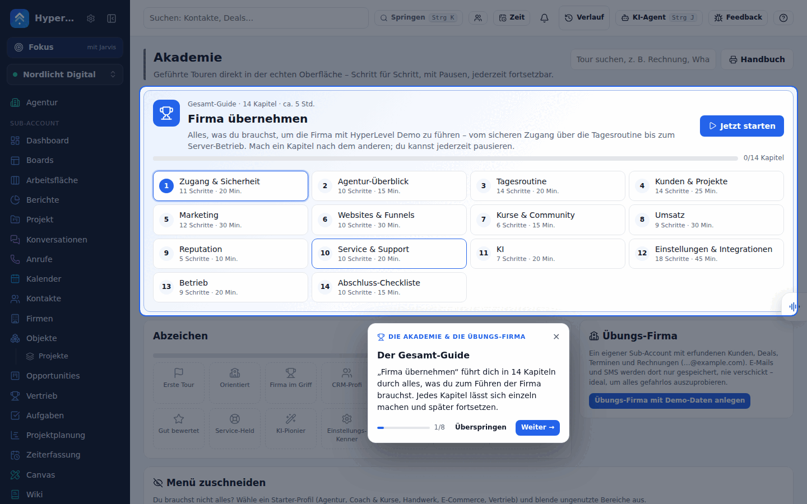

**English** · [Deutsch](academy.de.md)

# Academy – guided tours

The **Academy** (menu item *Academy*, at the very bottom above *Settings*) teaches everyone how to run the company with the app – right in the real interface: the tour highlights the field or button, explains it in a sentence or two, tells you what to click or type, waits until you have done it (or you click “Next”), and moves on – across several pages if needed.



## What is included

- **Complete guide “Take over the company”** – 14 chapters for a successor, about five hours in total, each chapter on its own and resumable at any time: Access & security → Agency overview → Daily routine (with tickets and your own dashboard) → Customers & projects (with companies, custom objects and properties) → Marketing (with lead scoring and the marketing dashboard) → Websites & funnels → Courses & community → Revenue → Reputation → Service & support → AI → Settings & integrations (with the integrations catalog, Zapier/Make/n8n, HubSpot import and the Android app) → Operations → Final checklist.
- **Course “Run your company with HyperLevel”** – ten lessons for founders who run their own company with the app (company setup, sales, marketing, customer service, finance, projects & time, AI & automation, metrics & weekly routine, privacy & compliance, scaling), each with a 10-minute task in the real interface; its own group and badges in the Academy. Printed version: [kurs-firma-fuehren.md](kurs-firma-fuehren.md) (generated from `web/src/tour/content/company.ts` via `web/src/tour/company-course.ts`), and the operating handbook that goes with it: [company-playbook.md](company-playbook.md).
- **Module tours** – more than 110 tours, one for every area with 5–15 steps, in ten groups: Getting started, Customers & daily business, Marketing, Websites & courses & community, Revenue, Reputation, Service & support, AI, Settings & channels, and Agency & operations. The full list with step count and duration is in the [appendix of the handbook](handbuch.md#anhang-alle-modul-touren) and in the Academy itself.
- **“?” at the top right** – on every page: the tours that fit exactly this page, “Continue” and the complete guide.
- **Progress & badges** – saved per person on the server: tours started, tours finished (✓), last step. If you reload the page, you are straight back in the running tour.
- **Practice company** (agency only) – a separate sub-account “Practice company (Academy)” with made-up contacts (and their companies), deals, tasks, an appointment, a form, a website, products, an invoice, a campaign, a workflow, two tickets, a help article, the custom object “Projects” with two records, association labels and a lead-scoring model (all e-mails `…@example.com`). E-mail and SMS are set to “Save only” there – nothing is sent. Tours with exercises offer to switch there at the start. Create and delete it in the Academy; as long as you are inside, a yellow notice at the top tells you that everything is just practice.
- **Handover status** (agency only) – what is set up and what is missing (e-mail/SMS sending, invoice details, channels, telephony, browser phone, AI assistant, AI phone agent, Stripe, Google, website chat, social planner, service – assignment, support mailbox, help center and open tickets without an assignee –, HubSpot move, white label, domains, OAuth, mailboxes, Supabase, Todoist, SaaS, backups, agency keys, Android app with paired phones), **who has access** (with 2FA status) and **open items** (admins without 2FA, missing required setup, websites that are down, overdue tasks). It reads from the existing status endpoints – passwords, tokens and keys are never shown.
- **Handbook** – the whole complete guide as a document (*Academy → Handbook*), for printing or “Save as PDF”. The same version is available as Markdown in [handbuch.md](handbuch.md).
- **Guides in the app** – at the end of every tour, “More on this” leads to the matching guide from `docs/`, right in the app (signed in only; customer logins only see the guides without server details).

## Getting started

The Academy is offered where you need it:

- **Welcome card “Ready in 10 minutes – start the Academy”** – on the home page (dashboard and agency overview) until the first tour (“Find your way around”) is done; in the demo always (all visitors share one login). ✕ hides it in this browser. New logins also see it at the top of the “What do you want to do?” dialog of simple mode – “Start the Academy” takes over the chosen goals and opens the tour.
- **“Learn” / “Start tour”** – in the empty views of the main areas (contacts, conversations, calendar, forms, websites & funnels, workflows, campaigns), in the page header of dashboard, agency and settings, and in the demo banner (“Start guided tour”). The link starts the tour that fits the page; if there is none, it opens the Academy.
- **Help menu “?”** – until the first tour is done, it shows “Learn: Ready in 10 minutes”.
- **Menu** – in simple mode, *Academy* is one of the fixed entries (next to dashboard, conversations, contacts, calendar, tasks).

Technically: `web/src/tour/learn.tsx` (small, loads the tour engine only on click; `Empty` has the prop `learn` for it) and `web/src/tour/welcome.tsx`.

## Using the Academy

- **Next / Back** page through the tour, **Skip** jumps to the next chapter in the complete guide (otherwise it ends the tour), **✕** or **Esc** pauses – your progress is kept. If a dialog is open, Esc closes the dialog first.
- Steps with 👉 wait for you: for a click, an input, a page change or a success message (“Saved”). “Next” always works.
- **Do it for me** fills in an example in some steps (e.g. a name) – only for harmless inputs, never when sending or deleting.
- On a phone, the explanation appears as a bar at the bottom; the menu opens itself for the tour when needed.
- Customer logins only see tours and steps for the areas they may use; agency tours and steps only admins.

## For developers

- Tours are plain data in `web/src/tour/content/*.ts` (types in `web/src/tour/types.ts`), the engine is in `web/src/tour/engine.tsx`, the page in `web/src/pages/Academy.tsx`, the server in `server/modules/academy.ts`.
- A step points at an element via `data-tour="key"` (on `Link`, `Field`, `Stat`, `Check` and `Empty` via the prop `tour`). Available automatically: `nav-<route>` (menu), `tab-<key>` (every tab), `page-head` / `page-title` / `page-actions` (page header), `modal` / `modal-foot`, `search`, `jump`, `help`, `project-switcher`, `account`. Only add attributes, never change the layout.
- Step kinds: `info`, `click` (continues after a click on the element), `navigate` (`to`: route; `to: 'forms/'` = any subpage), `fill` (waits for a value; for a select list, for the option from `demo.fill`), `wait` (`toast`, `appear` or `route`). `route` opens the page before the step, `optional` allows a missing element (then `missing` explains), `admin`/`perm` hide steps, `demo` is “Do it for me”.
- `tests/academy.test.ts` checks that every target exists as `data-tour` in the code, routes and tabs are real, guide links point to existing headings and `docs/handbuch.md` is up to date. Pages are all `case '…':` in `web/src/main.tsx` (also without a menu entry, e.g. `properties`). If chapters are renumbered, their IDs change – a migration in `server/modules/academy.ts` carries the saved progress along (see `002-journey-service-chapter`). After changes to the complete guide, regenerate the handbook:

  ```
  node --import tsx -e "import('./web/src/tour/handbook.ts').then((m) => require('node:fs').writeFileSync('docs/handbuch.md', m.handbookMarkdown('HyperLevel')))"
  ```

### API

| Method | Path | Purpose |
| --- | --- | --- |
| GET | `/api/academy` | Progress per tour, running tour, practice company |
| PUT | `/api/academy/tours/:id` | `{step, total, active?, done?}` – save the position; `active` = running (continues after a reload) |
| DELETE | `/api/academy/tours/:id` | Reset a tour |
| DELETE | `/api/academy/active` | No tour is running any more |
| POST / DELETE | `/api/academy/sandbox` | Create (with demo data) / delete the practice company – admins only |
| GET | `/api/academy/docs`, `/api/academy/docs/:name` | Guides from `docs/` (admins all, customer logins a selection) |
