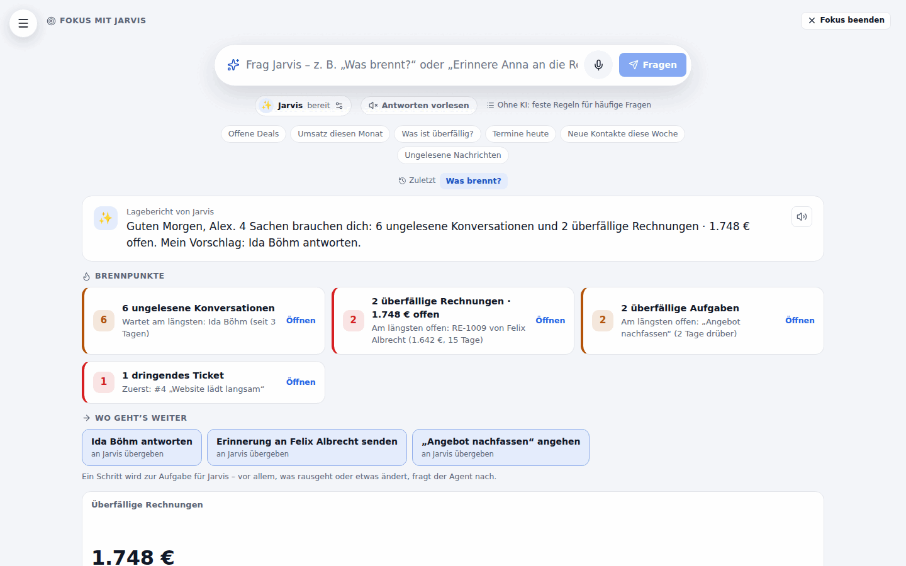

# Living Boards (Genius-Modulbaukasten)

> **Software, die sich an dich anpasst. Nicht andersrum.**

A **board** is a workspace you put together from widgets – key figures, charts, lists, the pipeline, appointments, tasks, the inbox, a wiki page, notes, an embedded page, quick-action buttons, a profit-calculator result or a widget from a Werkstatt plugin. You build it by **dragging**, or by **telling the board what you want** (typed or spoken) – it changes in real time, every change is a version, and every version can be undone.

Where: **Boards** in the menu (route `/app/boards`; `/app/boards/<id>` is one board, `/app/boards/vorlagen` the template gallery). Training for the team: **Akademie → Living Boards: dein Arbeitsplatz, wie du ihn willst**. The area *Dashboard* (member right) opens it; each widget additionally needs the right of the area it reads from.

## What a board is

- Per **sub-account**, **personal** (only the owner sees it) or **shared** (the team sees it; *ansehen* or *ansehen und ändern* – the owner decides). Agency admins can open every board by link and see all personal boards with *Als Admin auch die persönlichen Boards anderer zeigen*.
- A **name, a symbol and an accent colour** (the board colours its highlights).
- A **layout**: a 12-column grid (desktop), 6 columns (tablet, container width < 900 px) and one column (phone, < 560 px). Tablet and phone are derived from the desktop arrangement until somebody arranges them by hand ("Anpassen" on that screen size); *Tablet-/Handy-Anordnung zurücksetzen* derives them again.
- **Widgets**, each with a type, a title and its own settings.
- A **version history** with undo, redo and restore (the last 300 versions are kept).

## Editing

Press **Anpassen**. Every card gets a handle, a corner to resize by and its settings.

| Do | How |
| --- | --- |
| Move | Drag the handle. The card follows the pointer, a dashed ghost shows where it will rest, the others glide out of the way. Near the top or bottom edge the page scrolls by itself. Cards always rise as far as they can, so the ghost shows the real resting place; to put a card below a neighbour drag it past the neighbour. |
| Resize | Drag the corner at the bottom right (every widget type has a minimum and maximum size). |
| Keyboard | Focus the handle → **Leertaste** picks the card up → **Pfeiltasten** move it (up/down jump to the next place where it really lands differently), **Umschalt + Pfeiltasten** change its size → **Leertaste** drops, **Esc** cancels. A live region announces column, row and size. |
| Phone | One column. The handle is replaced by **▲ ▼** buttons that reorder the stack. |
| Add | **Widget hinzufügen**: searchable, grouped by purpose. Widgets that need a choice (a page, an address, buttons) open their settings at once. |
| Settings | The slider icon opens the panel at the side: title and the widget's fields (drawn from the widget's declaration, ids like pipelines or reports are chosen from the person's own data). **Speichern** makes one version. ✕ or Esc closes. |
| Undo / redo | The arrows in the header, or **Strg+Z** / **Strg+Umschalt+Z**. |
| History | **Verlauf**: who changed what and when (editor, HyperLevel Agent, MCP, API key), look at any version, **Zurückholen** (restoring is a new version, nothing is lost). |
| Start page | *Board-Einstellungen → Als meine Startseite verwenden*: after signing in, the bare landing page opens this board (per person; a board you may no longer see is skipped). |

Changes by other people – or the agent – appear at once with a one-line note who did what (server-sent events, like the Team-Chat). Your own change is never overwritten by the echo of itself; after a dropped connection the board reloads. The cursors of the others on the same board show with their names, placed relative to the board's grid (on by default; *Team ist hier → Mauszeiger anderer zeigen*) – see [Live-Zusammenarbeit](collaboration.md).

## Telling the board what you want (the prompt bar)

The bar at the bottom of a board takes a wish – *"Zeig die offenen Angebote neben dem Kalender"*, *"Mach das Umsatz-Diagramm größer und setz es nach oben"*, *"Färbe das Board violett"*. With a configured speech recognition there is a **microphone button** (push-to-talk, tap or hold – the same recording and transcription as the HyperLevel Agent; the text lands in the box unless *sofort senden* is on in the Agent panel).

What happens:

1. The model gets the board (widgets, settings, layout), the widget catalogue and the ids of the *person's own* pipelines, reports, workflows … – only those they may see – and answers with a **patch** in a fixed schema (strict structured output). Invalid answers get one repair round.
2. The patch is checked by the same engine as every other change (unknown fields, types, values and widgets are errors; at most 25 steps and 40 widgets).
3. The person sees a **card**: the message, the list of changes, a before/after thumbnail, a note on the risk and **Übernehmen / Verwerfen**. Nothing is saved before. The proposal belongs to the person who asked and expires after 30 minutes; only that person confirms it – never a key, never somebody else, never a spoken sentence.
4. **Auto-apply** (*Board-Einstellungen → Kleine Layout-Änderungen per Wunsch sofort übernehmen*, on by default, per person) lets **low-risk layout changes** (move, resize, rename, colour, title) go straight through with an *Rückgängig* button. Anything that changes what is shown – and always anything with an address or buttons – waits for the card.
5. Whatever is applied is a version (kind *Per Wunsch*, with the wish as text) and is audit-logged.
6. If no widget can do what was asked, the card says so (*"Dafür gibt es noch kein Widget: …"*) and offers **In der Werkstatt bauen lassen** – a Werkstatt plugin can provide a widget.

Limits: 40 wishes per person and hour, 1,000 characters per wish.

**Risk:** *low* = layout only, *normal* = changes content, *high* = adds an embedded address (**Einbettung**) or quick-action buttons (**Schnellaktionen**). High-risk steps need a confirmation in three places: the card (never auto-applied), the agent (the tool is classed *sensitive* and the agent must ask), and the server (a patch from an agent, MCP or key without `confirm_external: true` gets `409`).

## Widgets

| Type | Name | Shows | Needs the right |
| --- | --- | --- | --- |
| `kpi` | Kennzahl | One big number with comparison to the previous period; 22 presets (open pipeline value, forecast, win rate, new contacts, paid revenue, open invoices, MRR, unread conversations, tickets …) or a saved report | Dashboard |
| `chart` | Diagramm | Line, bar, funnel, donut … over report data; 14 presets (revenue per month, contacts per source, pipeline per stage …) or a saved report | Dashboard |
| `list` | Liste | Contacts, deals, tasks or tickets as list, with a saved filter (status, pipeline, min/max value, stale days, tag, search, smart list, due, project, mine …) | of the chosen entity |
| `pipeline` | Pipeline | Mini kanban: stages with count, value and the biggest deals | Opportunities |
| `agenda` | Termine | The next appointments by day (all or one calendar) | Kalender |
| `inbox` | Posteingang | The newest conversations with preview | Konversationen |
| `tasks` | Aufgaben | Tasks of the project planner (today/overdue/this week), tick them off right in the list | Kontakte & Aufgaben |
| `wiki` | Wiki-Seite | A page of a wiki space the viewer may open | Wiki & Dokumente |
| `notes` | Notiz | Free text with Markdown | – |
| `embed` | Einbettung | A page from an **allowed address** (see below) in a sandboxed frame | – |
| `actions` | Schnellaktionen | Buttons: start a workflow for chosen contacts, open a form, open a page, create a task or a contact – each through the regular route with the clicking person's rights | – (each button checks its own area) |
| `calc` | Gewinnrechner | Net profit, revenue, margin and break-even of a saved scenario | Rechnungen & Produkte |
| `plugin` | Plugin-Widget | A dashboard widget of an installed Werkstatt plugin (own sandbox, scopes as usual) | – |

Modules can add more (see *Widgets for module authors*).

## Permissions and isolation

- **Widgets read the data with the viewer's rights, not the author's.** A widget's data is fetched by calling the regular API route *as the person who looks at the board* – so member rights, SaaS plan limits, sub-account isolation and per-record rules (e.g. "mine") apply exactly as on the widget's own page. Somebody without the right sees a locked card that names the missing right and **no value** – also not in the page source.
- A board's JSON holds only configuration: types, settings, layout. Ids of other sub-accounts cannot be used: every id is resolved inside the viewer's sub-account.
- **Sub-account keys** act like a team member: they see shared boards only and may change them only if the team may. The agency key acts like an admin. Native app tokens read via `/api/mobile/boards*` (read only).
- Every write is **audit-logged** (create, patch, undo, redo, restore, compose, template publish/install): who, via which way (editor, agent, MCP, API), what.
- **Embeds**: https only, no credentials, no port, no IP address, and the host must be on the allow-list – checked when the setting is saved *and* every time the widget's data is read, so removing a host switches it off at once. YouTube, Vimeo and Loom share links are rewritten to their embed addresses. The frame is sandboxed (`allow-scripts allow-forms allow-popups allow-presentation`, `allow-same-origin` only for another origin).

## Templates and the Marktplatz

- **Starters** ship with the app: *Solo-Cockpit*, *Vertrieb*, *Agentur-Übersicht*, *Service*, *Projekte*. Create a board from one in **Neues Board** or **Vorlagen**.
- **Als Vorlage speichern** (board settings): a template holds the arrangement and the settings of the widgets – **config only, never data**. Settings that name things of this sub-account (a pipeline, a report, a workflow, a wiki page …) are dropped and chosen again by whoever uses the template. A review lists what the template reads and shows and warns about notes with text (they travel along), embedded hosts and quick-action buttons.
- **Im Marktplatz veröffentlichen** (admins, needs the Marktplatz licence): same review, plus an explicit approval and – if there are warnings – a confirmation that they were read. Publishing the same board again makes a new version of its template. *Aus dem Marktplatz nehmen* withdraws it.
- **Installing a template from another sub-account** shows exactly what it reads and shows (*"Liest Daten aus …"*, *"Zeigt Seiten von …"*, *"Hat Schnellaktions-Knöpfe"*) and needs a tick; the server checks the tick against the review. A checksum guards against tampering with a stored template.
- **Export/import** as JSON (`format: "gohigh-board-template"`) for moving templates between installations; the checksum is verified on import. The Marktplatz page shows a shelf with the published board templates.

## The patch format

One format for the editor, the prompt bar, the HyperLevel Agent, MCP and the API. `POST /api/boards/:id/patch` `{ops: [...], dry_run?, expected_version?, summary?, confirm_external?}`:

| `op` | Fields |
| --- | --- |
| `add` | `type`, optional `title`, `config {field: value}`, `ref` (own name for later steps), `w`/`h`, `placement` (`top`, `bottom`, `beside:<id|ref>`, `below:<id|ref>`, `above:<id|ref>`) or `x`/`y` |
| `remove` | `id` |
| `move` | `id`, `placement` or `x`/`y`, `bp` (`lg`, `md`, `sm` – on `sm` only the order counts) |
| `resize` | `id`, `w`/`h` or `dw`/`dh`, `bp` |
| `configure` | `id`, `config` (only the fields to change; `null` resets one) and/or `title` |
| `rename` | `name` and/or `icon` |
| `theme` | `accent` (`blau`, `grün`, `violett`, `orange`, `rot`, `türkis`, `rosa`, `grau`, `#rrggbb`, `""` = reset) |

The answer has `changes` (readable lines), `risk` (`low|normal|high`), `summary`, `version` and `created: [{ref, id}]`. Steps run in order; one error stops everything and nothing is saved (`400` with the reasons). Unknown keys, types and values are errors. Cells are clamped to the widget's limits and the grid, overlaps are resolved by moving the others down, and every card then rises as far as it can – the same maths runs in the browser, so the picture while dragging is the picture that is saved.

## API, MCP tools, mobile

REST routes, request/response shapes and the mobile endpoints are in [docs/api.md](api.md#living-boards). MCP tools (and thereby the HyperLevel Agent): `ghl_board_list`, `ghl_board_get` (optionally with the widgets' current data), `ghl_board_apply_patch` (with `dry_run`, `expected_version`, `confirm_external`), `ghl_board_widgets` (the catalogue including modules' widgets) and `ghl_board_create`. A key's patch counts as *write*, adding an embed or buttons as *sensitive*; `dry_run` is a read.

## Fokus-Modus mit Companion

<a id="fokus-modus"></a>

> **Nicht klicken – fragen. Und erledigen lassen.** HyperLevel as the source of truth you simply ask – and a companion ("Jarvis", or another agent you pick) that does things for you on the spot, and comes to you by itself when something burns.

Focus mode and the voice companion are **one mode**: one entry, one prompt, one voice. Questions about your data become a view made of board widgets; requests to *do* something go to the HyperLevel Agent right there; "Was brennt?" and the proactive check-ins show what needs you now and where the business should move next.



**Where:** the **Fokus** button at the top left – under the logo in the sidebar (a square button in the narrow rail), with the companion's name beneath it (*mit Jarvis*), next to the menu button on a phone. The route is `/app/focus`, so a bookmark or a link opens it directly. Three more ways in, on every page: the **edge button** on the right edge of the screen, the shortcut **Alt+J**, and – if you switch it on – the **wake word** (*"Hey Jarvis"*). All three open focus mode with the companion already listening (in focus mode they just start listening).

**The layout:** sidebar, top bar, quick menu and the phone's bottom bar step aside. A **round button** at the top left opens the normal menu as a drawer – choosing an entry there leaves focus mode and goes to that page; Esc or a click beside it closes the drawer. **Fokus beenden** (top right, or Esc when nothing is open – Esc first clears what was typed and stops listening or speaking) returns to the page you came from. The browser remembers the choice (`localStorage`, nothing on the server): opening the app on its bare address – a reload, the next morning – comes back to focus mode; going to any other page forgets it. Without storage (private mode) it is simply not remembered.

### Asking: a view in that moment

A large prompt bar, suggestion chips (*🔥 Was brennt?*, *Offene Deals*, *Umsatz diesen Monat*, *Was ist überfällig?*, *Termine heute*, *Neue Kontakte diese Woche*, *Ungelesene Nachrichten*) and the last eight questions of the sub-account (kept in this browser; a question still on screen shows its answer at once, older ones are asked again). The answer is a short sentence – its numbers are the ones the tiles read, never the model's – and a grid of tiles: key figures in a strip at the top, then full rows (12 columns on a desktop, two on a tablet, one on a phone, no horizontal scrolling), light and dark theme from the theme tokens. **Every tile says where its numbers come from** (*Quelle: Rechnungen · diesen Monat*, with what exactly is counted as a tooltip) and links into the page they are read from.

**Als Board speichern** turns the view into a personal Living Board (through the normal boards API: `POST /api/boards`, then one patch with the tiles) – from then on it is an ordinary board with versions, undo and sharing. Needs the area *Dashboard*.

### Doing: the agent right here

A request to *do* something (*"Schick Anna eine Erinnerung zur Rechnung"*, *"Lege eine Aufgabe für morgen an"*) is recognised by the same step that answers questions (the KI-Assistent's plan, or the keyword rules) and handed to the **companion's agent** – the built-in HyperLevel Agent or the custom agent you picked – **inside focus mode**: its streamed words, every tool step (expandable, with links and *Rückgängig*) and the **confirmation card** render in the result area. It is the same agent as the side panel (`POST /api/agent/chat` with `source: "focus"`): the same tools, rights, safety mode, confirmation rules, audit log ("KI-Agent (im Auftrag von …)") and undo; the conversation appears in the agent's history marked *Fokus* and **Im Agent-Panel weiterführen** opens it in the side panel. When the agent asked something back, the next thing you say answers it.

**"Das hier" means the page you came from.** Opened from a record page (a contact, a workflow, an invoice, a ticket …), the companion sends that page along: *"Erledige das hier"* or *"Fasse das hier zusammen"* acts on that record ([agent.md](agent.md#open-the-agent)).

**Voice never confirms.** A confirmation card waits for a click on **Ausführen**. A bare *"ja"*, *"ok"* or *"bestätigen"* – spoken or typed – is not sent; the companion says that it only confirms by click. A bare *"nein"* or *"abbrechen"* declines like the card's button. Anything else is a new message, and (the agent's own rule) a new message rejects the waiting action, it never runs it. In focus mode the agent is told it speaks as the companion: one to three spoken sentences, never claiming something is done before the tool reported it.

**Without AI** – no model for the agent (*Einstellungen → KI-Anbieter*) – questions keep working through the rules, and an action shows the offer to continue in the HyperLevel Agent with the note that it needs a model. In demo mode (where AI providers are blocked) it behaves the same.

### The companion: who answers, voice and wake word

The **chip** under the prompt (*✨ Jarvis · bereit*) opens the companion's settings (✕, Esc or a click outside closes them):

| | |
| --- | --- |
| **Wer antwortet** | *Jarvis – HyperLevel Agent* (default persona) or any of your KI-Agenten you may use (your own or shared ones). The choice decides which agent executes actions from focus mode, its name and its wake word. A custom agent that is deleted or no longer shared falls back to the built-in one. |
| **Name** | Empty = "Jarvis", or the custom agent's own name. |
| **Weckwort** | Per **device** (microphone permission is per device): *Auf „Hey Jarvis" hören*, phrase editable (empty = "Hey" + name). Shown only where the browser has its own continuous speech recognition – Chrome, Edge, Safari (desktop, iPhone and iPad); **not in Firefox and most Android WebViews** (the Android app), where the edge button and the shortcut remain. It only listens while it is switched on **and the tab is visible** (it pauses when hidden, and while the prompt's own microphone records). **In Chrome and Edge the browser's speech recognition sends the audio to the browser's maker (Google, Microsoft) to recognise it, in Safari to Apple** – the settings say so. HyperLevel receives only text, and only what follows the wake phrase becomes a question; nothing is recorded or stored. While it listens the edge button (and the chip in focus mode) shows a **green ear**, with a one-click **off** right next to it. A refused microphone switches it off and says why. A short two-tone sound confirms "I'm listening". |
| **Tastenkürzel** | **Alt+J** (on a Mac ⌥J) on every page, also in text fields: **hold** to talk – it ends when you let go; **press briefly** for hands-free – it ends when you pause. It does not clash with Strg/⌘+K (Springen), Strg/⌘+J (KI-Agent), Strg/⌘+B (sidebar) or Strg/⌘+Z (undo). Can be switched off. |
| **Antworten** | *Gesprochene Fragen laut beantworten* (default on) and *Auch getippte Fragen vorlesen* (the old *Antworten vorlesen* switch, still next to the prompt). **One voice** for everything: the sentence of a view, a briefing, the agent's final words (or, while a confirmation waits, the question whether to run it). **Barge-in:** the microphone, the edge button, Alt+J or the wake word stop it speaking at once; Esc too. |
| **Stimme von Jarvis** | See [The companion's voice](#the-companions-voice) below: by default a native Google Cloud Text-to-Speech voice in the app's language (**de-DE-Chirp3-HD-Iapetus**), else the browser's voice. |
| **Browserstimme** | Speaks whenever no server voice is available. *Automatisch* = for the default Jarvis voice a British male browser voice (*Google UK English Male*, Daniel, Arthur … – else any en-GB voice), otherwise one in the UI language – or a browser voice by name. |

#### The companion's voice

Jarvis's default voice is a **native Google Cloud Text-to-Speech Chirp 3 HD voice in the app's language** – `de-DE-Chirp3-HD-Iapetus` in German, `en-US-Chirp3-HD-Iapetus` in English (male, characterised as *clear*; no accent, since each language has its own voice) – spoken through the sub-account's own key – nothing is shared between sub-accounts. Setup: *Einstellungen → KI-Anbieter* → add a **Google Cloud Speech** connection with an API key and **enable the Text-to-Speech API** in that Google Cloud project ([voice.md](voice.md)). Until there is one, the companion settings say so (*Sprechen*, with a link to the KI-Anbieter page) and the **browser's voice** speaks – a natural male voice of the language if the browser has one (e.g. *Conrad*/*Killian* in Edge, *Markus* on Apple).

**kie.ai instead of Google (1.0.58):** add a **kie.ai** connection under *Einstellungen → KI-Anbieter* (it now offers *Sprachausgabe*, model *ElevenLabs Turbo 2.5*) and pick it under *Stimme von Jarvis → Wer spricht*. `auto` is then the ElevenLabs voice **Brian** (calm, deep, male); Turbo 2.5 is told the app's language (`language_code` de/en), so German answers are spoken without an English accent. Any voice of kie's list can be picked instead (field *Stimme des Anbieters*). kie works asynchronously – each answer is a task that is polled every 0.8 s, so it starts a little later than Google.

In the settings (*Sprechen → Stimme von Jarvis*): **Wer spricht** lists the sub-account's connections that can speak (Google, OpenAI, ElevenLabs, Azure, a local speech server …), plus *Stimme des Sub-Accounts* (the voice of *Einstellungen → Stimme*, as before 1.0.53) and *Browserstimme* (always the browser). **Stimme des Anbieters** is the provider's voice id – the provider's voice list is offered where the person has the settings right, free text otherwise (empty = the provider's default); *Probehören* plays a sample. Stored per person and sub-account (`tts_provider`, `tts_connection_id`, `tts_voice` of `GET/PUT /api/companion/prefs`); the browser asks once per sub-account which connections can speak (`GET /api/voice/prefs`) and calls `POST /api/voice/speak` with that connection and voice. If the server cannot speak at that moment (limit, provider down, connection removed) the browser's voice takes over; barge-in stops either at once, also while the audio is still on its way.

The voice field left empty means *automatic* (follows the app language). Whoever prefers another voice enters it there (e.g. Google `de-DE-Chirp3-HD-Charon` or `de-DE-Neural2-B`) or picks another provider. The 1.0.53 default `en-GB-Neural2-B` (British – it read German with an accent) is switched to automatic.

**Listening:** with a speech recognition set up (see *Setting it up*) the microphone records (MediaRecorder) and the sub-account's speech to text writes it down – tap (it ends when you pause: a small voice-activity check on the microphone level in the page, nothing leaves it before you stop) or hold; without one the browser's own recognition is used where there is one, else there is no microphone button and the edge button just opens focus mode. After the wake word the browser's recognizer is already listening: what you say after the phrase shows in the prompt as it comes and is asked once you pause. **The edge button** (outside focus mode) shows the companion's state – idle, waiting for the wake word (green ear), listening (red), thinking, speaking – and a badge for unseen check-ins. Inside focus mode it steps aside (the prompt's microphone is the companion there), so there are never two microphones on screen.

### Was brennt? – and proactive check-ins

**Was brennt?** (the chip, or saying *"Hey Jarvis, was brennt?"* / *"Lagebericht"*) shows the companion's briefing as the current view:

- **Brennpunkte** – the up to five most urgent things, computed on the server **from your own data with your rights** (each read through your own API routes – a route you may not open simply adds nothing; no new queries where an endpoint exists): overdue tasks of yours, overdue invoices (the longest open with number, customer, amount, days), dunning (failed payments, notices waiting for approval), unread conversations (who waits longest and how long), deals untouched for 14 days or past their close date (the biggest first), today's next appointments (urgent within the hour), tickets at or past the SLA (or urgent), failed automation runs of the last 24 hours, the project website not answering (uptime check), stock below minimum and approvals waiting for you. Ranked by urgency × impact, rules only – it works without AI.
- **Wo geht's weiter** – one to three concrete next steps from the top hotspots: *Anna Müller antworten*, *Erinnerung an … senden*, *„Website-Relaunch" nachfassen*, *Termin um 14:00 vorbereiten* … One click (or saying it) hands the step to the agent as a task – which still shows its confirmation card before anything goes out or changes; steps without a task open the page. **Proactive never acts on its own.**
- The **mentor sentence**: by the rules (greeting, how many things need you, the first step), or – with the KI-Assistent – phrased by the model in two short spoken sentences plus one strategic tip from the project profile's tagline and goals (purpose *Companion-Check-in*, at most 24 per person, sub-account and day; a sentence with a number that is not in the data is not used – the same guard as focus mode).
- Below: the tiles of the hotspots with live numbers.

**Proaktive Check-ins** (settings → *Check-ins*, per person and sub-account): *Aus* (default), **im Abstand** – every 5, 10, 15, 20, 30, 45, 60, 120, 180 or 240 minutes or a custom number (5–1440) – or **zu festen Uhrzeiten** (up to six times a day, HH:MM, in your time zone – the browser's is taken when you first set it, the sub-account's otherwise). **Ruhezeit** (default 20:00–08:00) holds interval check-ins back; fixed times are deliberate and always fire (a fixed time missed by more than two hours, e.g. while the server was down, is skipped). **Nur werktags** skips Saturday and Sunday. **Nur wenn sich etwas geändert hat** (default on) compares the hotspots with the last check-in and stays silent when they are the same – it never repeats the same nudge. A scheduler on the server looks once a minute (at most ten check-ins per run, the slot is claimed first so nothing is sent twice), computes the briefing as you, stores the check-in (kept 30 days) and tells you: a **web push** of the kind *Check-ins des Companions* (switch it per device under *Einstellungen → Mein Konto*), the Android app's feed, and – if the app is open – a card next to the edge button with a badge (polled once a minute while the tab is visible). *Check-ins vorlesen* reads the greeting and the top item aloud when it arrives. Clicking the card or the push opens focus mode with the check-in as the view (`/app/focus?checkin=<id>`, its tiles read again with your current rights). The settings list the last check-ins and offer **Check-in jetzt ausprobieren**.

### Jarvis live

> Since 1.0.54: a fluid conversation instead of turns, a companion that speaks up when something happens and brings ideas of its own – prepared, never on its own authority.

#### Gesprächsmodus and barge-in

After a **spoken** question the microphone stays open for a **follow-up window** (settings → *Sprechen → Gesprächsmodus*: *Aus*, 5, **8** (default) or 15 seconds): once the companion has spoken you simply keep talking – no wake word, no shortcut. A small voice-activity check on the microphone level in the page (`web/src/companion/vad.ts`: energy with an adaptive noise floor, ~150 ms of speech starts a turn, ~800 ms of silence ends it; nothing leaves the page for it) ends your turn; the recording then goes to the sub-account's speech to text (or the browser's own recognition listens). The window closes silently when nothing is said; *"danke Jarvis"*, *"stopp"*, *"das war's"* (and *"thanks, that's all"*) end the conversation, as do **Esc**, the **✕** on the pill, leaving focus mode or hiding the tab.

**Barge-in** (*Unterbrechen erlaubt*, default on): while the companion speaks, the open microphone watches for your voice with a higher threshold and about 250 ms of speech (`echoCancellation` is on, so its own voice mostly does not reach the microphone) – it stops at once (the server's audio and the browser's voice, also audio still on its way) and listens. A click on the edge button or **Space** interrupts too.

A pill under the prompt shows the state – **hört zu / denkt nach / spricht** – with a red microphone mark (*Mikro an*) and ✕; outside focus mode the edge button carries the red mark. **Privacy:** the microphone is open only while a conversation runs; the wake word stays opt-in per device and pauses meanwhile; `prefers-reduced-motion` turns the animations off.

**Speaking while the agent writes:** the agent's answer is spoken **sentence by sentence** as it streams – the first sentence plays while the rest is still being written (abbreviations like *z. B.* do not split). A longer task first gets a short, varied filler (*"Moment, ich schau nach …"*).

#### Hintergrundaufgaben

A run of the agent belongs to the tab, not to the page: you can ask the next thing, open a data view or leave focus mode while it works. Asking the agent something new while it still runs moves the running request to the background (its own conversation). The companion panel lists the tasks (*läuft / erledigt / wartet auf dich / fehlgeschlagen* – a click shows one again); the edge button shows a spinner while one runs. When a task ends while you look elsewhere, the companion says so and shows a toast – *"Erledigt: …"*, *"Das hat nicht geklappt: …"*, or *"… braucht deine Bestätigung"* (the confirmation card still needs your click).

#### Ereignis-Auslöser

Besides the check-ins the companion reacts to business events (settings → **Proaktiv → Ereignis-Auslöser**, each trigger on/off and **Sofort** or **Gesammelt**):

| Trigger | Source | Default |
| --- | --- | --- |
| New lead or contact | event `contact.created` (not from a workflow) | Sofort |
| Message unanswered | scan: the last message of a conversation is inbound and older than *X* minutes (default 30, per person) | Sofort |
| Invoice became overdue | scan: sent, still open, due date passed in the last three days | Gesammelt |
| Appointment starts in 10 minutes | scan: confirmed appointments | Sofort |
| Negative review (≤ 2 stars) | event `review.received` | Sofort |
| Deal won / lost | event `opportunity.status_changed` | Sofort / Gesammelt |
| Payment failed | event `payment.failed` (Stripe) | Sofort |
| Automation failed | scan: failed workflow runs | Gesammelt |

Who hears it: the people of the sub-account who use the companion, with the trigger on and the **right to open that area** (the same guard as the page); a record assigned to one of them (contact owner, conversation assignee, deal owner) goes only to that person. **Sofort** is spoken when the app is open (the open tab polls `GET /api/companion/live` every ~15 s – that is how the server knows), at most **one spoken interrupt per three minutes** (more become a silent card), and becomes a **web push** (kind *Sofort-Meldungen des Companions*) when the app is closed; in the **quiet hours** everything is collected. **Gesammelt** waits for the next check-in, which starts with *"Seit dem letzten Check-in: …"* (it then also comes when the Brennpunkte did not change). The same record never fires the same trigger twice (dedupe per record and trigger, e.g. a week for a lead). Each message offers a concrete next step (*"Soll ich antworten?"*): **Ja, bitte** – or a spoken *"ja"* within two minutes – hands it to the agent; anything that writes still shows the confirmation card. Implementation: `server/modules/companion-live.ts` (listeners through `app.events`, the scan in its own `onTick`, nothing added to other features) and the pure registry `server/services/companion-triggers.ts`.

#### Eigeninitiative

On check-ins (and on *Was schlägst du jetzt vor?* in the settings) the companion decides **itself** what is worth raising: with an AI provider the model (`app.services.aiRun`, purpose **Companion-Eigeninitiative**, schema-constrained, logged in the AI calls) looks at the briefing, open deals, new contacts without an answer (warm leads), customers with paid invoices who went quiet, today's appointments, the project's tagline and goals and up to five **gemerkte Hinweise** (Gedächtnis, `GET /api/cognee/memories` where enabled) – all read with your rights – and suggests opportunities, risks, growth steps and work it can take off your plate. Where it can it **prepares the work** – a reply, an e-mail, a task list or a social post as a draft – so the offer is *"Ich habe X vorbereitet – soll ich es schicken?"*; the draft is only text stored with the suggestion, and accepting hands it to the agent as quoted data with a fixed instruction, which still asks before anything goes out. For a new lead, a waiting message or a negative review the event itself can come with a prepared draft (level *ausgewogen* or higher).

A suggestion may only point at a record from the facts (no invented ids), and spoken numbers must come from the data. Suggestions are tracked (*offered / accepted / declined / ignored* – unanswered for 24 hours counts as ignored): the same suggestion comes again at the earliest after 72 hours (a declined one after 14 days), any record at most once a day, and kinds you keep declining are dropped. **Wie proaktiv:** *Zurückhaltend* (one operational suggestion per check-in, three a day), *Ausgewogen* (default: two, eight a day, one strategic idea a day), *Sehr proaktiv* (three, twenty a day, strategic ideas about the business's direction any time). **Without an AI provider** the rules suggest from *Was brennt?* and the warm leads (phrased differently per record and day, not one stock sentence), and the settings say so. At most 30 initiative calls per person and day.

#### Business Developer

> Since this version Jarvis is the **holistic Business Developer** of the business by default – not only an assistant that waits for questions.

**Rolle** (settings → *Companion*): *Business Developer* (default) or *Assistent*. As Business Developer the agent in focus mode thinks about the whole business on every question – revenue and pipeline (idle and at-risk deals, win rate, average deal size, open quotes), lead flow and conversion per source, retention, upsell and cross-sell (customers without a purchase for long, high lifetime value), marketing (campaigns, funnels, reviews), operational bottlenecks (overdue tasks, response times, unpaid invoices) and the goals and offers of the project profile (*Steckbrief*). It answers with **numbers from its tools** (first `ghl_growth_review`, then deals, invoices, contacts …), **ranks by business impact in euros** and ends every answer with **1–3 next steps it can prepare itself** (drafts, tasks, follow-ups, campaign drafts) – sending, publishing, changing and deleting still only through the confirmation card. It is told what it said in the last five days and does not repeat it unless the numbers changed. The initiative's model gets the same role (one line). *Assistent* behaves as before.

**Wachstums-Briefing** (settings → *Proaktiv*, per person and sub-account; **opt-in – off until the person switches it on** with *Wachstums-Briefing einschalten*, then at **08:00** in the person's time zone or the time chosen): once a day the companion computes a review **from the real numbers** – with the person's rights, nothing is written – and delivers it like a check-in (push of the kind *Check-ins des Companions*, the Android feed, the card in the open app; `/app/focus?checkin=<id>` opens it):

- **the top 3 opportunities** with their € impact – deals idle for 14+ days (value × win rate), quotes waiting for an answer for 5+ days, new leads without a first answer, upsell for the customers with the highest revenue in 12 months;
- **the top 3 risks** with € – overdue invoices, deals past their close date, a lead flow or revenue drop of 30 % or more against the week before, weak reviews (≤ 3 stars in 30 days), the operations bottleneck (3+ overdue tasks, messages waiting over 24 hours);
- **one growth idea from the data** – a reactivation campaign for *X* customers without a purchase for 90+ days (estimate: 15 % come back × the average purchase), review requests to *Y* happy customers (a purchase in the last 60 days, never asked), more leads from the best-converting source, and – when no new contact came in for 28 days – building a lead flow (lead magnet, form, landing page section and welcome mail, drafts only) – rotating, not the same idea within a week;
- each with a **prepared draft** (e-mail, campaign draft, social post) or a **one-click step** for the agent (*Wo geht's weiter*); the drafts appear as suggestions (*"Ja, bitte"* hands them to the agent, which still asks before anything goes out; a declined one does not come back for 14 days).

It comes **only when there is something new**: an item said in the last three days with the same numbers is left out (changed numbers come back as *Update*), and when nothing is left there is no briefing that day. The **quiet hours** of the check-ins hold it back (it comes at the first minute after them, the same day). Estimated amounts say *ca.*. The words are picked per day from several phrasings and never open like the last briefing; with the KI-Assistent the model phrases them (purpose *Companion-Wachstums-Briefing*, at most four answers a day – failed calls do not count; a number that is not in the data drops the sentence) – the Wochenbilanz and *Wachstums-Briefing jetzt ansehen* always, even when nothing is new (then an honest assessment from the numbers and the profile's goals with one lever for more revenue). **Without any AI** the review is just as complete – it is computed from the numbers, not written by a model. Counts over contacts (new leads per source, leads without a first answer) follow the **record-access rules** like the contact list: someone who sees only their own (or their team's) contacts only gets counts over those.

**Wochenbilanz** (Mondays instead of the daily briefing, switch *Montags die Wochenbilanz* – it follows the briefing switch: with the briefing off nothing comes): revenue (paid invoices), new leads, won deals and their value, win rate and open pipeline of the last seven days **against the week before** (with the change in %), then the same opportunities, risks and idea. *Wachstums-Briefing jetzt ansehen* creates one at once.

**When no model answers.** The agent no longer gives up when a model fails: it retries, then tries the **Ersatzmodelle** ([agent.md](agent.md#ersatzmodelle)). When really none answers, Jarvis in focus mode answers **by rules from the growth review** – the items that fit the question first (*"Was ist mit meinen Rechnungen?"* → the overdue invoices), each with its € amount, and the next steps – instead of an error; the side panel, the Team-Chat and automatic runs still show the error. With the role *Business Developer* and nothing burning, a check-in names a growth idea instead of a stock sentence.

Implementation: `server/modules/companion-growth.ts` (its own module: routes, scheduler, prompt extra, rules fallback, MCP tool; tables `companion_growth_memory` and `companion_growth_runs`, pruned after 60 days) and the pure `server/services/growth-review.ts`.

#### Echtzeit-Stimme (optional)

*Sprechen → Sprach-Engine*: **Klassisch** (default – speech to text → agent → text to speech, sentence by sentence) or **Echtzeit – Gemini Live**: Google's bidirectional streaming audio (Gemini Live API) speaks and listens at the same time, with its own turn-taking and barge-in. The browser streams 16 kHz PCM to **our server** (`POST /api/companion/live/session` gives a one-time ticket valid 30 seconds → WebSocket `/ws/companion-live`), which relays to Google with the sub-account's **Google Gemini** connection (*Einstellungen → KI-Anbieter*) – the key never reaches the browser. The live model has one tool, *hyperlevel_agent*: whatever needs your data or should be done runs through the same HyperLevel Agent path as everything in focus mode (rights, confirmation card, audit log); it is told – and the tool result says – that a write waits for your click and a spoken *"ja"* confirms nothing. Sessions end after 10 minutes; one per person. Without a Gemini connection, or when the server cannot reach Gemini, the companion says so in one line and the classic voice takes over. The protocol framing lives in `server/services/gemini-live.ts` (tested against a fake Live server).

### How a question becomes a view

1. **With the KI-Assistent** (*Einstellungen → KI-Assistent* on, with a key): the model gets the widget catalogue (only widgets that read: no notes, embeds, buttons or plugin frames), the ids of the person's own pipelines, calendars, projects, saved contact lists and reports (each read with the person's rights), the last few questions and the question, and answers in a strict schema (purpose *Fokus-Modus* in *Nutzung & Limit*, 40 questions per person and hour). It **only picks widgets and their settings** – it is told it knows no data, and a sentence or title of the model with a number the person did not say is not used. When it says the person asks for something to be done, the request goes to the agent (above).
2. **Without AI** – none set up, the model failed or answered something unusable, `rules_only`, or the hourly limit is used up – **German and English keyword rules** pick the widgets: deals/pipeline (open pipeline value, open deals, the biggest open deals, the pipeline), revenue/invoices (paid and won revenue in the period asked for, open invoices, revenue per month), overdue (overdue tasks and invoices, deals untouched for 14 days), tasks, appointments (today, today and tomorrow, the next 7 days), new contacts, unread conversations, tickets, and otherwise an overview of today. Periods (*heute*, *diese Woche*, *diesen Monat*, *letzten Monat*, *Quartal*, *Jahr*), *meine* and follow-ups (*"und nur meine?"* continues the last question) are understood; verbs like *schick*, *erstelle*, *erinnere* mark an action. The whole view part works without any AI provider.
3. Every tile is **checked against the catalogue**: unknown or excluded types are dropped, unknown settings are dropped, numbers are clamped to their range, a tile with a value its field does not allow is dropped, duplicates go, at most 8 tiles.
4. Every tile is **read like a board widget – as the person asking**, through their own API routes pinned to the sub-account of the request (member rights, SaaS plan, per-record rules). A tile of an area they may not open shows a locked card naming the missing right; the general overview leaves such tiles out. Nothing is written: no CRM data, no audit entry (an AI call is logged in `ai_calls` like every other).

### API and MCP

`POST /api/focus/ask` `{text, history?, lang?: de|en, rules_only?}` → `{say, source: ai|rules, note, action, tiles: [{id, type, title, config, w, h, source: {label, url, hint}, data: {view, ms}}], at}` (the same as a read: `GET /api/focus/ask?text=&history=&lang=&rules=1`); `GET /api/focus/status` → `{ai, reason, hourly, used, can_save}`. The companion: `GET/PUT /api/companion/prefs`, `GET /api/companion/briefing`, `GET /api/companion/checkins` and `…/checkins/:id`, `POST …/checkins/:id/seen`, `POST /api/companion/checkins/run`; Jarvis live: `GET /api/companion/live`, `GET/POST /api/companion/events/:id`, `GET /api/companion/suggestions`, `POST /api/companion/suggestions/:id`, `POST /api/companion/initiative/run`, `GET /api/companion/proactive`, `POST /api/companion/live/session`; Business Developer: `GET /api/companion/growth?kind=daily|weekly&lang=`, `POST /api/companion/growth/run` `{kind?}`; actions use `POST /api/agent/chat` with `source: "focus"`. Details in [docs/api.md](api.md#fokus-modus). For other agents – HyperLevel as a headless backbone – the MCP tool **`ghl_focus_view`** (`location_id`, `question`, optional `history`, `lang`, `rules_only`) returns `{say, source, action, tiles: [{type, title, config, source, data}], link}` with the data already read, and **`ghl_briefing`** (`location_id`, optional `lang`, `rules_only`) returns `{say, tip, source, hotspots: [{key, title, detail, count, link}], next: [{key, label, prompt?, url?}], link}` and **`ghl_growth_review`** (`location_id`, optional `kind: daily|weekly`, `lang`) returns the Business Developer's review as JSON – `{kind, say, kpis, prev, deltas, opportunities, risks: [{key, kind, area, title, detail, impact_eur, estimate, count, link, action}], idea, actions, source, link}` – all three with the connection's own rights and sub-account and read-only, so read-only keys and the HyperLevel Agent's read class may use them without a confirmation.

## Widgets for module authors

A widget is a **declaration plus a server function** – no browser code. The browser draws the settings panel from the fields and the content from one of a few standard *views*, so a module's widget looks and behaves like the built-in ones.

```ts
// in your module's register(app) – works in any module order:
import { boardWidgets } from '../services/boards-widgets.js';
boardWidgets(app).register({
  type: 'tickets_open',                 // a–z, 0–9, _  (unique; core types cannot be replaced)
  label: 'Offene Tickets',
  description: 'Anzahl und die dringendsten offenen Tickets.',
  icon: 'ticket',                       // a key of web/src/icons.tsx (unknown = puzzle piece)
  category: 'listen',                   // zahlen | listen | planung | wissen | aktionen | extern
  keywords: ['support', 'ticket'],
  access: '/api/tickets',               // the route whose right + plan decide who sees the data
  accessLabel: 'Service',
  size: { w: 4, h: 3, minW: 3, minH: 2 },
  fields: [
    { key: 'limit', label: 'Anzahl', type: 'number', min: 1, max: 20, default: 5 },
    { key: 'priority', label: 'Priorität', type: 'select', options: [['', 'Alle'], ['dringend', 'Dringend']], default: '' },
  ],
  // the viewer's request: w.call() runs a route AS THE VIEWER (guards, plan limits, sub-account included)
  data: async (w, c) => {
    const rows = await w.call('GET', `/api/tickets?state=open&limit=${c.limit}`);
    return { kind: 'list', rows: rows.map((t: any) => ({ id: t.id, title: t.subject, subtitle: t.contact_name, url: `tickets/${t.id}` })), url: 'tickets' };
  },
});
```

- **`fields`** validate the settings *and* draw the panel. Types: `text`, `textarea`, `number`, `select`, `bool`, `multi`, `list` (entries of sub-fields, one level), `url`, `json`. `showIf: {key, in: [...]}` shows a field depending on another; `optionsFrom` fills a `select` from the viewer's own data (`pipelines`, `stages`, `reports`, `workflows`, `forms`, `wiki_pages`, `scenarios`, `plugins`, `plugin_widgets`, `smart_lists`, `calendars`, `projects`, `tags`); `local: true` marks an id of this sub-account (not copied into templates); `hidden` keeps a field out of the panel.
- **`data(w, config)`** returns a **view**: `number`, `numbers`, `report` (a report result + chart type), `list`, `table`, `kanban`, `agenda`, `markdown`, `embed`, `actions`, `frame` (a plugin frame), `message` or `locked`. `w` carries `app`, `ctx` (the viewer's request), `locationId`, `tz`, `now`, `allowed(path)` and `call(method, path, body)`. Throwing is fine: the card shows a short message, never an error page.
- **Never read the database for the sub-account's data directly** – use `w.call` (or check `w.allowed(path)` first) so the viewer's rights stay in charge. A widget that touches the outside (addresses, buttons that start things) sets `risk: 'high'`: agents then always need a confirmation.
- **Validation of your settings** beyond field types: `validate(config, {app, locationId})` returns German problems.
- **Registering:** `boardWidgets(app).register(def)` (from `services/boards-widgets.ts`) creates the registry on first use, so it works whether your module comes before or after the boards module. A module listed after `boardsModule` can also call `app.services.boardWidgets.register(def)`. The built-in types cannot be replaced; a duplicate type from another module is an error at start. Widgets of a module that is no longer there stay in boards as "not available" cards and can be removed.
- Plugins (Werkstatt) provide widgets through their manifest's dashboard widget entry; the **Plugin-Widget** shows them.

## Setting it up (self-hosters)

- **No new environment variables, no new services.** Boards live in the same SQLite database (tables `boards`, `board_versions`, `board_proposals`, `board_prefs`, `board_templates`; they are part of the normal backup and are removed with their sub-account).
- **Telling the board** (text) needs the **KI-Assistent** of the sub-account (or the agency's AI connection): *Einstellungen → KI-Assistent* switched on with a working key ([ai-assistant.md](ai-assistant.md)). The purpose shows up as *Living Boards* in *Nutzung & Limit*; it counts against the sub-account's limits. Without it the bar says so and links to the settings; dragging works regardless. Use a model that follows JSON schemas well (any current Claude or GPT model does).
- **Speaking** needs a speech recognition (*Einstellungen → KI-Anbieter* with *Transkription*, then *Stimme*; [voice.md](voice.md)); without it the microphone button is hidden.
- **Jarvis's voice** (Google `de-DE-Chirp3-HD-Iapetus`) needs a *Google Cloud Speech* connection with an API key under *Einstellungen → KI-Anbieter* and the Text-to-Speech API enabled in the Google project; without it the browser's voice speaks ([above](#the-companions-voice)).
- **Business Developer** needs nothing new either: tables `companion_growth_memory` and `companion_growth_runs`, the scheduler runs in the server process; the review works without AI.
- **Jarvis live** needs nothing new: tables `companion_events` (kept 30 days) and `companion_suggestions` (90 days), the scan runs in the server process. The **Echtzeit-Stimme** needs a *Google Gemini* connection with an API key (and the server must reach `generativelanguage.googleapis.com` over a WebSocket; behind a proxy, allow WebSocket upgrades to `/ws/companion-live`). The initiative's AI suggestions need the KI-Assistent's model.
- **Fokus-Modus mit Companion** needs nothing new either: the companion's settings and check-ins live in the same database (tables `companion_prefs`, `companion_checkins` – check-ins are deleted after 30 days and with their person or sub-account), the scheduler runs in the server process, check-ins go out through the existing web push and the Android feed. Actions need a text model for the HyperLevel Agent ([agent.md](agent.md#models-bring-your-own-key)); the wake word needs a browser with its own speech recognition (Chrome, Edge, Safari) and https (microphone access).
- **Embedded pages**: *Boards → Freigegebene Einbettungs-Adressen* (admins) adds hosts to the built-in list (YouTube, Vimeo, Loom, Google Docs/Calendar/Looker Studio/Drive, Miro, Figma, Calendly, Cal.com, Airtable, Notion). If you put a strict `Content-Security-Policy` in front of the app yourself, allow these hosts under `frame-src`. Some sites refuse to be framed (`X-Frame-Options`) – the frame stays empty then; the card's link opens the page.
- **Live updates** use server-sent events (`GET /api/boards/:id/stream`), like the Team-Chat; a stream ends with the login it was opened with (signing out or revoking at once, an expired session within 20 seconds) and when the viewer loses access. A reverse proxy must not buffer them (nginx: `proxy_buffering off` for `/api/`; the app already sends `X-Accel-Buffering: no`) and should allow long-lived connections; behind a proxy that cuts them the board still works and reloads after a reconnect. At most 500 open streams, 100 per board: beyond that the stream is answered with 503 and the tab tries again when it is looked at again.
- **Marktplatz sharing** of board templates uses the existing Marktplatz licence check; the rest needs nothing.
- Limits: 200 boards per sub-account, 60 personal boards per person, 40 widgets per board, 256 KB per board, 300 versions per board, 100 templates per sub-account.

## Checked with fakes only – please verify with real accounts

The test suite mocks everything outside: the language model (the prompt bar is tested with canned answers; the schema is checked to be strict-structured-output compatible), speech recognition, Marktplatz licence and external pages. Before relying on it with real accounts, please try once: a wish in the prompt bar with your configured model (a layout wish and a content wish), push-to-talk with your speech provider, an embedded page of a host you allow, and publishing and installing a template across two sub-accounts. In focus mode: a few questions with your model (and once with the KI-Assistent switched off), push-to-talk and *Antworten vorlesen* with your speech providers and with the browser's own voice, and *Als Board speichern*. With the companion: an action with your agent's model (confirmation card inline, *Ausführen*, *Rückgängig*), the **wake word** in Chrome, Edge and Safari on your own microphone (the browser's recognizer is not part of the tests – they check the phrase matcher, the hands-free and barge-in logic only), Alt+J held and tapped, a proactive check-in on your phone (web push of the kind *Check-ins des Companions*) and the mentor sentence with your KI-Assistent. Jarvis live: the conversation mode and barge-in on your own microphone and speakers (the voice-activity thresholds are defaults from the tests – a loud room or speakers without echo cancellation may need a headset), the **Gemini Live** voice with a real key (the protocol is tested against a fake server only; the default model `gemini-live-2.5-flash-preview` may need a newer name), the initiative's suggestions with your model, and an event push on your phone.
