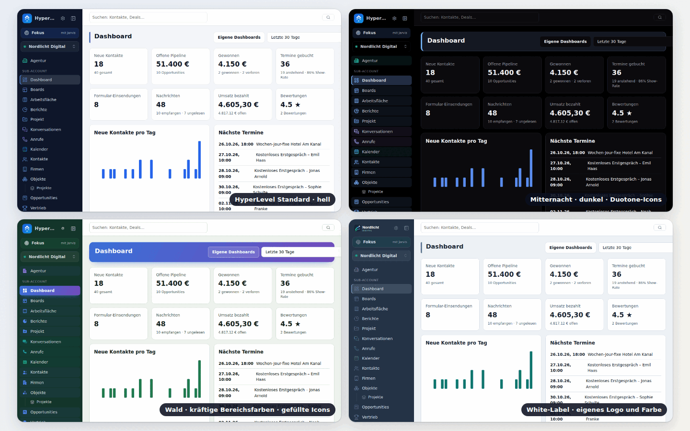

# Appearance: themes, accent, department colours, sidebar, icons, logos

HyperLevel's look is data. A person picks it under **Einstellungen → Darstellung**, the agency sets defaults (and
locks) under **Agentur → White-Label**, and nothing in a page component knows about any of it: everything
goes through CSS custom properties and a handful of attributes on `<html>`.

| What | Where it lives |
| --- | --- |
| Choices and validation (shared by server and browser) | `server/services/appearance-model.ts` |
| Preferences API, agency defaults/locks, logo upload | `server/modules/appearance.ts`, `server/services/svg-safe.ts` |
| Colour maths (WCAG contrast, OKLCH, accent derivation) | `web/src/theme/color.ts` |
| Theme data | `web/src/theme/themes.ts` |
| Department colours and the route → department map | `web/src/theme/depts.ts` |
| CSS variable generation | `web/src/theme/css.ts` |
| Store, cache, apply | `web/src/theme/store.ts`, `web/public/theme-boot.js` |
| All styling that uses the variables | `web/src/theme/theme.css` |
| Sidebar (logo, rail, flyouts, hidden entries) | `web/src/theme/Sidebar.tsx` |
| Pages | `web/src/theme/Appearance.tsx`, `Profiles.tsx`, `BrandingLook.tsx` |
| Hand-made icon pack | `web/src/theme/packs/solid.ts` |
| Raum-Modus (tokens, stylesheet, detection) | `web/src/xr/*`, [xr.md](xr.md) |
| Own order of tiles and cards (rules, drag & drop, store) | `server/services/tile-order.ts`, `web/src/sortable/*` – [Kacheln sortieren](#kacheln-sortieren) |
| Tests | `tests/theme.test.ts`, `tests/appearance.test.ts`, `tests/xr-spatial.test.ts`, `tests/tile-order.test.ts` |

## What people can choose



Per user (stored on the server, so it follows the account to every device; `localStorage` only makes the first
paint fast):

- **Theme** (19, each with a matched light and dark variant) and **mode** (hell / dunkel / wie das System).
- **Accent colour**: any colour (picker or preset). Hover, soft tint, link text, focus ring and the text on the
  accent (black or white) are derived automatically and stay readable.
- **Bereichsfarben**: every area of the menu has its own hue. Intensity *Aus / Dezent / Klar / Vibrant*, three
  palettes (*Harmonisch*, *Regenbogen*, *Gedeckt*), and an optional switch that also tints buttons, links and
  tabs on a department's pages.
- **Sidebar**: full or icons only (Ctrl/⌘+B). On phones the drawer stays.
- **Icon pack**: Linien, Fein, Kräftig, Eckig, Duotone, Gefüllt.
- **Density** (kompakt / normal / komfortabel) and **font size** (klein / normal / groß).
- **Raum-Modus** (Automatisch / An / Aus): the spatial UI for headsets and display glasses – large targets, glass surfaces, a type scale for
  eyes + pinch. Its colours are theme tokens (`--sp-*`, `web/src/xr/tokens.ts`, checked for contrast in every theme) and its stylesheet loads only
  while `data-spatial="1"` is on the root; the store then also sets `data-density="comfortable"`. Never locked by an agency. See [xr.md](xr.md).
- **Visible areas**: hide menu entries you do not use, or pick a starter profile.
- **Own order of tiles and cards** on every page – drag them where you want them, see [Kacheln sortieren](#kacheln-sortieren).

### Hidden areas are a view, not a permission

Hiding an area removes it from the menu, the search box, Ctrl+K and the dashboard widgets. It does **not**
change what the account may do: the permission areas (`server/core/permissions.ts`) are untouched, the page and
its API stay reachable by address, and *Alle Bereiche anzeigen* at the bottom of the menu brings everything back
for the session. Never use it to keep something from a person – use the area permissions of the login for that.

Starter profiles (`PROFILES` in the model): *Agentur*, *Coach & Kurse*, *Lokales Business / Handwerk*,
*E-Commerce*, *Vertriebsteam*, *Alles*. Choosing one shows which areas stay visible before it is applied. New
accounts are offered the choice once, right after their first sign-in (accounts younger than 14 days that did
not answer yet), and it is available in the Akademie and on the Darstellung page at any time.

## Einfach-Modus

Simple by default, powerful on demand. The rules are pure data in `server/services/areas-model.ts`, shared by the server
and the web app; the web side lives in `web/src/areas/`.

- **Goal setup "Was willst du tun?"** – a new login picks one or more goals: *Leads & Vertrieb*, *Kurse & Community*,
  *Agentur*, *Rechnungen & Büro* or *Alles*. Skipping (✕, Esc, "Später") applies *Leads & Vertrieb*. Existing logins see a
  dismissible banner once ("Neu: Einfach-Modus") with "Ziele wählen" and "Alles behalten". The goals can be changed at any
  time in the first card of Einstellungen → Darstellung. An agency that sets `goals` in its defaults
  (`PATCH /api/agency/branding/look`) decides for its clients, who then skip the setup; the lock *Sichtbare Bereiche* covers
  the goals too.
- **Adaptive sidebar** – with goals chosen the menu shows at most eleven core entries: Dashboard, Konversationen, Kontakte,
  Kalender, Aufgaben, Akademie (so new logins always find the guided tours) plus the areas of the goals. Everything else is under **Mehr**, a searchable panel with a one-line
  description per area, where areas can be pinned into the menu or moved under "Mehr". Einstellungen stays pinned at the
  bottom. *Alles* (or no goals) keeps the classic full menu. Hidden areas and permissions still apply on top.
- **Promotion by use** – each visit of an area is counted per person (not per sub-account). An area under "Mehr" opened at
  least three times in 14 days moves into the menu at the **next session start**, never while someone works; the counts are
  read once per browser session. Areas the person moved under "Mehr" themselves are never promoted.
- **Profi-Funktionen** – `PRO_FEATURES` names expert fields (invoice details, website pro tools, team inbox views, contact
  pro tools) that are hidden in Einfach-Modus until switched on; the preference is `pro`. Outside Einfach-Modus nothing is
  hidden.
- **Page heads** – one primary action stays in view. On a phone everything else goes into a "⋯" menu, on wider screens what
  does not fit into three buttons; destructive actions (`.danger`) always go into "⋯". A page opened with `?new=1` starts its
  primary action once (quick actions).

- **Forms and tables** (`web/src/areas/fields.tsx`, rules in `fields-model.ts`) – in Einfach-Modus a form shows only what
  most people fill in. Secondary fields go into `<MoreFields id="…" values={[…]}>`, one "Weitere Felder" toggle that opens by
  itself when one of its fields already holds a value and stays open once someone opened it (per form, in this browser).
  Expert settings go into `<ProOnly>`. Tables pick their columns with `useSimpleColumns(id, cols, essential)`: the essential
  columns plus those switched on in the small "Spalten" picker. In Profi everything shows inline, nothing is hidden. New
  forms follow the same rule: required and everyday fields visible, the rest behind the toggle. A guided tour whose
  target sits in a folded section unfolds it by itself.
- **Einstellungen and Agentur** (rules in `web/src/areas/settings-nav.ts`) – the tab bar of Einstellungen shows Firma,
  E-Mail & SMS, KI-Anbieter, Team, Abo, Darstellung and Mein Konto plus the sections of the chosen goals (Leads: Kanäle,
  Live-Chat; Kurse and Rechnungen & Büro: Rechnungen, Stripe & Zahlungen; Agentur: Sub-Accounts, Kanäle). Everything else
  is one click away under **Weitere Einstellungen**: a small dialog, grouped (Nachrichten & Kanäle, Rechnungen &
  Zahlungen, KI, Service, Daten/Recht/Schnittstellen, Konto & Team) with a search that also knows what people type (SMTP,
  IBAN, DKIM, Webhook, DSGVO, 2FA …). Agentur works the same way with **Weitere Bereiche** (Projekte, Kunden, SaaS,
  Snapshots, Domains, White-Label in the bar). The open section always stays in the bar, so links and tours keep
  working; Profi shows every tab as before. On the Firma tab, **Was muss ich einrichten?** lists only what is still
  missing (company details, e-mail sending, AI key, two-factor login for admins; invoice details and online payment for
  the goals that sell) – each a link to the section that fixes it; ✕ hides it in this browser. Inside the sections,
  technical settings (SMTP port and reply-to, tracking, inbound webhook URLs, webhook signing, manual Twilio IDs, SSO
  claims and scopes, number ranges, e-invoice options, limits, retention, Double-Opt-in texts …) sit behind "Weitere
  Felder"; a provider's webhook steps open by themselves when its key is saved but the webhook is still missing.
- **Daily pages** (lists and rules in `web/src/areas/easy-core.ts`, tested in `tests/easy-core.test.ts`) – what a busy admin
  sees at first glance in Einfach-Modus; Profi is unchanged:
  - *Dashboard*: four tiles that call for action – open tasks (overdue in red), unread messages, upcoming appointments, open
    pipeline – and the next appointments. New contacts, won deals, bookings, forms, messages, revenue, reviews, charts,
    pipelines, lead sources, plugin widgets and the period picker sit behind one "Mehr anzeigen".
  - *Kontakte*: columns Name, E-Mail, Telefon, Tags (Lead-Score, Quelle, Health, Angelegt via "Spalten"; an open smart list
    brings its own columns, chosen in both modes – docs/sales.md#smart-lists); attribution,
    company, lead-score and health filters behind "Weitere Filter (n)"; workflow and "Nicht stören" in the bulk bar behind
    "Mehr". New contact: name, e-mail, phone, company (website, tags folded). Editing: name, e-mail, phone, company (address,
    birthday, source and custom fields folded). Contact page: workflows & sequences and the lead score, service, courses
    and origin panels each behind one toggle; no "Termine" card when there are none.
  - *Firmen*: new company with name, domain, industry (the rest folded); the list starts with Name, Phase, Ort, Kontakte.
    Company and record pages show only filled properties; editing shows the required and the first six, the rest folded.
  - *Opportunities*: the deal dialog shows contact, name, value and stage (currency and expected close folded; open when
    set); line items, quotes & call notes and the deal properties fold away unless the deal has line items or properties.
    The deal list starts with Name, Kontakt, Stufe, Wert, Erwarteter Abschluss; the pipeline editor folds the loss reasons.
  - *Eigene Objekte*: a new record shows required, primary and the first six properties; the list starts with the primary
    property plus three.
  - *Kalender*: the booking dialog shows calendar, date, time and contact search ("Neuen Kontakt anlegen", note and
    repetition folded). The calendar settings show the tabs Allgemein, Verfügbarkeit, Bestätigung & Erinnerung, Typ & Team
    and Sync plus every tab that already holds settings – the rest behind "+ n weitere Bereiche"; on Allgemein only name,
    description, place, duration and colour (timing, URL path and booking questions folded); the custom confirmation text
    and the booking limits fold away unless set.
  - Both modes: shorter hints (pipeline stages, loss reasons, inbox subtitle), the composer's placeholder warning only
    when one is typed, no "Keine Zahlung" section in the appointment drawer, no empty separator under contact data.
- **Marketing & automation** (rules in `web/src/areas/marketing-fields.ts`, tests in `tests/easy-marketing.test.ts`) – the
  editors below keep their everyday fields in view and fold the rest; a folded part opens by itself when it differs from
  what a new item starts with:
  - *Kampagnen*: sender name and raw HTML, segment and any/without tags, A/B test & follow-up, send time per contact & speed
    ([email-marketing](email-marketing.md#simple-mode)); *E-Mail-Designer*: the look of blocks, sections and the mail
    (**Darstellung**).
  - *Workflows*: per step its name, error handling and fine-tuning; generated forms show required fields plus five
    ([workflow-actions](workflow-actions.md#the-editor)); the workflow's error handling.
  - *Formulare*: placeholder, key, show-if and jumps of a field; description, button, redirect, opportunity, consent,
    ticket and spam protection of the form.
  - *Websites*: font, favicon, sharing details, noindex, footer, chat (the `<head>` code only in Profi unless it holds
    code); *Blog*: address, excerpt, author, tags and **SEO & Social Media**.
  - *Sequenzen*: description, send window and stop rules; *Quizze*: intro and rules, points and explanation per question;
    *NPS-Umfragen*: question text and smart list.
  - *Webinare*: photo and address, further kinds of dates/time zone/blackout days/seats, headline/button/redirect and the
    behaviour tags; *Kurse*: hosted video, chapters, duration, drip and module of a lesson, access details, discussion &
    reviews; *Community*: moderation and points & levels.
  - *Ads*: in the assistant interests and own audiences, negative keywords, UTM switch, display paths; name, time window and
    minimum spend of a rule; headline, own questions and thank-you page of a lead form. *Bewertungen*: the widget code.

New preferences (`PATCH /api/appearance`): `goals`, `goal_asked`, `pinned`, `unpinned`, `pro`. `GET /api/appearance` adds
`offer_goals` (the banner); `offer_profiles` now shows the goal setup.

| Route | What it does |
|---|---|
| `GET /api/nav/usage` | Visits per area in the last 14 days: `{ usage: { contacts: 12 }, days: 14 }` |
| `POST /api/nav/usage` | `{ visits: { route: n } }` – a batch from the browser (at most 50 per area); unknown areas are ignored |

## Kacheln sortieren

Every row of key figures and every grid of cards can be put into your own order: the dashboard (key figures, cards,
plugin widgets – also in Einfach-Modus and behind *Mehr anzeigen*), Agentur → Projekte, the project's key figures, the
key figures of the other areas (helpdesk, calls, accounting, SEPA, shop, reviews, courses, community, sales, cloud …),
the lists of cards (courses, communities, agents, boards, objects, project planning, budgets, NPS surveys, AI Studio,
integrations) and the Fokus-Modus tiles.

- **Mouse / pen**: press anywhere on a tile and move it – there are no handles. The drag starts after 6 px, so a click on
  the tile, a link or a button in it stays a click. Text fields, selects, sliders, code and tables inside a tile (so their
  text can be selected and copied), video, audio and canvases never start a drag. To select other text in a tile:
  double-click a word (triple-click a paragraph), or hold **Alt** while dragging over it.
- **Touch**: press and hold a tile for a moment (350 ms), then move it; a quick swipe still scrolls the page, and a long
  press let go without moving is still a tap (the card, link or button opens).
- While dragging, the tile lifts and follows the pointer, the others make room, a dashed outline shows where it lands, and
  the page scrolls when you get near the top or bottom edge. **Esc** puts everything back – letting go afterwards is no
  click.
- **Keyboard**: tiles that hold nothing focusable (key figures) share **one tab stop per grid**; the **arrow keys** move the
  focus from tile to tile. On a focused tile (or anything inside it) **Alt+Umschalt+←/→** moves it one place, **↑/↓** one
  row, **Pos1/Ende** to the start or end – the focus stays on it. Screen readers hear "Verschoben auf Position 3 von 8".
  `prefers-reduced-motion` turns the gliding off.
- **Reihenfolge zurücksetzen** – a small link under a grid that only appears once you changed its order.

The order is saved **per login and grid** in the appearance preferences (`tile_order: { [gridId]: string[] }`), so it
follows you to every device, and in the browser (`localStorage`, `pghl.tile-order:<user>` – never in the look cache
`pghl.look`, which everyone on the browser shares), so it shows at once and survives being offline – changes made offline
are sent when the connection is back, and a server copy never overwrites them in the meantime. A saved order holds for the
rest of the session too: pages, Fokus answers and grids that show up later take it from the browser's store, never from the
copy loaded at sign-in.

It is **the same in every sub-account**, like the theme: an agency admin who arranges the dashboard's key figures while
switched into one client sees that arrangement in every client. Grids of records (projects, boards, courses …) use the
records' ids as keys, so each sub-account's records keep their own places within the one list. Tiles that are new appear at the end in their natural order, tiles that are gone drop out. When a grid shows only
part of its tiles (a status filter, Einfach-Modus, *Mehr anzeigen*), the hidden ones keep their place behind their
neighbour. It is personal: agency defaults never carry it, no lock applies, and *Auf Standard zurücksetzen* on the Darstellung page leaves it alone.

`PATCH /api/appearance` merges it grid by grid: `{ "tile_order": { "dashboard.stats": ["won", "contacts"] } }` changes
that grid only, `{ "dashboard.stats": null }` resets it, `"tile_order": null` resets all. The answer carries it once, in
`prefs.tile_order` (not in `effective`). Grid ids match `[a-z0-9][a-z0-9._:-]{0,79}`, keys are 1–120 letters, digits,
spaces and `_#:./@+=~!&(),'-`; at most 200 grids (the app has about 90), 200 keys per grid and 128 KB in all – a body
beyond that is answered with 400, and when the stored orders outgrow it the grids changed longest ago go first. When a
grid's list is full, the tiles on screen always stay and the hidden ones ranked last are dropped (deleted records, tiles of
earlier Fokus answers). A stored copy that no longer fits the rules loses only the grids or keys that do not fit.

For developers – a grid of direct children:

```tsx
import { SortableGrid } from '../sortable/Sortable';

<SortableGrid id="invoices.stats" className="stats" data-tour="invoices-stats">
  <Stat label="Offen" value={open} />
  {items.map((x) => <div key={x.id} className="card">…</div>)}
</SortableGrid>
```

Children are told apart by their React key (without one: their position in the code, `#0`, `#1` …); `pinned={['new']}`
keeps an "add" tile in place, `[data-nodrag]` on an element keeps drags from starting there. The grid previews the order
with CSS `order` while dragging (nothing moves in the DOM, iframes do not reload) and renders the new order on drop. Tiles
that are not direct children (rows packed from one list, like the Fokus tiles) use `useSortable({ id, keys })` and put
`data-sort-key` on each tile. Tiles with live embeds take `keepDom` (the plugin widgets on the dashboard): the children stay
in their natural DOM order and the saved order is shown with CSS `order`, so a drop or a keyboard move never moves – and
reloads – an iframe (the Tab order then follows the natural order). Code that is part of the first download (the dashboard, its plugin widgets) imports
SortableGrid from `web/src/sortable/lazy.tsx` instead: the engine (about 8 KB gzip) is a chunk of its own that starts
loading with the app, and the tiles show in their natural order until it is there (a `keepDom` grid shows nothing until
then, so no iframe is mounted twice). Tables, kanban boards, Living Boards
and custom report dashboards keep their own arranging.

## Agency defaults, locks and per-client overrides

*Agentur → White-Label* has the logos (see below) and **Standard-Darstellung der Logins**: a default for every
setting above and a lock per group (*Theme und Hell/Dunkel, Akzentfarbe, Bereichsfarben, Seitenleiste,
Icon-Pack, Dichte und Schrift, Sichtbare Bereiche*). A locked group cannot be changed by client logins; the
server answers 403 (`Von deiner Agentur festgelegt: …`). **Agency admins are never locked.** Under
*Agentur → Kunden → Branding* each client can override the defaults and open or close locks (`Wie Agentur`
inherits).

What a person sees = built-in defaults ← agency defaults ← client defaults ← their own choices (for unlocked
groups only). Only what a person changed is stored, so later changes of the defaults still reach everyone who
did not touch that setting. The agency's brand colour (`color` of the branding) is the accent of the standard
theme *HyperLevel Standard*; other themes keep their own accent unless a default or the person picks one.

### API

| Route | Auth | |
| --- | --- | --- |
| `GET /api/appearance` | user | own preferences, the effective set, defaults, locks, `offer_profiles` |
| `PATCH /api/appearance` | user | partial update; `null` resets a key; 403 for locked groups |
| `GET /api/appearance/public` | public | defaults for the login page (by domain) |
| `GET/PATCH /api/agency/branding/look` | admin | agency defaults and locks |
| `GET/PATCH /api/agency/locations/:id/branding/look` | admin | client overrides |
| `POST /api/agency/branding/logo` | admin | logo/mark/favicon upload (below) |

## Logos, marks, favicon, app name

The branding has five image slots: `logo_url`, `logo_dark_url`, `mark_url`, `mark_dark_url`, `favicon_url`, and
`show_name` (`no` hides the app name beside the logo). The sidebar picks by *its own colour*: a dark sidebar
takes the "for dark" logo when there is one, a light sidebar (e.g. *Papier*) the normal one. In the narrow
sidebar the square mark is used; without a mark the wide logo is cropped to its left square, without any logo
the HyperLevel icon (`/icon.svg`, `PRODUCT_ICON` in `web/src/theme/brand-icon.ts`) – never an initial. The login page takes the "for dark" logo when the page is dark (no wide logo: the mark, else the HyperLevel icon). The favicon falls back to the mark. Clients can have their own set; empty
slots fall back to the agency's.

Uploads accept PNG, JPEG, WebP and SVG (raster ≤ 1 MB, SVG ≤ 256 KB). Raster files must really be what they
claim (`server/core/files.ts`). An SVG is **refused, not repaired**, if it contains a script, an event handler
(`onload=…`), a `javascript:` address, `<foreignObject>`, `<iframe>`, animation elements, a DOCTYPE/entities, an
`@import` or any reference to something outside the file. Files are stored with an extension from the checked
type and served with `nosniff` and `default-src 'none'`. Image addresses typed in must start with `https://`
(or point to our `/uploads/`).

## Themes are data

A theme is eight colours per mode:

```ts
// web/src/theme/themes.ts
mytheme: {
  id: 'mytheme',
  name: 'Mein Theme',
  blurb: 'One short German sentence for the card.',
  //        bg         panel      text       muted      line       side       sideText   accent
  light: m('#f4f6fa', '#ffffff', '#111827', '#5d6677', '#e5e7eb', '#0f172a', '#cbd5e1', '#2563eb'),
  dark:  m('#0b1020', '#121a2e', '#e5e7eb', '#94a3b8', '#233049', '#070b16', '#cbd5e1', '#2563eb'),
},
```

1. Add the id to `THEME_IDS` in `server/services/appearance-model.ts` (the server validates against it; `THEMES`
   is typed `Record<ThemeId, …>`, so a missing or extra entry does not compile).
2. Add the entry above. A light `side` gives a light sidebar.
3. Run `npm test`: `tests/theme.test.ts` checks every theme in both modes – text and muted text on the page and
   on cards ≥ 4.5:1 (the *Kontrast* theme ≥ 7:1), sidebar text, headings and icons, the accent as a UI element
   ≥ 3:1, text on the accent, link text and focus ring, the status colours as text and all department colours (see
   below). Use `ensureContrast` from `color.ts` to find a passing value.
4. Pick an original name; palettes may be *inspired* by well-known families but are never copies of a
   trademarked theme.

Applying a theme sets `data-theme-id` and `data-theme="light|dark"` on `<html>` and writes one generated
`<style id="pghl-theme">` with the variables (`--bg --panel --text --muted --line --side* --brand* --d-*` and the
status colours `--green --red --yellow`, moved in lightness until they read ≥ 4.5:1 as text on the page and on cards).
Filled badges and buttons with white text (*Löschen*, error toasts, counters) use the fixed `--green-fill
--red-fill --yellow-fill` from `styles.css` instead.
Existing rules in `styles.css` keep working because they use the same variables; `theme.css` adds the new ones.
The generated CSS is `@media screen` only, so printing stays light.

### No flash of the wrong theme

`web/public/theme-boot.js` is a tiny blocking script in `<head>`. It reads `localStorage["pghl.look"]` (the
effective preferences plus the generated CSS of both modes, written by the store) and sets the attributes and
the `<style>` before the first paint; mode *system* is resolved with `matchMedia`. It is an external file
because the app's Content-Security-Policy allows no inline scripts. The server's answer replaces the cache after
sign-in. The old "Hell/Dunkel" choice of the account page (`pghl.theme`) is carried over once.

## Accent derivation

`deriveAccent(accent, surfaces, dark)` (`color.ts`) returns, for one accent on the current theme:

- `on`: black or white, whichever has the higher contrast (always ≥ 4.5:1);
- `hover`: the accent moved in OKLCH lightness while `on` stays ≥ 4.5:1;
- `soft`: the accent mixed into the panel (selected rows, tags);
- `text`: the accent as link/tab text, moved in lightness until it is ≥ 4.5:1 on the panel, the page and `soft`;
- `ring`: focus ring ≥ 3:1; `select`: background of selected text.

That is why a yellow accent gives yellow buttons with black text and dark amber links.

## Department colours

`web/src/theme/depts.ts`: `DEPTS` (12 departments with a base hue), `DEPT_OF_ROUTE` (menu route → department;
`tests/theme.test.ts` fails if a menu entry has none) and `deptColors(palette, dark, accent, surfaces)`. Per
department the generator emits `--d-<id>` / `--d-<id>-2` (gradient ends, chosen so the ink reads on both),
`--d-<id>-side` (≥ 3.5:1 on the sidebar), `--d-<id>-text` (≥ 4.5:1 on the page) and `--d-<id>-ink` (black or
white). The intensity is pure CSS in `theme.css` keyed on `html[data-dept-mode]`; the element that carries
`data-dept="crm"` (a menu link, `.main`) gets the variables. To add a department: a `DEPTS` entry, the routes in
`DEPT_OF_ROUTE`, and one `[data-dept='…']` line in `theme.css` (the test checks all three), plus an offset in `HARMONIC` for the harmonic palette.

## Sidebar rail

`html[data-sidebar="rail"]` narrows the grid column to 68 px (desktop only, `min-width: 861px`); `Sidebar.tsx`
renders tooltips (a fixed element, because the sidebar scrolls) and opens sub-menus (custom objects under
*Objekte*) as a flyout on hover and focus. Ctrl/⌘+B toggles it (not inside rich-text fields); the choice is the
preference `sidebar`.

## Icon packs

`Icon` (`web/src/icons.tsx`) is the only way pages draw icons. Four packs are the same Lucide icons drawn by CSS
(`theme.css`, `html[data-icons]`): *fine* (thin), *bold* (thick, round), *square* (miter joins, crisp edges),
*duotone* (a soft fill in the department colour). *Gefüllt* is a hand-made set for the menu icons
(`web/src/theme/packs/solid.ts`, 24×24, `currentColor`, real holes via `fill-rule="evenodd"`); it is a separate
chunk that loads only when chosen, and icons it does not have keep their Lucide drawing.

To add a pack: add its id to `ICON_PACKS` (model), then either CSS rules under `html[data-icons='<id>']` or a
pack file exporting `Partial<Record<IconName, string>>` registered with `registerIconPack` (load it lazily in
`store.ts` like `solid`). Add the card text in `Appearance.tsx`. `tests/theme.test.ts` checks that a pack file
covers every menu icon and contains plain markup only.

## Android app

The Android app is a WebView on the same pages: it follows theme, accent, dark mode and the logo automatically
(the status bar colour is the theme's sidebar colour through `<meta name="theme-color">`).

## Screenshots

Headless Chromium against the seeded demo (`npm run screenshots` renders the README images). For theme work:
sign in as the demo user, `PATCH /api/appearance` with the look to check, load a page and screenshot – the
repository's `scripts/screenshots.mjs` shows the setup.
